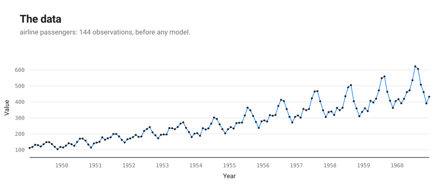
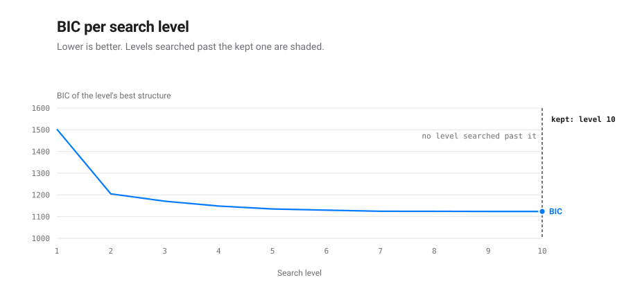
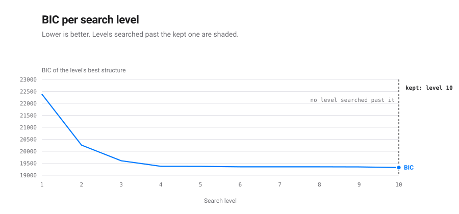

# Summary

This repository ports the Automatic Statistician [@duvenaud2013cks; @lloyd2014abcd]
from Python 2.7 and MATLAB to Python 3 and `torch`, ports AutoGP [@saad2023autogp]
from Julia and reruns the 2014 extrapolation benchmark against the forecasting
methods of 2026. Given a time series, the structure search looks for the
expression over Gaussian-process kernels that explains it best by the Bayesian
information criterion (BIC) [@schwarz1978bic]. It splits that expression into
additive components, describes each in English, checks each against its prior
[@lloyd2015criticism] and writes a report that now also states the expression
as a formula with its fitted parameters.

The main results:

- **Faithful port.** All 130 models the 2014 system published (13 series, 10
  search levels) reproduce their negative log likelihood: twelve series to
  within $5\times10^{-5}$ nats, the ill-conditioned solar series to within
  $5\times10^{-3}$. The component sentences of the airline report match the
  original word for word. On the two series rerun so far, the full ten-level
  search reaches a BIC at least as good as the published one (airline 1108.9
  against 1123.7; solar −872.3 against −870.3).
- **AutoGP checked against its original.** Every deterministic quantity of
  the port agrees with AutoGP.jl to $10^{-12}$ or better. The comparison
  found that AutoGP.jl's Hamiltonian moves see only the prior's gradient.
- **Extrapolation in 2026.** On the thirteen series, the published ABCD
  forecasts have the fifth-lowest mean standardised error of 24 methods
  (2.05), behind three pre-trained foundation models and N-BEATS
  [@ansari2025chronos2; @mistral2026timestral; @amazon2024chronosbolt;
  @oreshkin2020nbeats] and never fail badly (worst series 4.00). Eureqa
  [@schmidt2009distilling], the symbolic-regression baseline of 2014, has a
  comparable median (2.82) but a mean of 48.11, driven by one series where its
  formula extrapolates 590 times worse than the best method. PySR
  [@cranmer2023pysr], run here on the same split, stays bounded on that series
  (4.56) with a mean of 2.76.
- **The structure search is a symbolic regression**, over a grammar of kernel
  expressions rather than arithmetic ones. The reports now state the formula
  it found; the section on symbolic regression shows what that formula
  contains and what it cannot. It also positions the tool against Eureqa,
  PySR and their successors: they win on readability; the structure search
  models noise and uncertainty and extrapolates somewhat better than PySR
  here. Their formulas complement it on smooth components.

# The system

## What the search looks for

A Gaussian process (GP) [@rasmussen2006gpml] is a distribution over functions
fixed by a covariance $k(t, t')$: how strongly the values at times $t$ and
$t'$ move together. The search builds covariances from base kernels and
operators:

| symbol | base kernel | it describes |
|---|---|---|
| `SE` | squared exponential | a smooth function |
| `Per` | periodic | a repeating pattern, with its period |
| `Lin` | linear | a linear trend; products make polynomials |
| `C` | constant | an offset |
| `WN` | white noise | uncorrelated noise |
| `RQ` | rational quadratic (2013 only) | smoothness at several scales |

Sums add independent components, products modulate one by another (`Lin x Per`
is a cycle whose amplitude grows linearly) and two operators of the 2014
grammar switch between regimes: a changepoint `CP` and a change window `CW`.
The grammar rewrites one subexpression at a time; each candidate's
parameters are fitted by maximising the GP marginal likelihood (L-BFGS here,
conjugate gradients in GPML [@rasmussen2010gpmltoolbox]); candidates are
ranked by BIC; the best few seed the next level. The 2014 configuration
searches ten levels.

## From expression to report

The winning kernel is rewritten as a sum of products. Each product is one
additive component; components are ordered by how much each reduces the
cross-validated mean absolute error of extrapolation and each is described
by the original's rule system ("An approximately periodic function with a
period of 1.0 years and with linearly increasing amplitude"). Model checking
compares each component's posterior with its prior through quantile,
autocorrelation, periodogram and maximum mean discrepancy statistics
[@gretton2012kernel; @lloyd2015criticism]. The report is written in Markdown,
compiled to PDF by md2star, or in LaTeX compiled by `latexmk`, as the 2014
system wrote it; figures are drawn by sprezzature-figures.

## AutoGP: a posterior over structures

AutoGP [@saad2023autogp], which grew out of Bayesian synthesis of
probabilistic programs [@saad2019bayesian], replaces the greedy search by
sequential Monte Carlo: the data enter in batches, a population of
structures is reweighted by how well each predicted the batch, resampled and
moved by structure proposals and Hamiltonian Monte Carlo on the parameters.
The result is a weighted posterior over structures whose forecasts are
averaged. `autostat.smc` ports AutoGP.jl [@saad2023autogpjl]; each heavy
structure of its posterior gets the 2014 report and checks.

## Surfaces

The same service layer is reachable from a Python library, a command line
(Click), a local GUI generated by sprezzature-cli-gui, an HTTP API (FastAPI),
an MCP server (FastAPI-MCP, four tools) and an Agent Skill routed by
`TRIGGERS.md`.

# How faithful the port is

The port keeps the original's parameterisation, grammar, simplification
rules, initialisation heuristics, BIC parameter count and greedy loop
(`PORTING.md`). It changes the optimiser, the language of covariances
(`torch`, with autograd in place of hand-written derivatives) and the
parallelism. Four defects found in the original are documented there; none
changes a published number.

| check | result |
|---|---|
| NLL of the 130 published models | 12 series within $5\times10^{-5}$ nats; solar within $5\times10^{-3}$ |
| airline component sentences | identical to 2014 |
| gradients against finite differences | within $10^{-4}$ |
| ten-level search, final BIC (lower is better), two series so far | airline 1108.9 vs 1123.7; solar −872.3 vs −870.3 |

For AutoGP, `tests/test_smc_julia.py` loads AutoGP.jl v0.1.19 through
`juliacall`: joint densities of 30 structures agree to $10^{-14}$, covariance
matrices to $10^{-15}$, the densities of 400 structure moves to $10^{-15}$,
their density ratios to $4\times10^{-13}$ and predictive moments to
$3\times10^{-12}$. Gen's gradient for every kernel parameter equals that of
its standard normal prior on all 359 parameters tested, because
`covariance_prior` is not declared differentiable: the likelihood never
reaches the leapfrog steps. The port reproduces this by default and offers
the intended sampler as `HMCConfig(gradient="full")`.

# Extrapolation against the methods of 2026

The 2014 benchmark trains on the first 90 % of thirteen series and forecasts
the last 10 %. The repository recomputes the paper's table from the published
forecasts to within $2.2\times10^{-10}$, then scores 2026 methods on the same
split: classical models selected by information criterion [@hyndman2002ets;
@hyndman2008forecast; @fiorucci2016theta], LightGBM [@ke2017lightgbm] and
deep networks [@oreshkin2020nbeats; @challu2023nhits] tuned by rolling-origin
cross-validation on the training part only and pre-trained foundation
models used zero-shot [@ansari2024chronos; @ansari2025chronos2;
@das2024timesfm; @google2025timesfm25; @mistral2026timestral;
@qu2026kumotabular]. Standardised RMSE divides each series' error by the best
error on that series; 1.00 is the best.

| method | family | median | mean | series won |
|---|---|---|---|---|
| Chronos-2 | foundation | 1.47 | 1.65 | 1 |
| Chronos-Bolt (base) | foundation | 1.53 | 1.70 | 1 |
| Timestral 209M | foundation | 1.57 | 1.65 | 1 |
| KumoTabular on lags | foundation | 1.68 | 2.50 | 2 |
| TimesFM 2.5 | foundation | 1.72 | 2.17 | 0 |
| AutoARIMA | classical | 1.79 | 3.22 | 0 |
| N-HiTS | deep learning | 1.81 | 2.09 | 1 |
| AutoTheta | classical | 1.89 | 2.21 | 0 |
| N-BEATS | deep learning | 1.91 | 1.96 | 0 |
| AutoETS | classical | 1.96 | 2.45 | 0 |
| LightGBM on lags | machine learning | 2.08 | 4.38 | 1 |
| **ABCD 2014** | structure search | **2.12** | **2.05** | 1 |
| Spectral mixture [@wilson2013spectral] | 2014 baseline | 2.19 | 3.22 | 0 |
| **CKS 2013** | structure search | **2.48** | **2.17** | 2 |
| **PySR** [@cranmer2023pysr] | symbolic regression | **2.87** | **2.76** | 0 |
| **Eureqa** [@schmidt2009distilling] | symbolic regression (2014 published) | **2.82** | **48.11** | 1 |
| gplearn [@stephens2015gplearn] | symbolic regression | 3.60 | 8.84 | 0 |

Abridged from `benchmark/RESULTS.md` (24 methods). Two readings matter here.
The foundation models, trained on large corpora, now extrapolate these
series best: median standardised error 1.47 for Chronos-2 against 2.12 for
ABCD. And among methods that fit
one model to the series at hand, the structure search is the most reliable:
its mean is below its median, because no series goes badly. Eureqa's mean
comes from one series (monthly average daily calls), where its formula
scores 590.55 against 1.20 for ABCD; without it, Eureqa's mean is 2.90.

# The structure search as symbolic regression

## The parallel

Symbolic regression [@koza1992genetic] searches a grammar of expressions,
fits each expression's constants and selects by accuracy against
complexity. The structure search does the same with a different grammar:
its expressions denote covariances rather than regression functions, its
constants are fitted by marginal likelihood and BIC is its complexity
penalty. Both problems are NP-hard [@virgolin2022nphard] and both
communities search heuristically.

| method | search space | search | selection | output | noise |
|---|---|---|---|---|---|
| Eureqa [@schmidt2009distilling] | arithmetic trees | genetic programming | accuracy-parsimony front | closed form | implicit |
| PySR [@cranmer2023pysr] | arithmetic trees, user operators | evolution with annealing | loss-complexity front | closed forms | implicit, custom loss |
| AI Feynman [@udrescu2020aifeynman; @udrescu2020aifeynman2] | arithmetic, recursively simplified | neural-guided decomposition | description length | closed form | robust (2.0) |
| SINDy [@brunton2016sindy] | span of a fixed library | thresholded least squares | sparsity | closed-form ODE | smoothing |
| DSR [@petersen2021dsr] | token sequences | policy gradient | reward | closed form | implicit |
| Transformers [@kamienny2022e2e; @biggio2021nesymres] | pre-training distribution | amortised decoding | fit | closed form | via training data |
| LLM-SR [@shojaee2025llmsr] | Python programs | LLM proposals | fit | program | implicit |
| Bayesian machine scientist [@guimera2020bms] | arithmetic trees | MCMC | posterior, BIC likelihood | closed forms | Gaussian |
| CKS 2013 [@duvenaud2013cks] | kernel grammar, + and × | greedy beam | BIC | kernel, GP posterior | Gaussian |
| **ABCD 2014** [@lloyd2014abcd] | kernel grammar + CP, CW, WN | greedy beam | BIC | kernel, report, **formula** | explicit, heteroscedastic |
| AutoGP [@saad2023autogp] | kernel grammar | SMC | posterior weight | weighted kernels | Gaussian |

Symbolic-regression benchmarks [@lacava2021srbench; @defranca2025srbenchpp;
@aldeia2025srbench2; @shojaee2025llmsrbench] measure accuracy and recovery of
known equations on regression tasks; none contains an extrapolation task on
real time series, which is the task where the two families differ most.

## What the formula contains

Each report now has a section "The formula found". For the airline series,
the published 2014 model reads

$$y(t) = f_1(t) + f_2(t) + f_3(t) + f_4(t)$$

$$f_1(t) \sim \mathrm{GP}\left(0,\ 1122\,(t - 1946)(t' - 1946)\right),
\qquad f_1(t) = 92.68 + 31.58\,(t - 1949)$$

$$\begin{aligned}
f_2(t) \sim \mathrm{GP}\Big(0,\ & 21.91\,(t - 1945)(t' - 1945) \\
& \cdot \frac{\exp\left(1.924\cos\frac{2\pi (t - t')}{1.002}\right) - I_0(1.924)}{e^{1.924} - I_0(1.924)}
\cdot \exp\left(-\frac{(t - t')^2}{2 \cdot 22.98^2}\right)\Big)
\end{aligned}$$

$$f_3(t) \sim \mathrm{GP}\left(0,\ 0.285\,(t - 1943)(t' - 1943) \cdot \delta_{t t'}\right),
\qquad f_4(t) \sim \mathrm{GP}\left(0,\ 193.1\,\exp\left(-\frac{(t - t')^2}{2 \cdot 0.6787^2}\right)\right)$$

The trend has a closed form, read exactly from its posterior mean: 31.6
thousand passengers more each year. The cycle has a period of 1.002 years and
an amplitude growing linearly from 1945; the noise grows linearly too. For
the solar series the formula shows a change window $w_1(t)$ from 1643 to
1716, inside which a constant $f(t) = -0.5964\,w_1(t)$ lowers irradiance by
0.6 W/m²: the Maunder minimum, found without being told.

Every component built from constants and linear kernels gets such a closed
form, including when a change of regime switches it on or off. Periodic
components get one too: the periodic kernel is exactly a sum of cosines,

$$\exp(a\cos u) = I_0(a) + 2\sum_{k \ge 1} I_k(a)\cos(k u),$$

so a periodic component's posterior mean is a Fourier series in the period
found, whose weights fall quickly when $a$ is small. The report writes it up
to the harmonic after which the rest weighs less than 0.1 % of the
component, with $\approx$. On the thirteen published models this gives a
closed form to 16 of 76 components: trends and offsets, the yearly cycle of
the temperature series (amplitude 4.3 degrees), the weekly and half-yearly
cycles of the births series. Smooth components, periodic ones modulated by a
smooth kernel and noise have none: a draw from such a process is not a
finite formula and their covariance is the formula. This is the difference
with arithmetic symbolic regression. Its cost and its benefit: the
expression is less explicit, but it carries its own uncertainty, which is
why it does not extrapolate the way an unconstrained formula can.

## Recovering a known formula

Examples 4 and 5 use synthetic monthly sales from 2016 to 2023,
$y = 100 + 0.5\,m + 8\sin(2\pi m/12) + \varepsilon$ with $m$ the month index
and $\varepsilon \sim \mathrm{N}(0, 2^2)$. After five levels the search keeps
`Lin + WN + Per` and a sixth level does not improve on it. The formula it
reports, with $t$ in years:

$$f_1(t) = 99.63 + 6.095\,(t - 2016)$$

$$f_3(t) \approx 7.95\cos\left(2\pi (t - 2016) - 1.807\right) + 0.3961\cos\left(2\pi \cdot 2\,(t - 2016) - 0.9546\right)$$

$$f_2(t) \sim \mathrm{GP}\left(0,\ 3.578\,\delta_{t t'}\right)$$

The truth is a slope of 6 per year from 100, a sine of amplitude 8 and
period one year, with a noise variance of 4. The second harmonic (5 % of the
first) and a phase offset of 0.24 radians (two weeks) are what the search
adds; a part of both comes from dates being turned into decimal years with
365-day years, which does not sample months at exactly equal steps.

## Where autostat stands among symbolic-regression tools

Symbolic regression returns a formula $y = f(t)$; autostat returns an
expression over covariances, $y = f_1(t) + \dots + f_n(t)$ with each
$f_i$ a Gaussian process; it writes in closed form the components that have
one. The two answer different questions. The benchmark shows where the
difference matters.

**Extrapolation.** The benchmark holds three symbolic-regression systems,
each fitting $y = f(t)$ on the first 90 % and continuing the formula. Their
worst series is the same (monthly average daily calls) but the damage differs
by two orders of magnitude: 590.55 for Eureqa, 74.08 for gplearn, 4.56 for
PySR. The blow-up of 2014 is therefore not a property of free formulas as
such. PySR's mean (2.76) and median (2.87) remain behind ABCD's (2.05 and
2.12; worst series 4.00), from one seeded run with 60 iterations per series:
a modest margin. Operon [@burlacu2020operon] was tried and did not run: its
macOS wheel does not load.

**Noise.** Most symbolic-regression systems minimise squared error, so noise
is what is left over [@cranmer2023pysr; @lacava2021srbench]. The grammar
searched here models noise as a component: white noise, noise growing with
time (`Lin x WN`), noise confined to a period by a change of regime. The
formula of the sales example reports its noise variance (3.578 against a
true 4) the way it reports its slope.

**Selection.** Symbolic regression selects on an accuracy-complexity front,
usually without a probabilistic score. The structure search selects by BIC,
an approximation of the marginal likelihood; the closest arithmetic
counterpart is the Bayesian machine scientist [@guimera2020bms], which also
scores expressions with a BIC-approximated likelihood and samples them by
Markov chain Monte Carlo, as AutoGP does for kernels.

**Readability.** Here symbolic regression wins: a smooth component has no
closed form in this repository, only its covariance and a sentence ("A smooth
function"). Of the 76 components of the thirteen published models, 16 have an
exact or Fourier closed form.

Symbolic regression also complements the structure search. Each component's
posterior mean is a denoised, one-dimensional curve: the easiest input it can
get. On request (`symbolic=True`), PySR reads each smooth component and its
shortest formula is shown, marked $\approx$, only if it reproduces the
component to within 1 %. The covariance remains the model; the formula is
its reading. On the thirteen published models, PySR could try 13 smooth
components and found a formula within 1 % for 4 of them (largest gaps 0.083 to
0.72 %, the others kept their covariance): 20 of the 76 components then read as
a formula. The other 9 include fast-varying curves such as the airline's
smooth term, whose length scale is 0.68 years.

Methods built for dynamical systems (SINDy
[@brunton2016sindy]) or driven by a language model (LLM-SR
[@shojaee2025llmsr]) fit this task less well: the first expects derivatives
of a state, the second a call to a large model per expression.

# Examples and search depth

`examples/` holds a script per example of `EXAMPLES.md` and the reports it
writes, in both formats. The searches there stop at a fixed depth, because
the original configuration has no stopping rule: it always searches
`max_depth` levels. Searching deeper finds more:

| example | depth used | BIC | deeper search | BIC |
|---|---|---|---|---|
| airline, 2014 | 2 | 1236.4 (3 components) | 10 levels, converged at level 9 | 1108.9 (4 components) |
| airline, 2013 | 3 | 1370.4 (2 components, no cycle) | 10 levels, 13 minutes | 1112.4 (yearly cycle found from level 4) |
| sales, 2014 | 3 | 458.4 (`WN + Lin x SE + Per x SE`) | converged at level 5 | 449.2 (`Lin + WN + Per`, the generating formula) |

The sales series of examples 4 and 5 is synthetic: a linear trend, a yearly
sine and Gaussian noise. At three levels the search approximates it with
smooth terms; at five it finds `Lin + WN + Per`, the very formula the data were
drawn from; a sixth level does not improve on it. The examples now search
ten levels (airline) or five (sales). The published 2014 models (examples 2
and 8) come from the full ten-level search and need no extension.

# The stopping criterion

The 2014 configuration has no stopping rule: it always searches ten levels
and keeps the lowest BIC. The thirteen published searches show what that
choice buys. For each, the table gives the level kept, the level where its
structure first appeared (the levels between only refit its parameters), the
gap to the best different structure on the Kass and Raftery scale
[@kass1995bayes] and what a rule stopping after one or two levels without a
BIC fall above 0.1 would have done.

| series | kept level | structure first reached | best rival (ΔBIC) | patience 1 | patience 2 | components (closed forms) |
|---|---|---|---|---|---|---|
| 01-airline | 10 | 7 | 6.2 (strong) | stops at 10, same model | does not stop | 4 (1) |
| 02-solar | 10 | 9 | 4.5 (positive) | does not stop | does not stop | 8 (2) |
| 03-mauna | 10 | 7 | 38.5 (very strong) | does not stop | does not stop | 5 (0) |
| 04-wheat | 10 | 5 | 6.0 (strong) | stops at 8, same model | stops at 9, same model | 4 (1) |
| 05-temperature | 9 | 6 | 5.2 (positive) | stops at 8, same model | stops at 9, same model | 4 (2) |
| 06-internet | 10 | 10 | 26.3 (very strong) | stops at 7, worse model (+29.2) | stops at 8, worse model (+29.2) | 7 (1) |
| 07-call-centre | 10 | 10 | 1.9 (barely worth mentioning) | does not stop | does not stop | 6 (2) |
| 08-radio | 8 | 5 | 3.5 (positive) | stops at 7, same model | stops at 8, same model | 6 (2) |
| 09-gas-production | 10 | 10 | 4.6 (positive) | does not stop | does not stop | 7 (0) |
| 10-sulphuric | 10 | 8 | 18.7 (very strong) | does not stop | does not stop | 9 (1) |
| 11-unemployment | 9 | 5 | 66.3 (very strong) | stops at 10, same model | does not stop | 6 (1) |
| 12-births | 5 | 5 | 2.3 (positive) | stops at 6, same model | stops at 7, same model | 4 (2) |
| 13-wages | 10 | 8 | 11.4 (very strong) | stops at 7, worse model (+11.4) | does not stop | 6 (1) |

Four findings.

- **Ten levels are sometimes not enough.** On internet, call-centre and
  gas-production the kept structure appears at level 10, the last one: the
  search was still changing the expression when it was cut. On solar it
  appears at level 9.
- **A flat BIC is not convergence.** Stopping at the first level without
  improvement would have kept a worse model on two series: internet, by 29.2
  (very strong evidence against it) and wages, by 11.4. Two levels of
  patience repair wages but not internet, where the search stalls for two
  levels before finding a much better structure.
- **Much of the depth refits.** On nine series the kept structure is found
  by level 8 and the later levels only refit its parameters. On six of them
  that refit is worth 5.5 BIC or less; on sulphuric it is worth 9.3, on
  mauna 35.5 and on unemployment 44.2. There the search is finding better
  parameters for an expression it already has, through its random restarts:
  depth buys optimisation as well as structure.
- **The last level is not always the best.** On temperature, radio,
  unemployment and births the kept model comes from an earlier level: the
  later levels, restarted from random initialisations, fitted no better.

The evidence for the kept structure against its best rival is very strong on
five series, strong on two, positive on five and barely worth mentioning on
call-centre (1.9): there, two expressions explain the data equally well and
the report should be read as one of them.

The examples in `examples/` therefore search until BIC has not fallen by
0.1 for two levels in a row (at most twenty) then report the levels past
the best one. Each report has a section "Search path and stopping criterion"
with the BIC curve, the table above for its own search and these readings.

# Limits

- **Cost.** Exact GP inference is cubic in the number of points; series are
  binned to 1,000 points; the full airline search took 4.1 hours on six
  processes. Scalable bounds [@kim2018scaling] and Bayesian optimisation over
  the grammar [@malkomes2016bayesian; @bitzer2022structural] are known ways
  to search with fewer evaluations; none is ported.
- **One input.** The search treats one time input; multivariate grammars
  [@duvenaud2011additive] and shared structure across series
  [@hwang2016relational] are not ported.
- **Formulas.** Without PySR, or when no short formula is within 1 %, smooth
  components keep their covariance as their formula.
- **Benchmark.** TabPFN-TS [@hoo2025tabpfnts] did not run (licence);
  AutoGP.jl, GPy-ABCD [@fletcher2021gpyabcd], AutoBNN [@koster2024autobnn]
  and Moirai [@woo2024moirai] could not be installed on the benchmark
  machine.

# Related work not compared

Neural kernel networks learn kernel sums and products by gradient descent
[@sun2018nkn]; spectral mixtures fix a flexible form [@wilson2013spectral].
Language models now propose kernels [@suwandi2025cake], probabilistic
programs [@li2024boxlm] or judge fits from plots [@lee2025multimodal].
gallifrey reimplements AutoGP in JAX for astronomy [@boettner2025gallifrey].
The Automatic Statistician project is summarised in
@steinruecken2019automatic and its grammar descends from the matrix
decomposition grammar of @grosse2012compositionality. Bayesian symbolic
regression [@jin2019bsr; @guimera2020bms] is the closest arithmetic
counterpart to a posterior over structures.

# References
