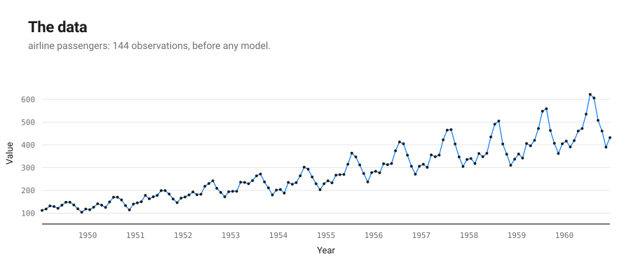
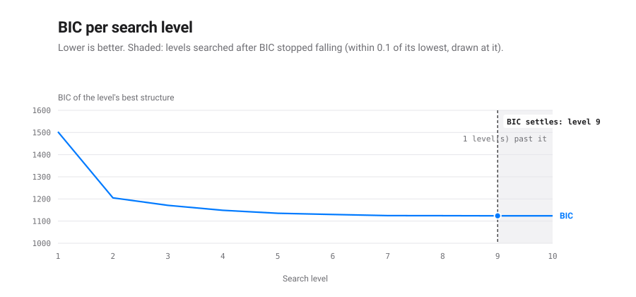
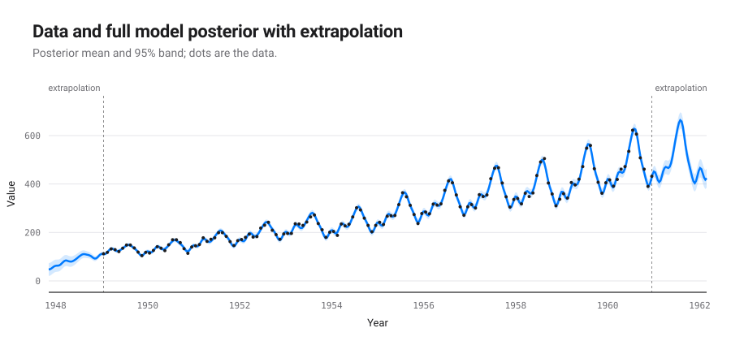
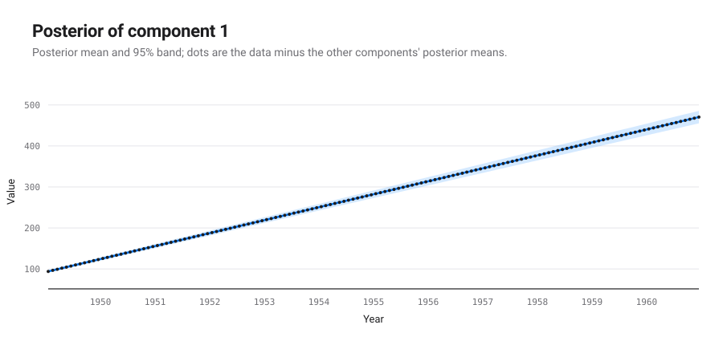
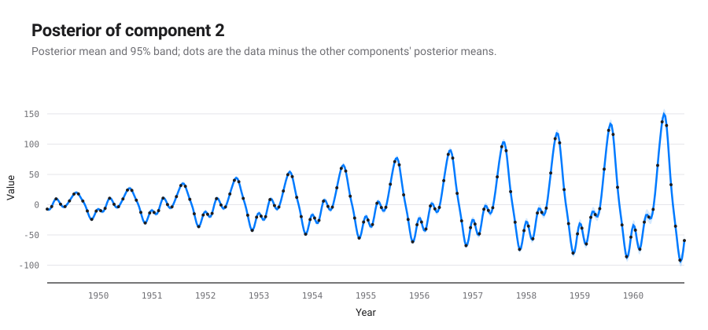
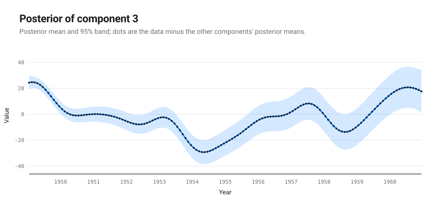
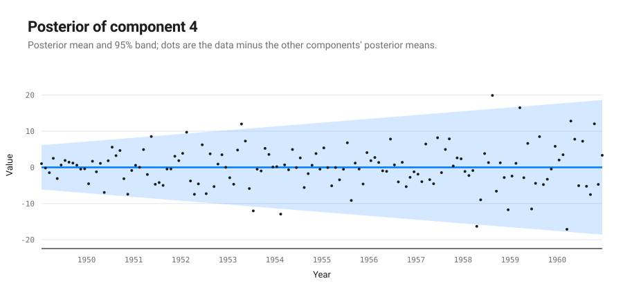

# An automatic report for the dataset: airline passengers

*Produced by `autostat` (automatic-statistician-revisited), a Python 3 port of the Automatic Bayesian Covariance Discovery system of Lloyd et al. (AAAI 2014).*

## Executive summary

The structure search selected `Lin + Lin x Per x SE + Lin x WN + SE` (Bayesian information criterion 1123.7; negative log likelihood 534.5 on 144 points). It decomposes into 4 additive components, listed by how much each reduces extrapolation error:

1. A linearly increasing function.
2. An approximately periodic function with a period of 1.0 years and with linearly increasing amplitude.
3. A smooth function.
4. Uncorrelated noise with linearly increasing standard deviation.

| # | R² cumulative (%) | Residual variance explained (%) | Cross-validated MAE | MAE reduction (%) |
|---|---|---|---|---|
| data | | | 280 | |
| 1 | 85.4 | 85.4 | 34 | 87.9 |
| 2 | 98.5 | 89.9 | 12.4 | 63.5 |
| 3 | 99.8 | 85.1 | 9.11 | 26.7 |
| 4 | 100.0 | 100.0 | 9.11 | 0.0 |

MAE: mean absolute error over ten contiguous held-out blocks.

## The formula found

The structure search is a symbolic regression: it searches a grammar of expressions over kernels and keeps the one with the lowest Bayesian information criterion. This is the expression it kept, with every fitted parameter in place; $t$ is in years.

$$y(t) = f_{1}(t) + f_{2}(t) + f_{3}(t) + f_{4}(t)$$

Each component is a Gaussian process with its own covariance:

$$f_{1}(t) \sim \mathrm{GP}\!\left(0,\ 1122\,(t - 1946)(t' - 1946)\right)$$

$$f_{2}(t) \sim \mathrm{GP}\!\left(0,\ 21.91\,(t - 1945)(t' - 1945) \cdot \frac{\exp\!\left(1.924\cos\frac{2\pi (t - t')}{1.002}\right) - I_0(1.924)}{e^{1.924} - I_0(1.924)} \cdot \exp\!\left(-\frac{(t - t')^2}{2 \cdot 22.98^2}\right)\right)$$

$$f_{3}(t) \sim \mathrm{GP}\!\left(0,\ 193.1\,\exp\!\left(-\frac{(t - t')^2}{2 \cdot 0.6787^2}\right)\right)$$

$$f_{4}(t) \sim \mathrm{GP}\!\left(0,\ 0.285\,(t - 1943)(t' - 1943) \cdot \delta_{t t'}\right)$$

These components have a closed form, read from their posterior mean:

$$f_{1}(t) = 92.68 + 31.58\,(t - 1949)$$

The other components are smooth, quasi-periodic or noise without a short formula: a draw from such a process has no finite closed form; its covariance above is the formula.

Closed form of each component:

| # | component | closed form |
|---|---|---|
| 1 | A linearly increasing function | exact polynomial of degree 1 |
| 2 | An approximately periodic function with a period of 1.0 years and with linearly increasing amplitude | none: the covariance is the formula |
| 3 | A smooth function | none: the covariance is the formula |
| 4 | Uncorrelated noise with linearly increasing standard deviation | none: the covariance is the formula |

## Search path and stopping criterion

The 2014 configuration searches a fixed number of levels and keeps the lowest BIC; it has no stopping rule. The table follows the winner of each level. A change of structure adds or removes terms; a level that keeps the structure only refits its parameters. BIC differences read on the scale of Kass and Raftery (1995): under 2 barely worth mentioning, 2 to 6 positive, 6 to 10 strong, over 10 very strong.

| level | BIC | change | structure | components | closed | params |
|---|---|---|---|---|---|---|
| 1 | 1502.9 |  | WN + SE | 2 | 0 | 3 |
| 2 | 1205.1 | -297.9 | WN + Per x SE + SE | 3 | 0 | 7 |
| 3 | 1170.9 | -34.1 | WN + Lin x SE + Lin x Per x SE | 3 | 0 | 9 |
| 4 | 1148.7 | -22.2 | WN + Lin x SE + Lin x Per x SE + Lin x SE | 4 | 0 | 12 |
| 5 | 1135.4 | -13.3 | Lin x SE + Lin x Per x SE + Lin x SE + Lin x WN | 4 | 0 | 13 |
| 6 | 1129.9 | -5.5 | Lin x SE + Lin x Per x SE + Lin x WN + SE | 4 | 0 | 12 |
| 7 | 1124.9 | -5.0 | Lin + Lin x Per x SE + Lin x WN + SE | 4 | 1 | 11 |
| 8 | 1124.4 | -0.5 | Lin + Lin x Per x SE + Lin x WN + SE | 4 | 1 | 11 |
| 9 | 1123.8 | -0.7 | Lin + Lin x Per x SE + Lin x WN + SE | 4 | 1 | 11 |
| 10 (kept) | 1123.7 | -0.1 | Lin + Lin x Per x SE + Lin x WN + SE | 4 | 1 | 11 |

- The search ran 10 levels (the published 2014 search: ten levels, no stopping rule) and keeps the model of level 10, Lin + Lin x Per x SE + Lin x WN + SE, BIC 1123.7.
- That structure was first reached at level 7; the levels after it only refitted its parameters, lowering BIC by 1.2 in all.
- The best different structure, Lin x SE + Lin x Per x SE + Lin x WN + SE (level 6), is 6.2 above it: strong evidence for the kept one on the Kass and Raftery scale.
- BIC stopped falling at level 9. The 1 level(s) searched past it kept its structure and lowered BIC by 0.06 in all, less than the tolerance of 0.1: going on buys nothing the data pay for.
- A rule stopping after 1 level(s) without a fall above 0.1 would have ended the search at level 10 and kept the same model.
- A rule stopping after 2 level(s) without a fall above 0.1 would not have stopped within these 10 levels.
- The kept expression has 11 parameters for 144 points: its BIC is a fit term 2 NLL = 1069.0 plus a complexity term p ln n = 54.7, each extra parameter costing 4.97; it splits into 4 components, 1 of them with a closed form.

## Detailed discussion of the components

### Component 1: A linearly increasing function

This component is linearly increasing.

This component explains 85.4% of the data's variance on its own; with the components above it, 85.4%. Adding it changes the cross-validated MAE by -87.9%.

*Extrapolation.* This component is assumed to continue to increase linearly.

### Component 2: An approximately periodic function with a period of 1.0 years and with linearly increasing amplitude

This component is approximately periodic with a period of 1.0 years and varying amplitude. Across periods the shape of this function varies very smoothly. The amplitude of the function increases linearly. The shape of this function within each period has a typical lengthscale of 6.0 weeks.

This component explains 13.3% of the data's variance on its own; with the components above it, 98.5%. Adding it changes the cross-validated MAE by -63.5%.

*Extrapolation.* This component is assumed to continue to be approximately periodic. The shape of the function is assumed to vary very smoothly between periods but will eventually return to the prior. The amplitude of the function is assumed to continue to increase linearly. The prior is entirely uncertain about the phase of the periodic function. Consequently the pointwise posterior will appear to lose its periodicity, but this merely reflects the uncertainty in the shape and phase of the function.

### Component 3: A smooth function

This component is a smooth function with a typical lengthscale of 8.1 months.

This component explains 2.7% of the data's variance on its own; with the components above it, 99.8%. Adding it changes the cross-validated MAE by -26.7%.

*Extrapolation.* This component is assumed to continue smoothly but is also assumed to be stationary so its distribution will return to the prior. The prior distribution places mass on smooth functions with a marginal mean of zero and a typical lengthscale of 8.1 months.

### Component 4: Uncorrelated noise with linearly increasing standard deviation

This component models uncorrelated noise. The standard deviation of the noise increases linearly.

This component explains 0.6% of the data's variance on its own; with the components above it, 100.0%. Adding it changes the cross-validated MAE by -0.0%.

*Extrapolation.* This component assumes the uncorrelated noise will continue indefinitely. The standard deviation of the noise is assumed to continue to increase linearly.

## Model checking

Each statistic compares draws of a component's posterior with draws of its prior. A small p-value (bold below 0.05) points at a property of the data that the component's prior does not reproduce.

| # | QQ max | QQ min | ACF min | ACF min lag | Periodogram max | Periodogram peak | MMD |
|---|---|---|---|---|---|---|---|
| 1 | 0.364 | 0.364 | 0.982 | 0.988 | 0.694 | 0.974 | **0.000** |
| 2 | 0.966 | 0.062 | 0.766 | 0.884 | 0.984 | 0.652 | **0.010** |
| 3 | 0.476 | 0.694 | 0.476 | 0.534 | 0.702 | 0.634 | 0.206 |
| 4 | 0.738 | 0.930 | 0.982 | 0.982 | 0.974 | 0.956 | 0.447 |

QQ: quantile-quantile gaps. ACF: autocorrelation function. MMD: maximum mean discrepancy two-sample test.
