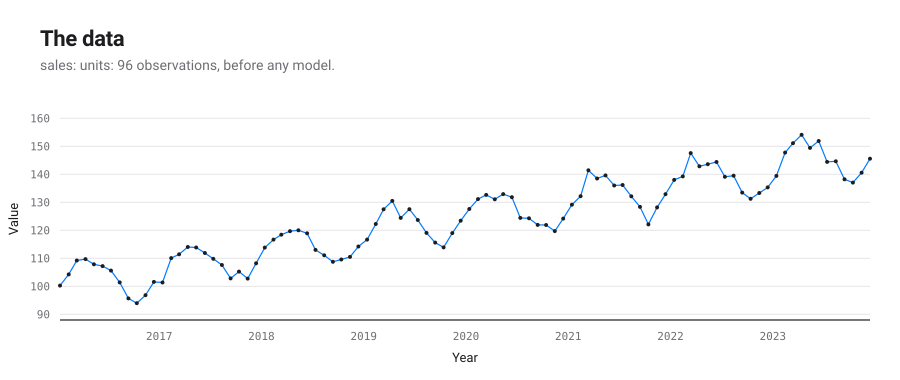
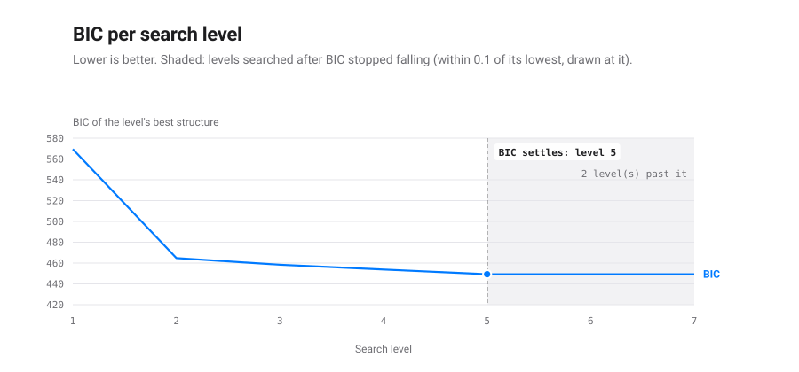
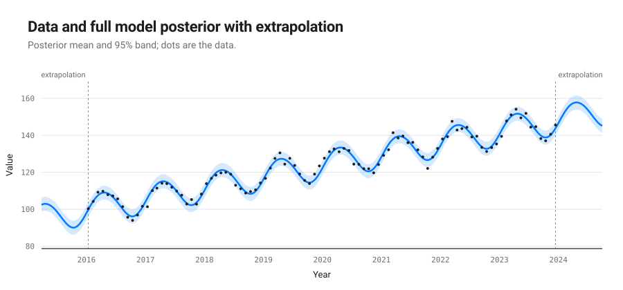
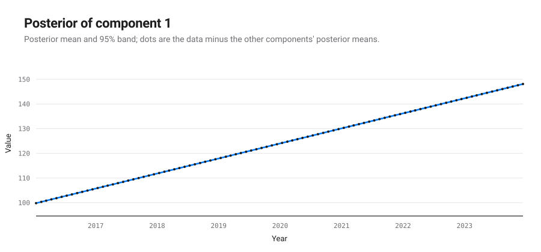
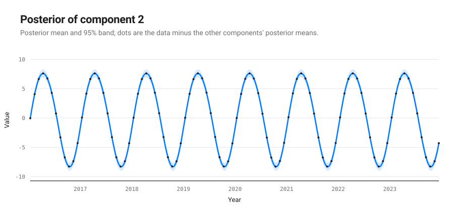
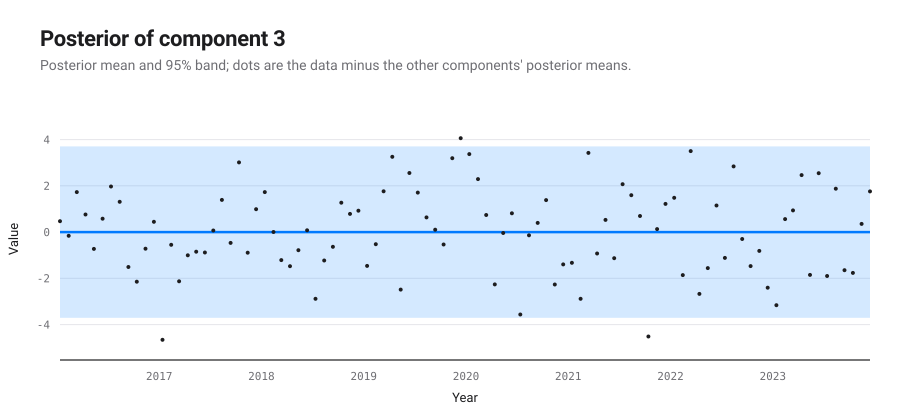

# An automatic report for the dataset: sales: units

*Produced by `autostat` (automatic-statistician-revisited), a Python 3 port of the Automatic Bayesian Covariance Discovery system of Lloyd et al. (AAAI 2014).*

## Executive summary

The structure search selected `Lin + WN + Per` (Bayesian information criterion 449.2; negative log likelihood 210.9 on 96 points). It decomposes into 3 additive components, listed by how much each reduces extrapolation error:

1. A linearly increasing function.
2. A periodic function with a period of 1.0 years.
3. Uncorrelated noise.

| # | R² cumulative (%) | Residual variance explained (%) | Cross-validated MAE | MAE reduction (%) |
|---|---|---|---|---|
| data | | | 124 | |
| 1 | 83.8 | 83.8 | 5.16 | 95.8 |
| 2 | 98.4 | 90.3 | 1.58 | 69.3 |
| 3 | 100.0 | 100.0 | 1.58 | -0.0 |

MAE: mean absolute error over ten contiguous held-out blocks.

## The formula found

The structure search is a symbolic regression: it searches a grammar of expressions over kernels and keeps the one with the lowest Bayesian information criterion. This is the expression it kept, with every fitted parameter in place; $t$ is in years.

$$y(t) = f_{1}(t) + f_{2}(t) + f_{3}(t)$$

Each component is a Gaussian process with its own covariance:

$$f_{1}(t) \sim \mathrm{GP}\!\left(0,\ 37.14\,(t - 2000)(t' - 2000)\right)$$

$$f_{2}(t) \sim \mathrm{GP}\!\left(0,\ 31.71\,\frac{\exp\!\left(0.01596\cos\frac{2\pi (t - t')}{1}\right) - I_0(0.01596)}{e^{0.01596} - I_0(0.01596)}\right)$$

$$f_{3}(t) \sim \mathrm{GP}\!\left(0,\ 3.578\,\delta_{t t'}\right)$$

These components have a closed form, read from their posterior mean:

$$f_{1}(t) = 99.63 + 6.095\,(t - 2016)$$

$$f_{2}(t) \approx 7.95\cos\!\left(\frac{2\pi \cdot (t - 2016)}{1} - 1.807\right) + 0.3961\cos\!\left(\frac{2\pi \cdot 2 \cdot (t - 2016)}{1} - 0.9546\right)$$

A periodic kernel is exactly a sum of cosines, so a periodic component is a Fourier series in its period; it is written up to the harmonic after which the rest weighs less than 0.1 % of the component, hence the approximate sign.

The other components are smooth, quasi-periodic or noise without a short formula: a draw from such a process has no finite closed form; its covariance above is the formula.

Closed form of each component:

| # | component | closed form |
|---|---|---|
| 1 | A linearly increasing function | exact polynomial of degree 1 |
| 2 | A periodic function with a period of 1.0 years | Fourier series, 2 harmonics, largest gap 0.027 % of the component |
| 3 | Uncorrelated noise | none: the covariance is the formula |

## Search path and stopping criterion

The 2014 configuration searches a fixed number of levels and keeps the lowest BIC; it has no stopping rule. The table follows the winner of each level. A change of structure adds or removes terms; a level that keeps the structure only refits its parameters. BIC differences read on the scale of Kass and Raftery (1995): under 2 barely worth mentioning, 2 to 6 positive, 6 to 10 strong, over 10 very strong.

| level | BIC | change | structure | components | closed | params |
|---|---|---|---|---|---|---|
| 1 | 569.4 |  | WN + SE | 2 | 0 | 3 |
| 2 | 464.8 | -104.6 | WN + Per x SE + SE | 3 | 0 | 7 |
| 3 | 458.4 | -6.4 | WN + Lin x SE + Per x SE | 3 | 0 | 8 |
| 4 | 453.8 | -4.6 | Lin + WN + Per x SE | 3 | 1 | 7 |
| 5 | 449.2 | -4.6 | Lin + WN + Per | 3 | 2 | 6 |
| 6 | 449.2 | -0.0 | Lin + WN + Per | 3 | 2 | 6 |
| 7 (kept) | 449.2 | -0.0 | Lin + WN + Per | 3 | 2 | 6 |

Posterior weight of each structure met, exp(-BIC/2) normalised under a flat prior, after the Bayesian machine scientist (Guimerà et al., 2020): where the search keeps one structure, the weights say how much the data prefer it to the others. The 2 structure(s) under 0.001 are left out.

| structure | lowest BIC | weight |
|---|---|---|
| Lin + WN + Per | 449.2 | 0.899 |
| Lin + WN + Per x SE | 453.8 | 0.092 |
| WN + Lin x SE + Per x SE | 458.4 | 0.009 |

- The search ran 7 levels (stopping after 2 level(s) without a BIC fall above 0.1, at most 20) and keeps the model of level 7, Lin + WN + Per, BIC 449.2.
- That structure was first reached at level 5; the levels after it only refitted its parameters, lowering BIC by 0.0 in all.
- The best different structure, Lin + WN + Per x SE (level 4), is 4.6 above it: positive evidence for the kept one on the Kass and Raftery scale.
- Weighed by exp(-BIC/2) under a flat prior, as the Bayesian machine scientist weighs expressions, the structures met give the kept one a posterior weight of 0.899 and the next, Lin + WN + Per x SE, 0.092: the data favour the kept one without ruling the next out.
- BIC stopped falling at level 5. The 2 level(s) searched past it kept its structure and lowered BIC by 0.00 in all, less than the tolerance of 0.1: going on buys nothing the data pay for.
- A rule stopping after 1 level(s) without a fall above 0.1 would have ended the search at level 6 and kept the same structure, less refitted.
- A rule stopping after 2 level(s) without a fall above 0.1 would have ended the search at level 7 and kept the same model.
- The kept expression has 6 parameters for 96 points: its BIC is a fit term 2 NLL = 421.9 plus a complexity term p ln n = 27.4, each extra parameter costing 4.56; it splits into 3 components, 2 of them with a closed form.

## Detailed discussion of the components

### Component 1: A linearly increasing function

This component is linearly increasing.

This component explains 83.8% of the data's variance on its own; with the components above it, 83.8%. Adding it changes the cross-validated MAE by -95.8%.

*Extrapolation.* This component is assumed to continue to increase linearly.

### Component 2: A periodic function with a period of 1.0 years

This component is periodic with a period of 1.0 years. The shape of this function within each period is very smooth and resembles a sinusoid.

This component explains 7.7% of the data's variance on its own; with the components above it, 98.4%. Adding it changes the cross-validated MAE by -69.3%.

*Extrapolation.* This component is assumed to continue periodically with a period of 1.0 years.

### Component 3: Uncorrelated noise

This component models uncorrelated noise.

This component explains 1.7% of the data's variance on its own; with the components above it, 100.0%. Adding it changes the cross-validated MAE by 0.0%.

*Extrapolation.* This component assumes the uncorrelated noise will continue indefinitely.

## Model checking

Not computed for this report (`describe(..., check=False)`).
