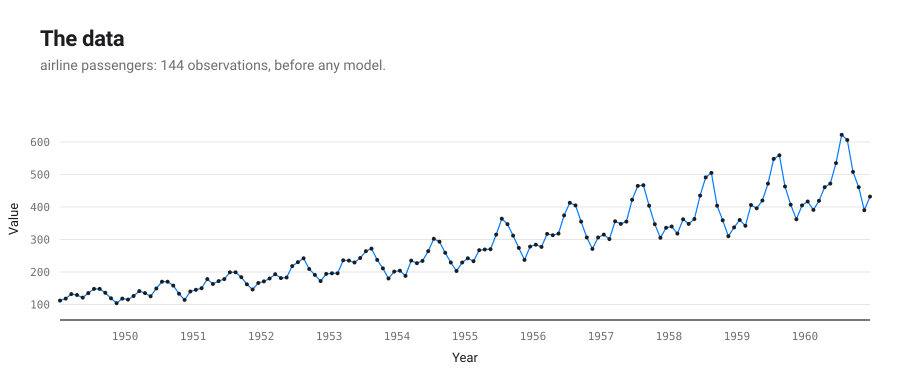
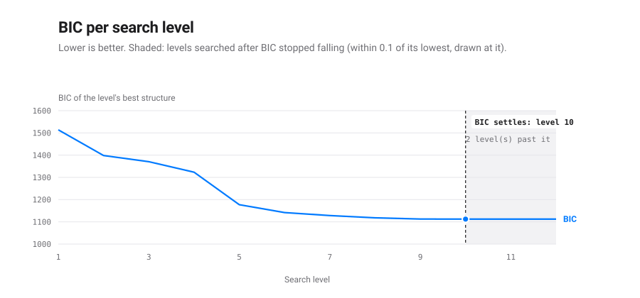
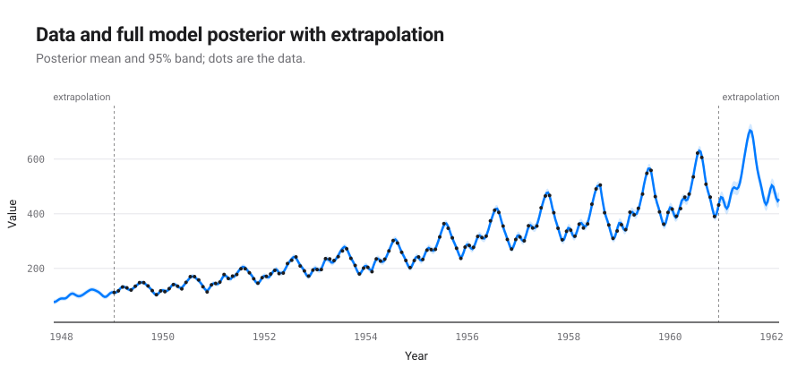
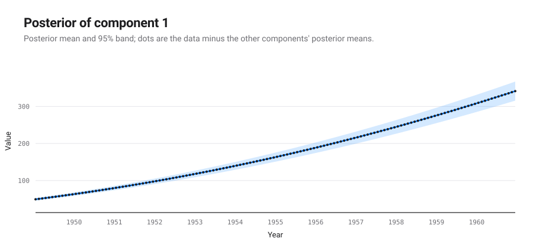
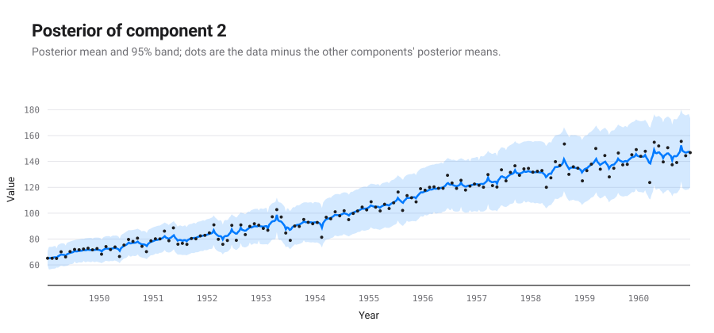
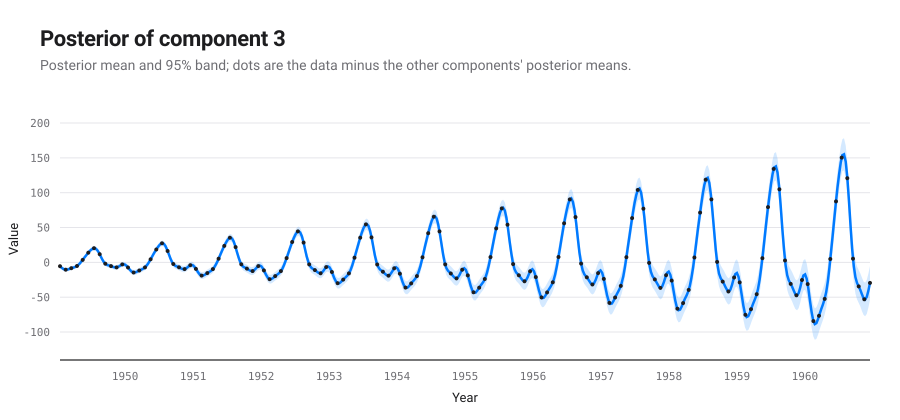
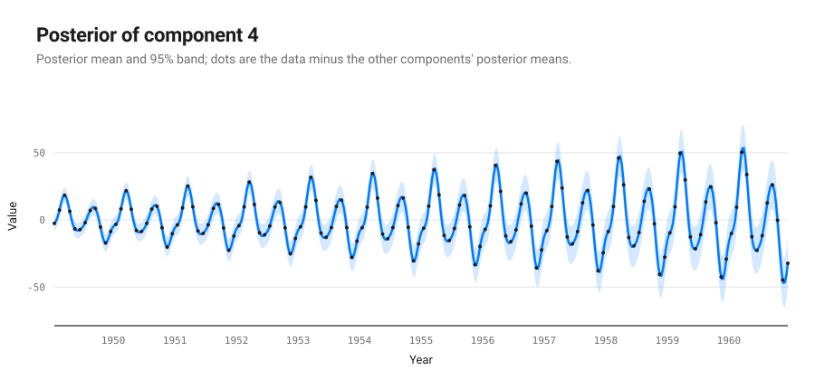
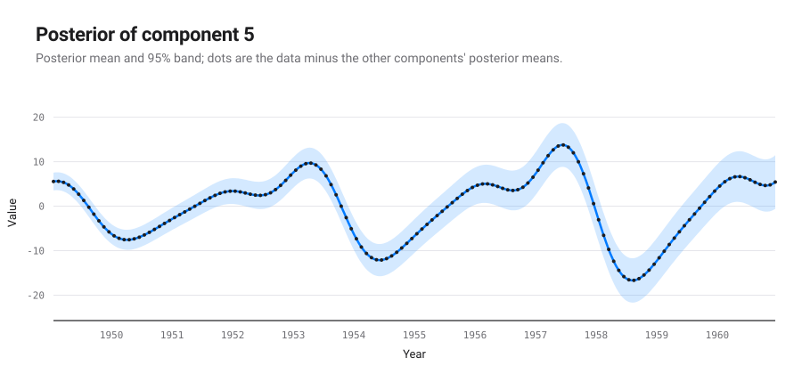

# An automatic report for the dataset: airline passengers

*Produced by `autostat` (automatic-statistician-revisited), a Python 3 port of the Automatic Bayesian Covariance Discovery system of Lloyd et al. (AAAI 2014).*

## Executive summary

The structure search selected `Lin x Per + (Lin + RQ) x (Lin + Lin x Per)` (Bayesian information criterion 1112.4; negative log likelihood 521.4 on 144 points). It decomposes into 5 additive components, listed by how much each reduces extrapolation error:

1. A quadratic polynomial.
2. This simple AI is not capable of describing the component Lin x RQ.
3. A periodic function with a period of 1.0 years but with quadraticly varying amplitude.
4. This simple AI is not capable of describing the component Lin x Per x RQ.
5. A periodic function with a period of 4.2 years but with linearly increasing amplitude.

| # | R² cumulative (%) | Residual variance explained (%) | Cross-validated MAE | MAE reduction (%) |
|---|---|---|---|---|
| data | | | 280 | |
| 1 | 81.6 | 81.6 | 106 | 62.1 |
| 2 | 86.6 | 27.1 | 32.3 | 69.5 |
| 3 | 97.1 | 78.6 | 16.5 | 48.9 |
| 4 | 99.6 | 87.3 | 8.57 | 48.1 |
| 5 | 100.0 | 100.0 | 5.84 | 31.9 |

MAE: mean absolute error over ten contiguous held-out blocks.

## The formula found

The structure search is a symbolic regression: it searches a grammar of expressions over kernels and keeps the one with the lowest Bayesian information criterion. This is the expression it kept, with every fitted parameter in place; $t$ is in years.

$$y(t) = f_{1}(t) + f_{2}(t) + f_{3}(t) + f_{4}(t) + f_{5}(t) + \varepsilon(t)$$

Each component is a Gaussian process with its own covariance:

$$f_{1}(t) \sim \mathrm{GP}\!\left(0,\ 0.7107\,(t - 1943)(t' - 1943) \cdot (t - 1940)(t' - 1940)\right)$$

$$f_{2}(t) \sim \mathrm{GP}\!\left(0,\ 56.66\,(t - 1940)(t' - 1940) \cdot \left(1 + \frac{(t - t')^2}{2 \cdot 1.654 \times 10^{-4} \cdot 0.001875^2}\right)^{-1.654 \times 10^{-4}}\right)$$

$$f_{3}(t) \sim \mathrm{GP}\!\left(0,\ 0.04947\,(t - 1943)(t' - 1943) \cdot (t - 1944)(t' - 1944) \cdot \frac{\exp\!\left(2.195\cos\frac{2\pi (t - t')}{1.002}\right) - I_0(2.195)}{e^{2.195} - I_0(2.195)}\right)$$

$$f_{4}(t) \sim \mathrm{GP}\!\left(0,\ 3.944\,(t - 1944)(t' - 1944) \cdot \frac{\exp\!\left(2.195\cos\frac{2\pi (t - t')}{1.002}\right) - I_0(2.195)}{e^{2.195} - I_0(2.195)} \cdot \left(1 + \frac{(t - t')^2}{2 \cdot 1.654 \times 10^{-4} \cdot 0.001875^2}\right)^{-1.654 \times 10^{-4}}\right)$$

$$f_{5}(t) \sim \mathrm{GP}\!\left(0,\ 0.4332\,(t - 1943)(t' - 1943) \cdot \frac{\exp\!\left(1.132\cos\frac{2\pi (t - t')}{4.18}\right) - I_0(1.132)}{e^{1.132} - I_0(1.132)}\right)$$

$$\varepsilon(t) \sim \mathrm{N}\!\left(0,\ 1.091 \times 10^{-10}\right)$$

These components have a closed form, read from their posterior mean:

$$f_{1}(t) = 48.88 + 13.61\,(t - 1949) + 0.9081\,(t - 1949)^{2}$$

The other components are smooth, quasi-periodic or noise without a short formula: a draw from such a process has no finite closed form; its covariance above is the formula.

Closed form of each component:

| # | component | closed form |
|---|---|---|
| 1 | A quadratic polynomial | exact polynomial of degree 2 |
| 2 | This simple AI is not capable of describing the component Lin x RQ | none: the covariance is the formula |
| 3 | A periodic function with a period of 1.0 years but with quadraticly varying amplitude | none: the covariance is the formula |
| 4 | This simple AI is not capable of describing the component Lin x Per x RQ | none: the covariance is the formula |
| 5 | A periodic function with a period of 4.2 years but with linearly increasing amplitude | none: the covariance is the formula |

## Search path and stopping criterion

The 2014 configuration searches a fixed number of levels and keeps the lowest BIC; it has no stopping rule. The table follows the winner of each level. A change of structure adds or removes terms; a level that keeps the structure only refits its parameters. BIC differences read on the scale of Kass and Raftery (1995): under 2 barely worth mentioning, 2 to 6 positive, 6 to 10 strong, over 10 very strong.

| level | BIC | change | structure | components | closed | params |
|---|---|---|---|---|---|---|
| 1 | 1513.7 |  | RQ | 1 | 0 | 3 |
| 2 | 1398.4 | -115.3 | Lin + RQ | 2 | 1 | 5 |
| 3 | 1370.4 | -28.0 | Lin x RQ + RQ | 2 | 0 | 7 |
| 4 | 1323.2 | -47.2 | RQ x (Lin + Per) + RQ | 3 | 0 | 10 |
| 5 | 1177.0 | -146.1 | RQ x (Lin + Per x RQ) + RQ | 3 | 0 | 12 |
| 6 | 1141.8 | -35.3 | (Lin + RQ) x (Lin + Per x RQ) + RQ | 5 | 1 | 14 |
| 7 | 1128.3 | -13.5 | (Lin + RQ) x (Lin + Lin x Per) + RQ | 5 | 1 | 13 |
| 8 | 1118.0 | -10.3 | C + (Lin + RQ) x (Lin + Lin x Per) | 5 | 2 | 11 |
| 9 | 1112.7 | -5.3 | Per + (Lin + RQ) x (Lin + Lin x Per) | 5 | 2 | 13 |
| 10 | 1112.4 | -0.2 | Lin x Per + (Lin + RQ) x (Lin + Lin x Per) | 5 | 1 | 14 |
| 11 | 1112.4 | -0.0 | Lin x Per + (Lin + RQ) x (Lin + Lin x Per) | 5 | 1 | 14 |
| 12 (kept) | 1112.4 | -0.0 | Lin x Per + (Lin + RQ) x (Lin + Lin x Per) | 5 | 1 | 14 |

- The search ran 12 levels (stopping after 2 level(s) without a BIC fall above 0.1, at most 20) and keeps the model of level 12, Lin x Per + (Lin + RQ) x (Lin + Lin x Per), BIC 1112.4.
- That structure was first reached at level 10; the levels after it only refitted its parameters, lowering BIC by 0.0 in all.
- The best different structure, Per + (Lin + RQ) x (Lin + Lin x Per) (level 9), is 0.2 above it: barely worth mentioning evidence for the kept one on the Kass and Raftery scale.
- BIC stopped falling at level 10. The 2 level(s) searched past it kept its structure and lowered BIC by 0.00 in all, less than the tolerance of 0.1: going on buys nothing the data pay for.
- A rule stopping after 1 level(s) without a fall above 0.1 would have ended the search at level 11 and kept the same structure, less refitted.
- A rule stopping after 2 level(s) without a fall above 0.1 would have ended the search at level 12 and kept the same model.
- The kept expression has 14 parameters for 144 points: its BIC is a fit term 2 NLL = 1042.9 plus a complexity term p ln n = 69.6, each extra parameter costing 4.97; it splits into 5 components, 1 of them with a closed form.

## Detailed discussion of the components

### Component 1: A quadratic polynomial

This component is a quadratic polynomial.

This component explains 81.6% of the data's variance on its own; with the components above it, 81.6%. Adding it changes the cross-validated MAE by -62.1%.

*Extrapolation.* This component is assumed to continue as a quadratic polynomial.

### Component 2: This simple AI is not capable of describing the component Lin x RQ

This simple AI is not capable of describing the component Lin x RQ.

This component explains 35.3% of the data's variance on its own; with the components above it, 86.6%. Adding it changes the cross-validated MAE by -69.5%.

*Extrapolation.* This simple AI is not capable of describing the component Lin x RQ.

### Component 3: A periodic function with a period of 1.0 years but with quadraticly varying amplitude

This component is periodic with a period of 1.0 years but with varying amplitude. The amplitude of the function varies quadraticly. The shape of this function within each period has a typical lengthscale of 5.6 weeks.

This component explains 11.9% of the data's variance on its own; with the components above it, 97.1%. Adding it changes the cross-validated MAE by -48.9%.

*Extrapolation.* This component is assumed to continue periodically with a period of 1.0 years but with varying amplitude. The amplitude of the function is assumed to continue to vary quadraticly.

### Component 4: This simple AI is not capable of describing the component Lin x Per x RQ

This simple AI is not capable of describing the component Lin x Per x RQ.

This component explains -0.8% of the data's variance on its own; with the components above it, 99.6%. Adding it changes the cross-validated MAE by -48.1%.

*Extrapolation.* This simple AI is not capable of describing the component Lin x Per x RQ.

### Component 5: A periodic function with a period of 4.2 years but with linearly increasing amplitude

This component is periodic with a period of 4.2 years but with varying amplitude. The amplitude of the function increases linearly. The shape of this function within each period has a typical lengthscale of 7.5 months.

This component explains 0.6% of the data's variance on its own; with the components above it, 100.0%. Adding it changes the cross-validated MAE by -31.9%.

*Extrapolation.* This component is assumed to continue periodically with a period of 4.2 years but with varying amplitude. The amplitude of the function is assumed to continue to increase linearly.

## Model checking

Each statistic compares draws of a component's posterior with draws of its prior. A small p-value (bold below 0.05) points at a property of the data that the component's prior does not reproduce.

| # | QQ max | QQ min | ACF min | ACF min lag | Periodogram max | Periodogram peak | MMD |
|---|---|---|---|---|---|---|---|
| 1 | 0.284 | 0.284 | 0.982 | 0.988 | 0.564 | 0.974 | **0.000** |
| 2 | 0.324 | 0.344 | 0.496 | 0.774 | 0.672 | 0.968 | **0.000** |
| 3 | 0.564 | 0.272 | 0.784 | 0.824 | 0.522 | 0.638 | 0.087 |
| 4 | 0.958 | 0.580 | 0.770 | 0.554 | 0.904 | 0.412 | **0.016** |
| 5 | 0.424 | 0.848 | 0.824 | 0.792 | 0.964 | 0.682 | **0.003** |

QQ: quantile-quantile gaps. ACF: autocorrelation function. MMD: maximum mean discrepancy two-sample test.
