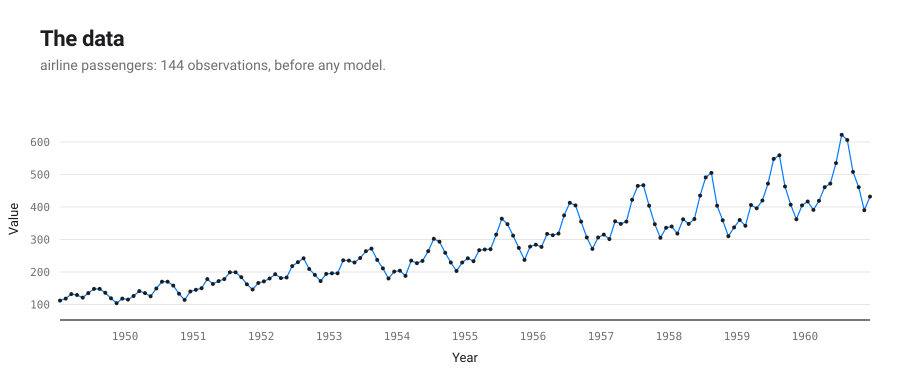

# An automatic report for the dataset: airline passengers

*Produced by `autostat.smc` (automatic-statistician-revisited), a Python port of AutoGP (Saad et al., ICML 2023), with the report writer and model checks of the Automatic Statistician (Lloyd et al., AAAI 2014; Lloyd and Ghahramani, NIPS 2015).*

## Posterior over structures

AutoGP keeps no single best structure and runs no BIC search: its stopping point is the end of the data schedule; the weights below replace the comparison of BIC between levels. Each structure's own report gives its formula.

Sequential Monte Carlo kept a weighted population of structures. Forecasts average them by weight. Each structure below is described on its own, with the parameters of its heaviest particle.

| # | weight | AutoGP structure | as 2014 kernels | report |
|---|---|---|---|---|
| 1 | 0.543 | `(Lin * (((Lin * Per) + ((Lin * Lin) * (Lin + (Per + GE)))) + Lin))` | `WN + (C + Lin + (C + GE + Lin + Per) x (C + Lin) x (C + Lin) + (C + Lin) x (C + Per)) x (C + Lin)` | [structure_1](structure_1/report.md) |
| 2 | 0.276 | `((Lin * (((Per + (GE * Lin)) + Lin) + Lin)) * Lin)` | `WN + (C + Lin + Lin + Per + GE x (C + Lin)) x (C + Lin) x (C + Lin)` | [structure_2](structure_2/report.md) |
| 3 | 0.089 | `((Lin * ((Per + (((Lin + GE) * Lin) * GE)) + Lin)) * Lin)` | `WN + (C + Lin + Per + GE x (C + Lin) x (C + GE + Lin)) x (C + Lin) x (C + Lin)` | [structure_3](structure_3/report.md) |
| 4 | 0.029 | `(Lin * (Lin * (Lin + (Lin + ((Per + ((GE * Lin) * Lin)) * (GE + Lin))))))` | `WN + (C + Lin) x (C + Lin + Lin + (C + GE + Lin) x (C + Per + GE x (C + Lin) x (C + Lin))) x (C + Lin)` |  |
| 5 | 0.028 | `((Lin * ((Per + (((GE + (Lin + GE)) * (Lin * Lin)) * Per)) + Lin)) * Lin)` | `WN + (C + Lin + Per + (C + Lin) x (C + GE + GE + Lin) x (C + Lin) x (C + Per)) x (C + Lin) x (C + Lin)` |  |
| 6 | 0.018 | `(((Lin * Lin) * ((Per + GE) + Lin)) * Lin)` | `WN + (C + GE + Lin + Per) x (C + Lin) x (C + Lin) x (C + Lin)` |  |
| 7 | 0.014 | `((Lin * ((Per + Lin) + (Lin + GE))) * (Lin * Lin))` | `WN + (C + Lin) x (C + GE + Lin + Lin + Per) x (C + Lin) x (C + Lin)` |  |
| 8 | 0.002 | `((Lin * ((Per + (((((GE + GE) * (Lin + Lin)) * Lin) * Lin) * Lin)) + Lin)) * Lin)` | `WN + (C + Lin + Per + (C + Lin) x (C + Lin + Lin) x (C + Lin) x (C + Lin) x (GE + GE)) x (C + Lin) x (C + Lin)` |  |

## Structure 1 (weight 0.543)

1. A linearly increasing function.
2. A linearly increasing function.
3. A quadratic polynomial.
4. A quadratic polynomial.
5. A linearly increasing function.
6. A linearly increasing function.
7. A quadratic polynomial.
8. A periodic function with a period of 1.0 years.
9. A periodic function with a period of 1.0 years but with quadraticly varying amplitude.
10. A periodic function with a period of 1.0 years but with amplitude increasing linearly away from Aug 1949.
11. A rough function with marginal standard deviation increasing linearly away from Apr 1950.
12. A quadratic polynomial.
13. A linearly increasing function.
14. A periodic function with a period of 1.0 years but with amplitude increasing linearly away from Mar 1951.
15. A quadratic polynomial.
16. A linearly increasing function.
17. A linearly increasing function.
18. A quadratic polynomial.
19. A periodic function with a period of 2.0 years but with amplitude increasing linearly away from Jul 1954.
20. A rough function.
21. A rough function with marginal standard deviation increasing linearly away from Mar 1951.
22. A quadratic polynomial.
23. A linearly increasing function.
24. A periodic function with a period of 2.0 years but with amplitude increasing linearly away from Mar 1951.
25. A periodic function with a period of 2.0 years but with cubicly varying amplitude.
26. A quadratic polynomial.
27. Uncorrelated noise.
28. A periodic function with a period of 2.0 years but with quadraticly varying amplitude.
29. A periodic function with a period of 2.0 years but with quadraticly varying amplitude.
30. A rough function with quadraticly varying marginal standard deviation.
31. A cubic polynomial.
32. A periodic function with a period of 2.0 years.
33. A rough function with marginal standard deviation increasing linearly away from Jul 1954.
34. A periodic function with a period of 2.0 years but with quadraticly varying amplitude.
35. A quartic polynomial.
36. A rough function with quadraticly varying marginal standard deviation.
37. A cubic polynomial.
38. A periodic function with a period of 2.0 years but with amplitude increasing linearly away from Apr 1950.
39. A rough function with cubicly varying marginal standard deviation.
40. A cubic polynomial.
41. A rough function with quadraticly varying marginal standard deviation.
42. A cubic polynomial.
43. A constant.

## Structure 2 (weight 0.276)

1. A linearly increasing function.
2. A quadratic polynomial.
3. A linearly increasing function.
4. A quadratic polynomial.
5. A linearly increasing function.
6. A quadratic polynomial.
7. A rough function with marginal standard deviation increasing linearly away from Dec 1950.
8. A cubic polynomial.
9. A quadratic polynomial.
10. A quadratic polynomial.
11. A rough function with marginal standard deviation increasing linearly away from Nov 1951.
12. A periodic function with a period of 1.0 years.
13. A rough function with quadraticly varying marginal standard deviation.
14. A periodic function with a period of 1.0 years but with quadraticly varying amplitude.
15. A periodic function with a period of 1.0 years but with amplitude increasing linearly away from Dec 1950.
16. A rough function with quadraticly varying marginal standard deviation.
17. A rough function with marginal standard deviation increasing linearly away from Aug 1953.
18. A periodic function with a period of 1.0 years but with amplitude increasing linearly away from Nov 1951.
19. A rough function with quadraticly varying marginal standard deviation.
20. Uncorrelated noise.
21. A rough function with cubicly varying marginal standard deviation.
22. A cubic polynomial.
23. A rough function.
24. A linearly increasing function.
25. A constant.

## Structure 3 (weight 0.089)

1. A linearly increasing function.
2. A linearly increasing function.
3. A quadratic polynomial.
4. A quadratic polynomial.
5. A linearly increasing function.
6. A quadratic polynomial.
7. A periodic function with a period of 1.0 years but with amplitude increasing linearly away from Nov 1951.
8. A periodic function with a period of 1.0 years.
9. A rough function with marginal standard deviation increasing linearly away from Feb 1950.
10. A periodic function with a period of 1.0 years but with amplitude increasing linearly away from Jun 1954.
11. A periodic function with a period of 1.0 years but with quadraticly varying amplitude.
12. A rough function.
13. A rough function with quadraticly varying marginal standard deviation.
14. A rough function with marginal standard deviation increasing linearly away from Nov 1951.
15. A rough function.
16. A rough function with marginal standard deviation increasing linearly away from Nov 1951.
17. A rough function with quadraticly varying marginal standard deviation.
18. A rough function with marginal standard deviation increasing linearly away from Dec 1951.
19. A rough function with marginal standard deviation increasing linearly away from Dec 1951.
20. A rough function with quadraticly varying marginal standard deviation.
21. A rough function with quadraticly varying marginal standard deviation.
22. Uncorrelated noise.
23. A rough function with cubicly varying marginal standard deviation.
24. A rough function with quadraticly varying marginal standard deviation.
25. A rough function with cubicly varying marginal standard deviation.
26. A rough function with quadraticly varying marginal standard deviation.
27. A rough function with quadraticly varying marginal standard deviation.
28. A rough function with quarticly varying marginal standard deviation.
29. A rough function with cubicly varying marginal standard deviation.
30. A rough function with quadraticly varying marginal standard deviation.
31. A rough function with cubicly varying marginal standard deviation.
32. A rough function with marginal standard deviation increasing linearly away from Jun 1954.
33. A rough function with quadraticly varying marginal standard deviation.
34. A rough function with cubicly varying marginal standard deviation.
35. A rough function with marginal standard deviation increasing linearly away from Jun 1954.
36. A cubic polynomial.
37. A constant.
