# An automatic report for the dataset: airline passengers, structure 1 of the posterior

*Produced by `autostat` (automatic-statistician-revisited), a Python 3 port of the Automatic Bayesian Covariance Discovery system of Lloyd et al. (AAAI 2014).*

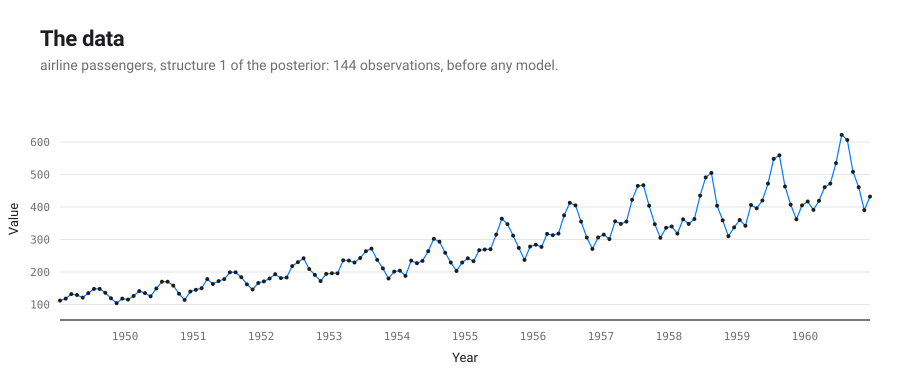

## Executive summary

With posterior weight 0.543, AutoGP kept `WN + (C + Lin + (C + GE + Lin + Per) x (C + Lin) x (C + Lin) + (C + Lin) x (C + Per)) x (C + Lin)` (Bayesian information criterion 1222.4; negative log likelihood 549.1 on 144 points). It decomposes into 43 additive components, listed by how much each reduces extrapolation error:

1. A linearly increasing function.
2. A linearly increasing function.
3. A quadratic polynomial.
4. A quadratic polynomial.
5. A linearly increasing function.
6. A linearly increasing function.
7. A quadratic polynomial.
8. A periodic function with a period of 1.0 years.
9. A periodic function with a period of 1.0 years but with quadraticly varying amplitude.
10. A periodic function with a period of 1.0 years but with amplitude increasing linearly away from Aug 1949.
11. A rough function with marginal standard deviation increasing linearly away from Apr 1950.
12. A quadratic polynomial.
13. A linearly increasing function.
14. A periodic function with a period of 1.0 years but with amplitude increasing linearly away from Mar 1951.
15. A quadratic polynomial.
16. A linearly increasing function.
17. A linearly increasing function.
18. A quadratic polynomial.
19. A periodic function with a period of 2.0 years but with amplitude increasing linearly away from Jul 1954.
20. A rough function.
21. A rough function with marginal standard deviation increasing linearly away from Mar 1951.
22. A quadratic polynomial.
23. A linearly increasing function.
24. A periodic function with a period of 2.0 years but with amplitude increasing linearly away from Mar 1951.
25. A periodic function with a period of 2.0 years but with cubicly varying amplitude.
26. A quadratic polynomial.
27. Uncorrelated noise.
28. A periodic function with a period of 2.0 years but with quadraticly varying amplitude.
29. A periodic function with a period of 2.0 years but with quadraticly varying amplitude.
30. A rough function with quadraticly varying marginal standard deviation.
31. A cubic polynomial.
32. A periodic function with a period of 2.0 years.
33. A rough function with marginal standard deviation increasing linearly away from Jul 1954.
34. A periodic function with a period of 2.0 years but with quadraticly varying amplitude.
35. A quartic polynomial.
36. A rough function with quadraticly varying marginal standard deviation.
37. A cubic polynomial.
38. A periodic function with a period of 2.0 years but with amplitude increasing linearly away from Apr 1950.
39. A rough function with cubicly varying marginal standard deviation.
40. A cubic polynomial.
41. A rough function with quadraticly varying marginal standard deviation.
42. A cubic polynomial.
43. A constant.

| # | R² cumulative (%) | Residual variance explained (%) | Cross-validated MAE | MAE reduction (%) |
|---|---|---|---|---|
| data | | | 280 | |
| 1 | 58.9 | 58.9 | 226 | 19.3 |
| 2 | 78.2 | 47.0 | 190 | 16.0 |
| 3 | 86.2 | 36.5 | 159 | 16.3 |
| 4 | 86.2 | -0.0 | 159 | 0.3 |
| 5 | 86.2 | -0.0 | 158 | 0.2 |
| 6 | 86.2 | -0.0 | 158 | 0.2 |
| 7 | 86.2 | -0.1 | 157 | 0.2 |
| 8 | 91.5 | 38.5 | 157 | 0.2 |
| 9 | 96.7 | 60.8 | 157 | 0.2 |
| 10 | 99.2 | 75.8 | 157 | 0.2 |
| 11 | 99.6 | 51.1 | 156 | 0.2 |
| 12 | 99.6 | -0.8 | 156 | 0.1 |
| 13 | 99.6 | -0.4 | 156 | 0.1 |
| 14 | 99.7 | 20.3 | 156 | 0.0 |
| 15 | 99.7 | -0.5 | 156 | 0.0 |
| 16 | 99.7 | -0.1 | 156 | 0.0 |
| 17 | 99.7 | -0.1 | 156 | 0.0 |
| 18 | 99.7 | -0.1 | 156 | 0.0 |
| 19 | 99.7 | -0.0 | 156 | 0.0 |
| 20 | 99.7 | 18.4 | 156 | 0.0 |
| 21 | 99.8 | 5.6 | 156 | 0.0 |
| 22 | 99.8 | -0.0 | 156 | 0.0 |
| 23 | 99.8 | -0.1 | 156 | 0.0 |
| 24 | 99.8 | -0.3 | 156 | 0.0 |
| 25 | 99.8 | 0.7 | 156 | 0.0 |
| 26 | 99.8 | -0.0 | 156 | 0.0 |
| 27 | 99.9 | 41.0 | 156 | 0.0 |
| 28 | 99.9 | 0.3 | 156 | -0.0 |
| 29 | 99.9 | 1.5 | 156 | -0.0 |
| 30 | 99.9 | 0.8 | 156 | -0.0 |
| 31 | 99.9 | 0.1 | 156 | -0.0 |
| 32 | 99.9 | 23.9 | 156 | -0.0 |
| 33 | 99.9 | 1.0 | 156 | -0.0 |
| 34 | 99.9 | 11.6 | 156 | -0.0 |
| 35 | 99.9 | 0.5 | 156 | -0.0 |
| 36 | 99.9 | 16.5 | 156 | -0.0 |
| 37 | 99.9 | 1.9 | 156 | -0.0 |
| 38 | 99.9 | 5.8 | 156 | -0.0 |
| 39 | 99.9 | 20.2 | 156 | -0.1 |
| 40 | 99.9 | 3.4 | 156 | -0.1 |
| 41 | 100.0 | 99.4 | 156 | -0.1 |
| 42 | 100.0 | 100.0 | 157 | -0.1 |
| 43 | 100.0 | -17.7 | 281 | -79.2 |

MAE: mean absolute error over ten contiguous held-out blocks.

## The formula found

The structure search is a symbolic regression: it searches a grammar of expressions over kernels and keeps the one with the lowest Bayesian information criterion. This is the expression it kept, with every fitted parameter in place; $t$ is in years.

$$y(t) = 280.3 + f_{1}(t) + f_{2}(t) + f_{3}(t) + f_{4}(t) + f_{5}(t) + f_{6}(t) + f_{7}(t) + f_{8}(t) + f_{9}(t) + f_{10}(t) + f_{11}(t) + f_{12}(t) + f_{13}(t) + f_{14}(t) + f_{15}(t) + f_{16}(t) + f_{17}(t) + f_{18}(t) + f_{19}(t) + f_{20}(t) + f_{21}(t) + f_{22}(t) + f_{23}(t) + f_{24}(t) + f_{25}(t) + f_{26}(t) + f_{27}(t) + f_{28}(t) + f_{29}(t) + f_{30}(t) + f_{31}(t) + f_{32}(t) + f_{33}(t) + f_{34}(t) + f_{35}(t) + f_{36}(t) + f_{37}(t) + f_{38}(t) + f_{39}(t) + f_{40}(t) + f_{41}(t) + f_{42}(t) + f_{43}(t)$$

Each component is a Gaussian process with its own covariance:

$$f_{1}(t) \sim \mathrm{GP}\!\left(0,\ 337\,(t - 1951)(t' - 1951)\right)$$

$$f_{2}(t) \sim \mathrm{GP}\!\left(0,\ 220.4\,(t - 1951)(t' - 1951)\right)$$

$$f_{3}(t) \sim \mathrm{GP}\!\left(0,\ 3.665\,(t - 1951)(t' - 1951) \cdot (t - 1951)(t' - 1951)\right)$$

$$f_{4}(t) \sim \mathrm{GP}\!\left(0,\ 0.0361\,(t - 1950)(t' - 1950) \cdot (t - 1951)(t' - 1951)\right)$$

$$f_{5}(t) \sim \mathrm{GP}\!\left(0,\ 2.232\,(t - 1950)(t' - 1950)\right)$$

$$f_{6}(t) \sim \mathrm{GP}\!\left(0,\ 2.171\,(t - 1950)(t' - 1950)\right)$$

$$f_{7}(t) \sim \mathrm{GP}\!\left(0,\ 0.03712\,(t - 1950)(t' - 1950) \cdot (t - 1951)(t' - 1951)\right)$$

$$f_{8}(t) \sim \mathrm{GP}\!\left(0,\ 177\,\frac{\exp\!\left(3.636\cos\frac{2\pi (t - t')}{1.005}\right) - I_0(3.636)}{e^{3.636} - I_0(3.636)}\right)$$

$$f_{9}(t) \sim \mathrm{GP}\!\left(0,\ 0.1294\,(t - 1950)(t' - 1950) \cdot (t - 1951)(t' - 1951) \cdot \frac{\exp\!\left(3.636\cos\frac{2\pi (t - t')}{1.005}\right) - I_0(3.636)}{e^{3.636} - I_0(3.636)}\right)$$

$$f_{10}(t) \sim \mathrm{GP}\!\left(0,\ 7.781\,(t - 1950)(t' - 1950) \cdot \frac{\exp\!\left(3.636\cos\frac{2\pi (t - t')}{1.005}\right) - I_0(3.636)}{e^{3.636} - I_0(3.636)}\right)$$

$$f_{11}(t) \sim \mathrm{GP}\!\left(0,\ 3.13\,\exp\!\left(-\left(\frac{|t - t'|}{0.771}\right)^{0.9571}\right) \cdot (t - 1950)(t' - 1950)\right)$$

$$f_{12}(t) \sim \mathrm{GP}\!\left(0,\ 0.02065\,(t - 1952)(t' - 1952) \cdot (t - 1950)(t' - 1950)\right)$$

$$f_{13}(t) \sim \mathrm{GP}\!\left(0,\ 0.8211\,(t - 1951)(t' - 1951)\right)$$

$$f_{14}(t) \sim \mathrm{GP}\!\left(0,\ 2.943\,(t - 1951)(t' - 1951) \cdot \frac{\exp\!\left(3.636\cos\frac{2\pi (t - t')}{1.005}\right) - I_0(3.636)}{e^{3.636} - I_0(3.636)}\right)$$

$$f_{15}(t) \sim \mathrm{GP}\!\left(0,\ 0.01484\,(t - 1954)(t' - 1954) \cdot (t - 1950)(t' - 1950)\right)$$

$$f_{16}(t) \sim \mathrm{GP}\!\left(0,\ 0.1939\,(t - 1951)(t' - 1951)\right)$$

$$f_{17}(t) \sim \mathrm{GP}\!\left(0,\ 0.1079\,(t - 1952)(t' - 1952)\right)$$

$$f_{18}(t) \sim \mathrm{GP}\!\left(0,\ 0.001794\,(t - 1952)(t' - 1952) \cdot (t - 1951)(t' - 1951)\right)$$

$$f_{19}(t) \sim \mathrm{GP}\!\left(0,\ 0.02288\,(t - 1954)(t' - 1954) \cdot \frac{\exp\!\left(0.3959\cos\frac{2\pi (t - t')}{2.037}\right) - I_0(0.3959)}{e^{0.3959} - I_0(0.3959)}\right)$$

$$f_{20}(t) \sim \mathrm{GP}\!\left(0,\ 16.35\,\exp\!\left(-\left(\frac{|t - t'|}{0.771}\right)^{0.9571}\right)\right)$$

$$f_{21}(t) \sim \mathrm{GP}\!\left(0,\ 0.2719\,\exp\!\left(-\left(\frac{|t - t'|}{0.771}\right)^{0.9571}\right) \cdot (t - 1951)(t' - 1951)\right)$$

$$f_{22}(t) \sim \mathrm{GP}\!\left(0,\ 0.001289\,(t - 1954)(t' - 1954) \cdot (t - 1951)(t' - 1951)\right)$$

$$f_{23}(t) \sim \mathrm{GP}\!\left(0,\ 0.07754\,(t - 1954)(t' - 1954)\right)$$

$$f_{24}(t) \sim \mathrm{GP}\!\left(0,\ 0.05721\,(t - 1951)(t' - 1951) \cdot \frac{\exp\!\left(0.3959\cos\frac{2\pi (t - t')}{2.037}\right) - I_0(0.3959)}{e^{0.3959} - I_0(0.3959)}\right)$$

$$f_{25}(t) \sim \mathrm{GP}\!\left(0,\ 7.284 \times 10^{-5}\,(t - 1950)(t' - 1950) \cdot (t - 1954)(t' - 1954) \cdot (t - 1951)(t' - 1951) \cdot \frac{\exp\!\left(0.3959\cos\frac{2\pi (t - t')}{2.037}\right) - I_0(0.3959)}{e^{0.3959} - I_0(0.3959)}\right)$$

$$f_{26}(t) \sim \mathrm{GP}\!\left(0,\ 7.174 \times 10^{-4}\,(t - 1954)(t' - 1954) \cdot (t - 1952)(t' - 1952)\right)$$

$$f_{27}(t) \sim \mathrm{GP}\!\left(0,\ 30.32\,\delta_{t t'}\right)$$

$$f_{28}(t) \sim \mathrm{GP}\!\left(0,\ 3.805 \times 10^{-4}\,(t - 1954)(t' - 1954) \cdot (t - 1951)(t' - 1951) \cdot \frac{\exp\!\left(0.3959\cos\frac{2\pi (t - t')}{2.037}\right) - I_0(0.3959)}{e^{0.3959} - I_0(0.3959)}\right)$$

$$f_{29}(t) \sim \mathrm{GP}\!\left(0,\ 0.00438\,(t - 1954)(t' - 1954) \cdot (t - 1950)(t' - 1950) \cdot \frac{\exp\!\left(0.3959\cos\frac{2\pi (t - t')}{2.037}\right) - I_0(0.3959)}{e^{0.3959} - I_0(0.3959)}\right)$$

$$f_{30}(t) \sim \mathrm{GP}\!\left(0,\ 0.001808\,\exp\!\left(-\left(\frac{|t - t'|}{0.771}\right)^{0.9571}\right) \cdot (t - 1954)(t' - 1954) \cdot (t - 1951)(t' - 1951)\right)$$

$$f_{31}(t) \sim \mathrm{GP}\!\left(0,\ 1.193 \times 10^{-5}\,(t - 1954)(t' - 1954) \cdot (t - 1952)(t' - 1952) \cdot (t - 1951)(t' - 1951)\right)$$

$$f_{32}(t) \sim \mathrm{GP}\!\left(0,\ 3.44\,\frac{\exp\!\left(0.3959\cos\frac{2\pi (t - t')}{2.037}\right) - I_0(0.3959)}{e^{0.3959} - I_0(0.3959)}\right)$$

$$f_{33}(t) \sim \mathrm{GP}\!\left(0,\ 0.1087\,\exp\!\left(-\left(\frac{|t - t'|}{0.771}\right)^{0.9571}\right) \cdot (t - 1954)(t' - 1954)\right)$$

$$f_{34}(t) \sim \mathrm{GP}\!\left(0,\ 0.01095\,(t - 1950)(t' - 1950) \cdot (t - 1951)(t' - 1951) \cdot \frac{\exp\!\left(0.3959\cos\frac{2\pi (t - t')}{2.037}\right) - I_0(0.3959)}{e^{0.3959} - I_0(0.3959)}\right)$$

$$f_{35}(t) \sim \mathrm{GP}\!\left(0,\ 2.284 \times 10^{-6}\,(t - 1950)(t' - 1950) \cdot (t - 1952)(t' - 1952) \cdot (t - 1954)(t' - 1954) \cdot (t - 1951)(t' - 1951)\right)$$

$$f_{36}(t) \sim \mathrm{GP}\!\left(0,\ 0.02082\,\exp\!\left(-\left(\frac{|t - t'|}{0.771}\right)^{0.9571}\right) \cdot (t - 1950)(t' - 1950) \cdot (t - 1954)(t' - 1954)\right)$$

$$f_{37}(t) \sim \mathrm{GP}\!\left(0,\ 1.373 \times 10^{-4}\,(t - 1952)(t' - 1952) \cdot (t - 1954)(t' - 1954) \cdot (t - 1950)(t' - 1950)\right)$$

$$f_{38}(t) \sim \mathrm{GP}\!\left(0,\ 0.6585\,(t - 1950)(t' - 1950) \cdot \frac{\exp\!\left(0.3959\cos\frac{2\pi (t - t')}{2.037}\right) - I_0(0.3959)}{e^{0.3959} - I_0(0.3959)}\right)$$

$$f_{39}(t) \sim \mathrm{GP}\!\left(0,\ 3.462 \times 10^{-4}\,\exp\!\left(-\left(\frac{|t - t'|}{0.771}\right)^{0.9571}\right) \cdot (t - 1950)(t' - 1950) \cdot (t - 1954)(t' - 1954) \cdot (t - 1951)(t' - 1951)\right)$$

$$f_{40}(t) \sim \mathrm{GP}\!\left(0,\ 2.469 \times 10^{-4}\,(t - 1954)(t' - 1954) \cdot (t - 1950)(t' - 1950) \cdot (t - 1951)(t' - 1951)\right)$$

$$f_{41}(t) \sim \mathrm{GP}\!\left(0,\ 0.05205\,\exp\!\left(-\left(\frac{|t - t'|}{0.771}\right)^{0.9571}\right) \cdot (t - 1950)(t' - 1950) \cdot (t - 1951)(t' - 1951)\right)$$

$$f_{42}(t) \sim \mathrm{GP}\!\left(0,\ 3.434 \times 10^{-4}\,(t - 1952)(t' - 1952) \cdot (t - 1950)(t' - 1950) \cdot (t - 1951)(t' - 1951)\right)$$

$$f_{43}(t) \sim \mathrm{GP}\!\left(0,\ 20328\right)$$

Polynomial and periodic components have a closed form, read from their posterior mean:

$$f_{1}(t) = -31.12 + 14.13\,(t - 1949)$$

$$f_{2}(t) = -14.33 + 8.534\,(t - 1949)$$

$$f_{3}(t) = 4.181 - 4.387\,(t - 1949) + 1.13\,(t - 1949)^{2}$$

$$f_{4}(t) = 0.01608 - 0.03552\,(t - 1949) + 0.01281\,(t - 1949)^{2}$$

$$f_{5}(t) = -0.1004 + 0.08054\,(t - 1949)$$

$$f_{6}(t) = -0.03953 + 0.06938\,(t - 1949)$$

$$f_{7}(t) = 0.03327 - 0.0418\,(t - 1949) + 0.01212\,(t - 1949)^{2}$$

$$f_{8}(t) \approx 14.55\cos\!\left(\frac{2\pi \cdot (t - 1949)}{1.005} - 3.019\right) + 11.33\cos\!\left(\frac{2\pi \cdot 2 \cdot (t - 1949)}{1.005} - 1.524\right) + 3.795\cos\!\left(\frac{2\pi \cdot 3 \cdot (t - 1949)}{1.005} + 1.41\right) + 3.987\cos\!\left(\frac{2\pi \cdot 4 \cdot (t - 1949)}{1.005} + 0.6521\right) + 2.036\cos\!\left(\frac{2\pi \cdot 5 \cdot (t - 1949)}{1.005} + 0.6162\right) + 0.2603\cos\!\left(\frac{2\pi \cdot 6 \cdot (t - 1949)}{1.005} + 1.718\right) + 0.1805\cos\!\left(\frac{2\pi \cdot 7 \cdot (t - 1949)}{1.005} - 1.387\right) + 0.04093\cos\!\left(\frac{2\pi \cdot 8 \cdot (t - 1949)}{1.005} - 2.358\right)$$

$$f_{12}(t) = 0.02337 - 0.02634\,(t - 1949) + 0.006088\,(t - 1949)^{2}$$

$$f_{13}(t) = -0.07583 + 0.03442\,(t - 1949)$$

$$f_{15}(t) = 0.02111 - 0.02078\,(t - 1949) + 0.003086\,(t - 1949)^{2}$$

$$f_{16}(t) = -0.0179 + 0.008127\,(t - 1949)$$

$$f_{17}(t) = -0.0157 + 0.005098\,(t - 1949)$$

$$f_{18}(t) = 0.003038 - 0.002365\,(t - 1949) + 4.478 \times 10^{-4}\,(t - 1949)^{2}$$

$$f_{22}(t) = 0.002318 - 0.001474\,(t - 1949) + 1.917 \times 10^{-4}\,(t - 1949)^{2}$$

$$f_{23}(t) = -0.02636 + 0.004803\,(t - 1949)$$

$$f_{26}(t) = 0.001144 - 5.801 \times 10^{-4}\,(t - 1949) + 6.772 \times 10^{-5}\,(t - 1949)^{2}$$

$$f_{31}(t) = 0.001536 - 0.001476\,(t - 1949) + 4.445 \times 10^{-4}\,(t - 1949)^{2} - 4.127 \times 10^{-5}\,(t - 1949)^{3}$$

$$f_{32}(t) \approx 2.008\cos\!\left(\frac{2\pi \cdot (t - 1949)}{2.037} - 0.7734\right) + 0.05068\cos\!\left(\frac{2\pi \cdot 2 \cdot (t - 1949)}{2.037} - 2.554\right) + 0.03266\cos\!\left(\frac{2\pi \cdot 3 \cdot (t - 1949)}{2.037} - 1.79\right)$$

$$f_{35}(t) = -7.67 \times 10^{-4} + 0.001352\,(t - 1949) - 8.131 \times 10^{-4}\,(t - 1949)^{2} + 1.986 \times 10^{-4}\,(t - 1949)^{3} - 1.653 \times 10^{-5}\,(t - 1949)^{4}$$

$$f_{37}(t) = 0.009746 - 0.01276\,(t - 1949) + 0.004541\,(t - 1949)^{2} - 4.627 \times 10^{-4}\,(t - 1949)^{3}$$

$$f_{40}(t) = 0.01185 - 0.01705\,(t - 1949) + 0.00703\,(t - 1949)^{2} - 7.866 \times 10^{-4}\,(t - 1949)^{3}$$

$$f_{42}(t) = 0.006971 - 0.01102\,(t - 1949) + 0.005382\,(t - 1949)^{2} - 8.244 \times 10^{-4}\,(t - 1949)^{3}$$

$$f_{43}(t) = -123.9$$

A periodic kernel is exactly a sum of cosines, so a periodic component is a Fourier series in its period; it is written up to the harmonic after which the rest weighs less than 0.1 % of the component, hence the approximate sign.

The other components are smooth, quasi-periodic or noise: a draw from such a process has no finite closed form; its covariance above is the formula.

Closed form of each component:

| # | component | closed form |
|---|---|---|
| 1 | A linearly increasing function | exact polynomial of degree 1 |
| 2 | A linearly increasing function | exact polynomial of degree 1 |
| 3 | A quadratic polynomial | exact polynomial of degree 2 |
| 4 | A quadratic polynomial | exact polynomial of degree 2 |
| 5 | A linearly increasing function | exact polynomial of degree 1 |
| 6 | A linearly increasing function | exact polynomial of degree 1 |
| 7 | A quadratic polynomial | exact polynomial of degree 2 |
| 8 | A periodic function with a period of 1.0 years | Fourier series, 8 harmonics, largest gap 0.013 % of the component |
| 9 | A periodic function with a period of 1.0 years but with quadraticly varying amplitude | none: the covariance is the formula |
| 10 | A periodic function with a period of 1.0 years but with amplitude increasing linearly away from Aug 1949 | none: the covariance is the formula |
| 11 | A rough function with marginal standard deviation increasing linearly away from Apr 1950 | none: the covariance is the formula |
| 12 | A quadratic polynomial | exact polynomial of degree 2 |
| 13 | A linearly increasing function | exact polynomial of degree 1 |
| 14 | A periodic function with a period of 1.0 years but with amplitude increasing linearly away from Mar 1951 | none: the covariance is the formula |
| 15 | A quadratic polynomial | exact polynomial of degree 2 |
| 16 | A linearly increasing function | exact polynomial of degree 1 |
| 17 | A linearly increasing function | exact polynomial of degree 1 |
| 18 | A quadratic polynomial | exact polynomial of degree 2 |
| 19 | A periodic function with a period of 2.0 years but with amplitude increasing linearly away from Jul 1954 | none: the covariance is the formula |
| 20 | A rough function | none: the covariance is the formula |
| 21 | A rough function with marginal standard deviation increasing linearly away from Mar 1951 | none: the covariance is the formula |
| 22 | A quadratic polynomial | exact polynomial of degree 2 |
| 23 | A linearly increasing function | exact polynomial of degree 1 |
| 24 | A periodic function with a period of 2.0 years but with amplitude increasing linearly away from Mar 1951 | none: the covariance is the formula |
| 25 | A periodic function with a period of 2.0 years but with cubicly varying amplitude | none: the covariance is the formula |
| 26 | A quadratic polynomial | exact polynomial of degree 2 |
| 27 | Uncorrelated noise | none: the covariance is the formula |
| 28 | A periodic function with a period of 2.0 years but with quadraticly varying amplitude | none: the covariance is the formula |
| 29 | A periodic function with a period of 2.0 years but with quadraticly varying amplitude | none: the covariance is the formula |
| 30 | A rough function with quadraticly varying marginal standard deviation | none: the covariance is the formula |
| 31 | A cubic polynomial | exact polynomial of degree 3 |
| 32 | A periodic function with a period of 2.0 years | Fourier series, 3 harmonics, largest gap 0.0082 % of the component |
| 33 | A rough function with marginal standard deviation increasing linearly away from Jul 1954 | none: the covariance is the formula |
| 34 | A periodic function with a period of 2.0 years but with quadraticly varying amplitude | none: the covariance is the formula |
| 35 | A quartic polynomial | exact polynomial of degree 4 |
| 36 | A rough function with quadraticly varying marginal standard deviation | none: the covariance is the formula |
| 37 | A cubic polynomial | exact polynomial of degree 3 |
| 38 | A periodic function with a period of 2.0 years but with amplitude increasing linearly away from Apr 1950 | none: the covariance is the formula |
| 39 | A rough function with cubicly varying marginal standard deviation | none: the covariance is the formula |
| 40 | A cubic polynomial | exact polynomial of degree 3 |
| 41 | A rough function with quadraticly varying marginal standard deviation | none: the covariance is the formula |
| 42 | A cubic polynomial | exact polynomial of degree 3 |
| 43 | A constant | exact polynomial of degree 0 |

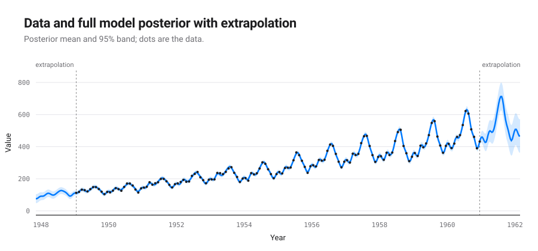

## Detailed discussion of the components

### Component 1: A linearly increasing function

This component is linearly increasing.

This component explains 58.9% of the data's variance on its own; with the components above it, 58.9%. Adding it changes the cross-validated MAE by -19.3%.

*Extrapolation.* This component is assumed to continue to increase linearly.

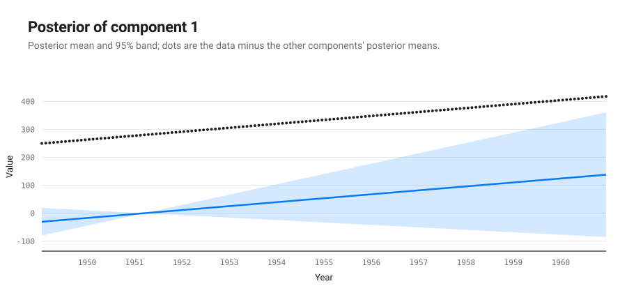

### Component 2: A linearly increasing function

This component is linearly increasing.

This component explains 39.6% of the data's variance on its own; with the components above it, 78.2%. Adding it changes the cross-validated MAE by -16.0%.

*Extrapolation.* This component is assumed to continue to increase linearly.

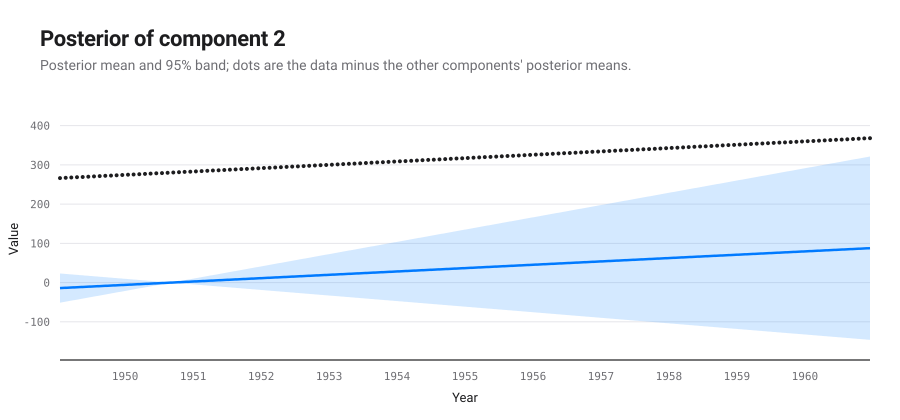

### Component 3: A quadratic polynomial

This component is a quadratic polynomial.

This component explains 42.9% of the data's variance on its own; with the components above it, 86.2%. Adding it changes the cross-validated MAE by -16.3%.

*Extrapolation.* This component is assumed to continue as a quadratic polynomial.

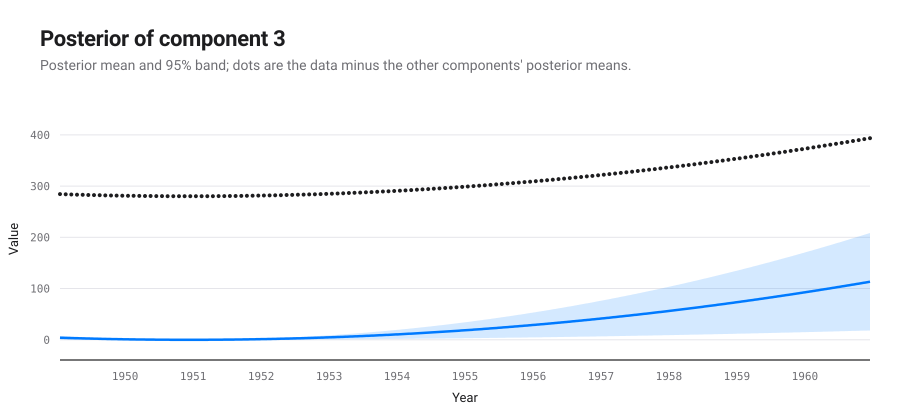

### Component 4: A quadratic polynomial

This component is a quadratic polynomial.

This component explains 0.7% of the data's variance on its own; with the components above it, 86.2%. Adding it changes the cross-validated MAE by -0.3%.

*Extrapolation.* This component is assumed to continue as a quadratic polynomial.

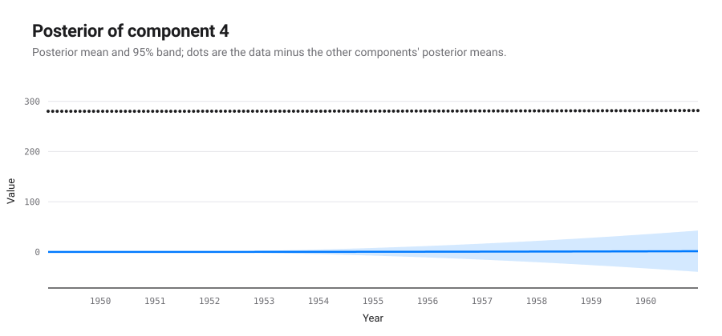

### Component 5: A linearly increasing function

This component is linearly increasing.

This component explains 0.4% of the data's variance on its own; with the components above it, 86.2%. Adding it changes the cross-validated MAE by -0.2%.

*Extrapolation.* This component is assumed to continue to increase linearly.

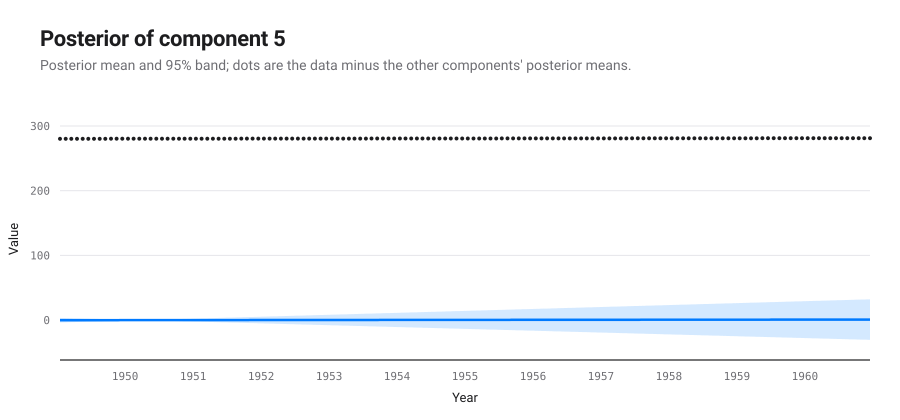

### Component 6: A linearly increasing function

This component is linearly increasing.

This component explains 0.4% of the data's variance on its own; with the components above it, 86.2%. Adding it changes the cross-validated MAE by -0.2%.

*Extrapolation.* This component is assumed to continue to increase linearly.

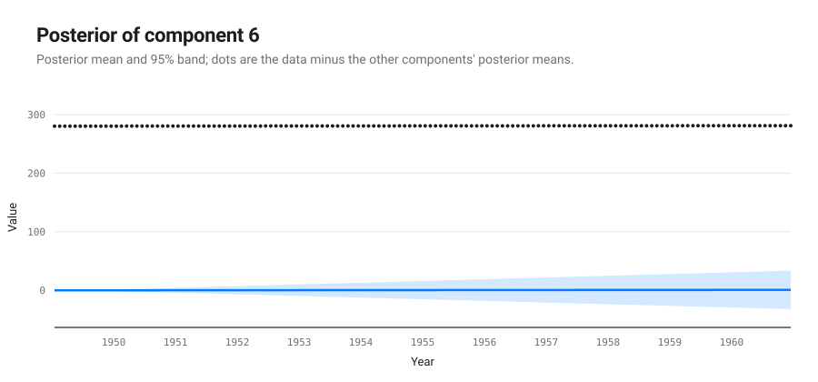

### Component 7: A quadratic polynomial

This component is a quadratic polynomial.

This component explains 0.6% of the data's variance on its own; with the components above it, 86.2%. Adding it changes the cross-validated MAE by -0.2%.

*Extrapolation.* This component is assumed to continue as a quadratic polynomial.

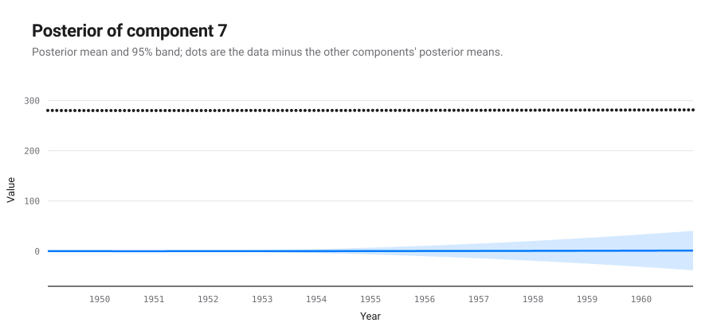

### Component 8: A periodic function with a period of 1.0 years

This component is periodic with a period of 1.0 years. The shape of this function within each period has a typical lengthscale of 4.4 weeks.

This component explains 5.1% of the data's variance on its own; with the components above it, 91.5%. Adding it changes the cross-validated MAE by -0.2%.

*Extrapolation.* This component is assumed to continue periodically with a period of 1.0 years.

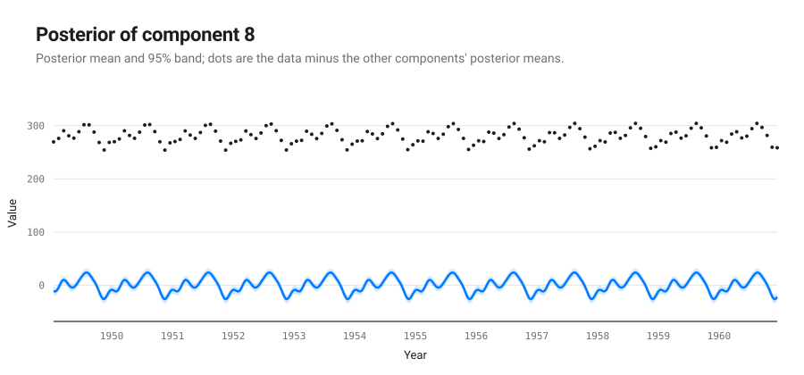

### Component 9: A periodic function with a period of 1.0 years but with quadraticly varying amplitude

This component is periodic with a period of 1.0 years but with varying amplitude. The amplitude of the function varies quadraticly. The shape of this function within each period has a typical lengthscale of 4.4 weeks.

This component explains 6.8% of the data's variance on its own; with the components above it, 96.7%. Adding it changes the cross-validated MAE by -0.2%.

*Extrapolation.* This component is assumed to continue periodically with a period of 1.0 years but with varying amplitude. The amplitude of the function is assumed to continue to vary quadraticly.

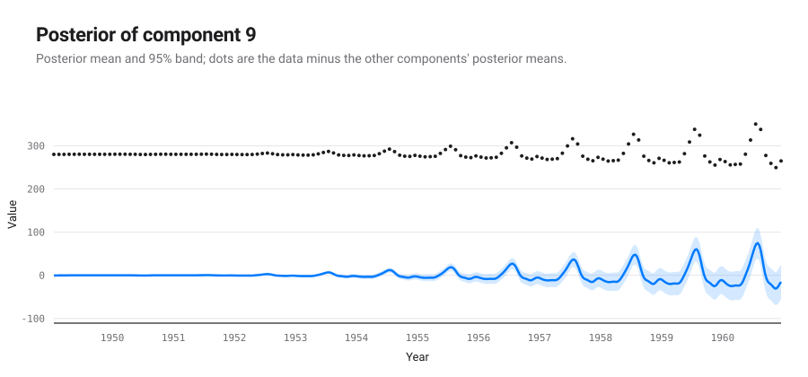

### Component 10: A periodic function with a period of 1.0 years but with amplitude increasing linearly away from Aug 1949

This component is periodic with a period of 1.0 years but with varying amplitude. The amplitude of the function increases linearly away from Aug 1949. The shape of this function within each period has a typical lengthscale of 4.4 weeks.

This component explains 7.7% of the data's variance on its own; with the components above it, 99.2%. Adding it changes the cross-validated MAE by -0.2%.

*Extrapolation.* This component is assumed to continue periodically with a period of 1.0 years but with varying amplitude. The amplitude of the function is assumed to continue to increase linearly.

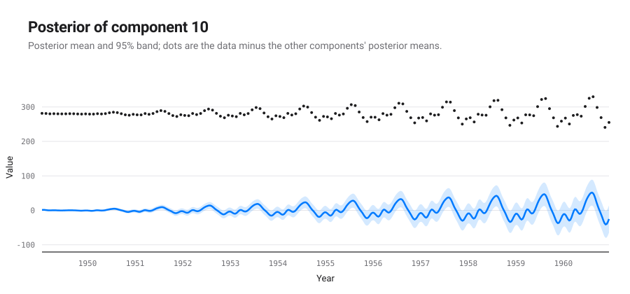

### Component 11: A rough function with marginal standard deviation increasing linearly away from Apr 1950

This component is a rough function with a typical lengthscale of 4.5 months. The marginal standard deviation of the function increases linearly away from Apr 1950. Its sample paths are continuous but not differentiable (gamma-exponential exponent 0.96).

This component explains -0.1% of the data's variance on its own; with the components above it, 99.6%. Adding it changes the cross-validated MAE by -0.2%.

*Extrapolation.* This component is assumed to continue roughly but is also assumed to be stationary so its distribution will return to the prior. The prior distribution places mass on rough functions with a marginal mean of zero and a typical lengthscale of 4.5 months. The marginal standard deviation of the function is assumed to continue to increase linearly.

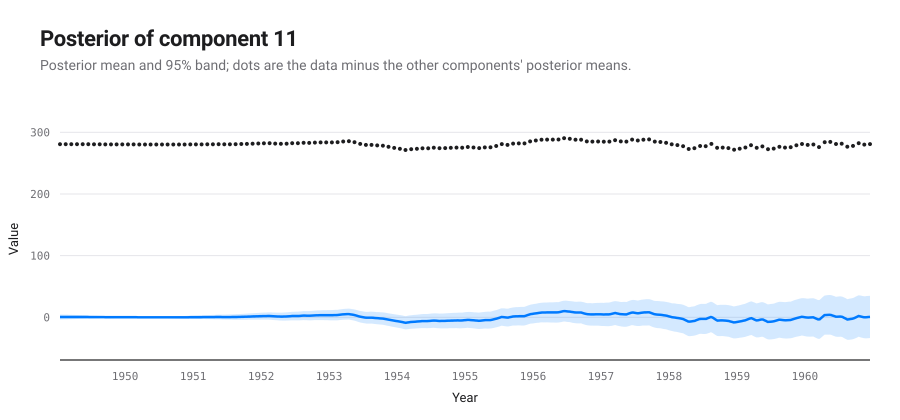

### Component 12: A quadratic polynomial

This component is a quadratic polynomial.

This component explains 0.3% of the data's variance on its own; with the components above it, 99.6%. Adding it changes the cross-validated MAE by -0.1%.

*Extrapolation.* This component is assumed to continue as a quadratic polynomial.

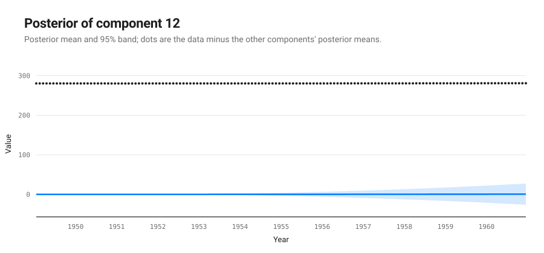

### Component 13: A linearly increasing function

This component is linearly increasing.

This component explains 0.2% of the data's variance on its own; with the components above it, 99.6%. Adding it changes the cross-validated MAE by -0.1%.

*Extrapolation.* This component is assumed to continue to increase linearly.

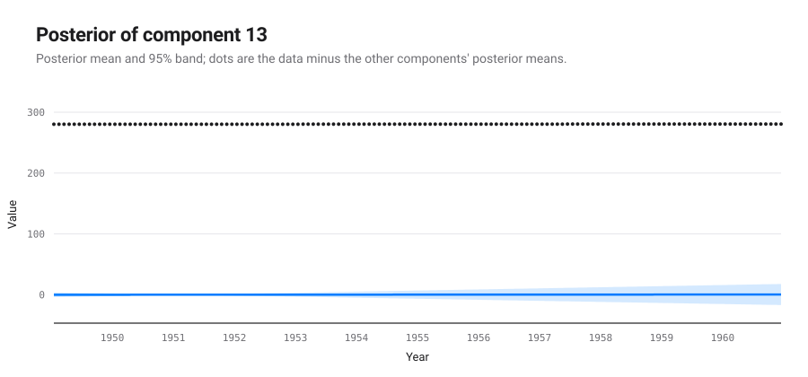

### Component 14: A periodic function with a period of 1.0 years but with amplitude increasing linearly away from Mar 1951

This component is periodic with a period of 1.0 years but with varying amplitude. The amplitude of the function increases linearly away from Mar 1951. The shape of this function within each period has a typical lengthscale of 4.4 weeks.

This component explains 1.8% of the data's variance on its own; with the components above it, 99.7%. Adding it changes the cross-validated MAE by -0.0%.

*Extrapolation.* This component is assumed to continue periodically with a period of 1.0 years but with varying amplitude. The amplitude of the function is assumed to continue to increase linearly.

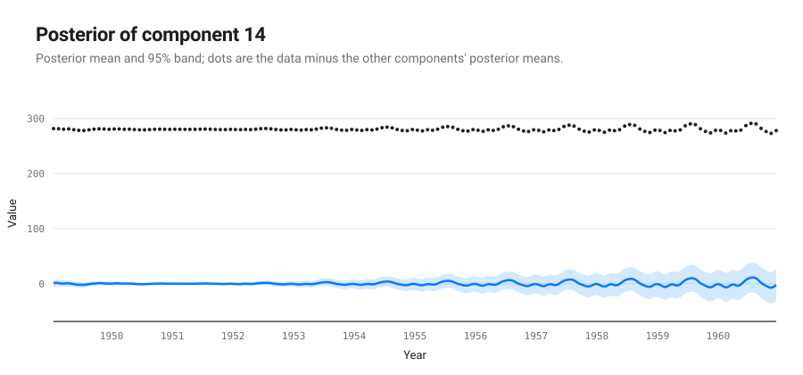

### Component 15: A quadratic polynomial

This component is a quadratic polynomial.

This component explains 0.1% of the data's variance on its own; with the components above it, 99.7%. Adding it changes the cross-validated MAE by -0.0%.

*Extrapolation.* This component is assumed to continue as a quadratic polynomial.

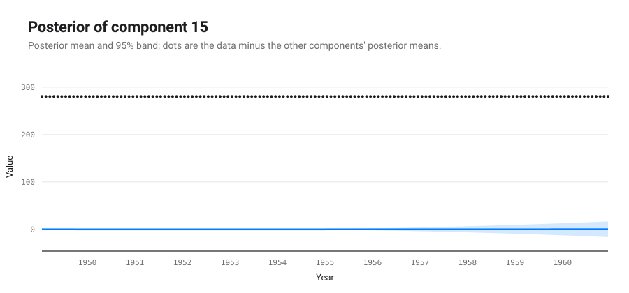

### Component 16: A linearly increasing function

This component is linearly increasing.

This component explains 0.0% of the data's variance on its own; with the components above it, 99.7%. Adding it changes the cross-validated MAE by -0.0%.

*Extrapolation.* This component is assumed to continue to increase linearly.

### Component 17: A linearly increasing function

This component is linearly increasing.

This component explains 0.0% of the data's variance on its own; with the components above it, 99.7%. Adding it changes the cross-validated MAE by -0.0%.

*Extrapolation.* This component is assumed to continue to increase linearly.

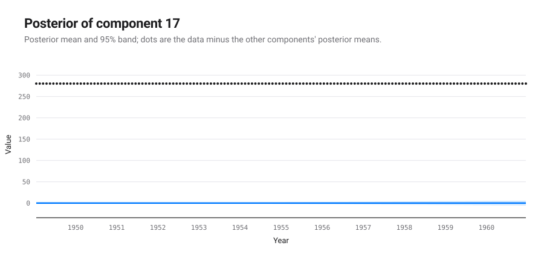

### Component 18: A quadratic polynomial

This component is a quadratic polynomial.

This component explains 0.0% of the data's variance on its own; with the components above it, 99.7%. Adding it changes the cross-validated MAE by -0.0%.

*Extrapolation.* This component is assumed to continue as a quadratic polynomial.

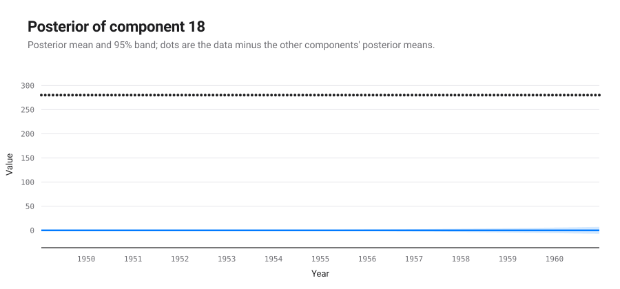

### Component 19: A periodic function with a period of 2.0 years but with amplitude increasing linearly away from Jul 1954

This component is periodic with a period of 2.0 years but with varying amplitude. The amplitude of the function increases linearly away from Jul 1954. The shape of this function within each period has a typical lengthscale of 6.2 months.

This component explains 0.0% of the data's variance on its own; with the components above it, 99.7%. Adding it changes the cross-validated MAE by -0.0%.

*Extrapolation.* This component is assumed to continue periodically with a period of 2.0 years but with varying amplitude. The amplitude of the function is assumed to continue to increase linearly.

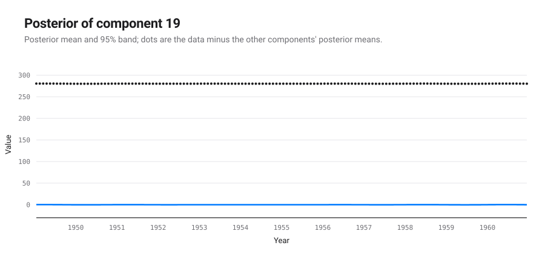

### Component 20: A rough function

This component is a rough function with a typical lengthscale of 4.5 months. Its sample paths are continuous but not differentiable (gamma-exponential exponent 0.96).

This component explains 0.3% of the data's variance on its own; with the components above it, 99.7%. Adding it changes the cross-validated MAE by -0.0%.

*Extrapolation.* This component is assumed to continue roughly but is also assumed to be stationary so its distribution will return to the prior. The prior distribution places mass on rough functions with a marginal mean of zero and a typical lengthscale of 4.5 months.

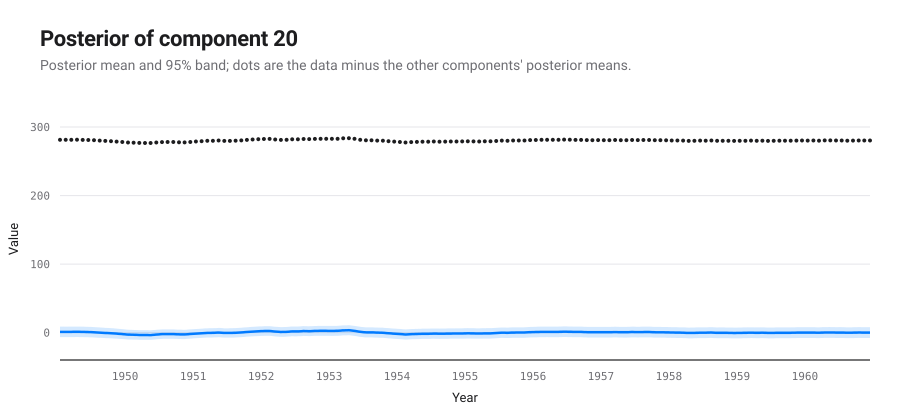

### Component 21: A rough function with marginal standard deviation increasing linearly away from Mar 1951

This component is a rough function with a typical lengthscale of 4.5 months. The marginal standard deviation of the function increases linearly away from Mar 1951. Its sample paths are continuous but not differentiable (gamma-exponential exponent 0.96).

This component explains -0.0% of the data's variance on its own; with the components above it, 99.8%. Adding it changes the cross-validated MAE by -0.0%.

*Extrapolation.* This component is assumed to continue roughly but is also assumed to be stationary so its distribution will return to the prior. The prior distribution places mass on rough functions with a marginal mean of zero and a typical lengthscale of 4.5 months. The marginal standard deviation of the function is assumed to continue to increase linearly.

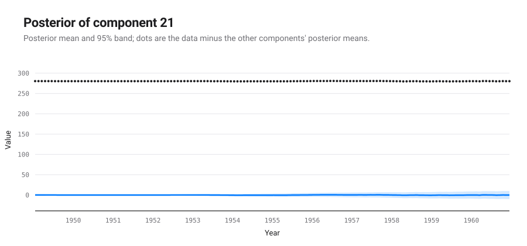

### Component 22: A quadratic polynomial

This component is a quadratic polynomial.

This component explains 0.0% of the data's variance on its own; with the components above it, 99.8%. Adding it changes the cross-validated MAE by -0.0%.

*Extrapolation.* This component is assumed to continue as a quadratic polynomial.

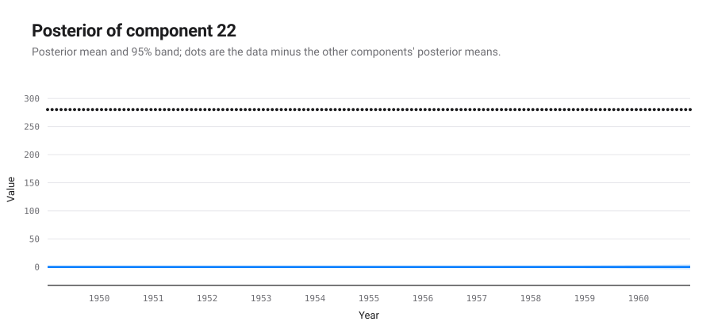

### Component 23: A linearly increasing function

This component is linearly increasing.

This component explains 0.0% of the data's variance on its own; with the components above it, 99.8%. Adding it changes the cross-validated MAE by -0.0%.

*Extrapolation.* This component is assumed to continue to increase linearly.

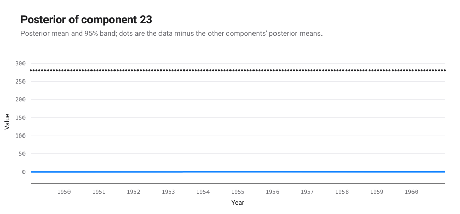

### Component 24: A periodic function with a period of 2.0 years but with amplitude increasing linearly away from Mar 1951

This component is periodic with a period of 2.0 years but with varying amplitude. The amplitude of the function increases linearly away from Mar 1951. The shape of this function within each period has a typical lengthscale of 6.2 months.

This component explains 0.0% of the data's variance on its own; with the components above it, 99.8%. Adding it changes the cross-validated MAE by -0.0%.

*Extrapolation.* This component is assumed to continue periodically with a period of 2.0 years but with varying amplitude. The amplitude of the function is assumed to continue to increase linearly.

### Component 25: A periodic function with a period of 2.0 years but with cubicly varying amplitude

This component is periodic with a period of 2.0 years but with varying amplitude. The amplitude of the function varies cubicly. The shape of this function within each period has a typical lengthscale of 6.2 months.

This component explains 0.0% of the data's variance on its own; with the components above it, 99.8%. Adding it changes the cross-validated MAE by -0.0%.

*Extrapolation.* This component is assumed to continue periodically with a period of 2.0 years but with varying amplitude. The amplitude of the function is assumed to continue to vary cubicly.

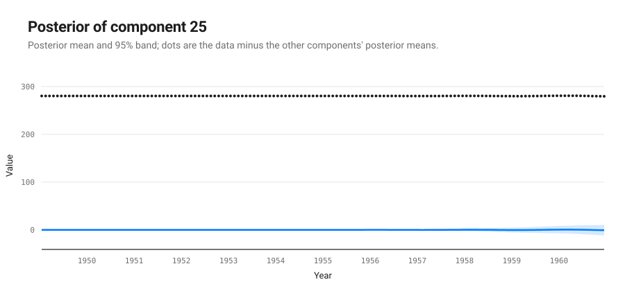

### Component 26: A quadratic polynomial

This component is a quadratic polynomial.

This component explains 0.0% of the data's variance on its own; with the components above it, 99.8%. Adding it changes the cross-validated MAE by -0.0%.

*Extrapolation.* This component is assumed to continue as a quadratic polynomial.

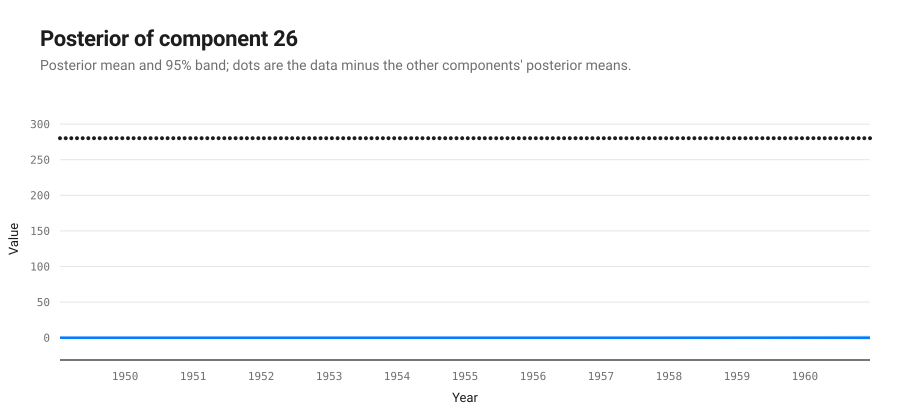

### Component 27: Uncorrelated noise

This component models uncorrelated noise.

This component explains 0.2% of the data's variance on its own; with the components above it, 99.9%. Adding it changes the cross-validated MAE by -0.0%.

*Extrapolation.* This component assumes the uncorrelated noise will continue indefinitely.

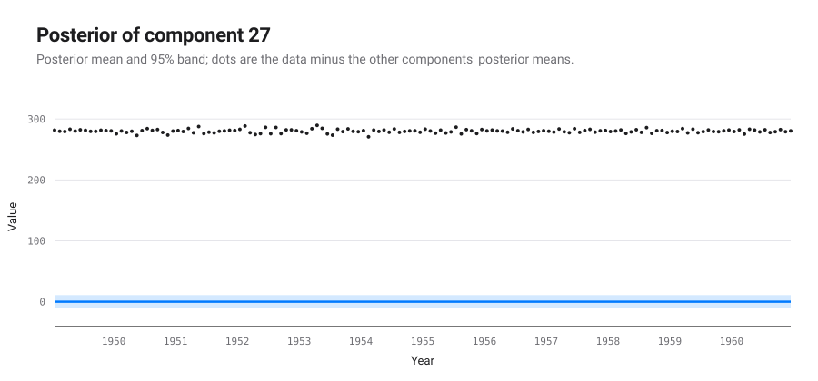

### Component 28: A periodic function with a period of 2.0 years but with quadraticly varying amplitude

This component is periodic with a period of 2.0 years but with varying amplitude. The amplitude of the function varies quadraticly. The shape of this function within each period has a typical lengthscale of 6.2 months.

This component explains -0.0% of the data's variance on its own; with the components above it, 99.9%. Adding it changes the cross-validated MAE by 0.0%.

*Extrapolation.* This component is assumed to continue periodically with a period of 2.0 years but with varying amplitude. The amplitude of the function is assumed to continue to vary quadraticly.

### Component 29: A periodic function with a period of 2.0 years but with quadraticly varying amplitude

This component is periodic with a period of 2.0 years but with varying amplitude. The amplitude of the function varies quadraticly. The shape of this function within each period has a typical lengthscale of 6.2 months.

This component explains 0.0% of the data's variance on its own; with the components above it, 99.9%. Adding it changes the cross-validated MAE by 0.0%.

*Extrapolation.* This component is assumed to continue periodically with a period of 2.0 years but with varying amplitude. The amplitude of the function is assumed to continue to vary quadraticly.

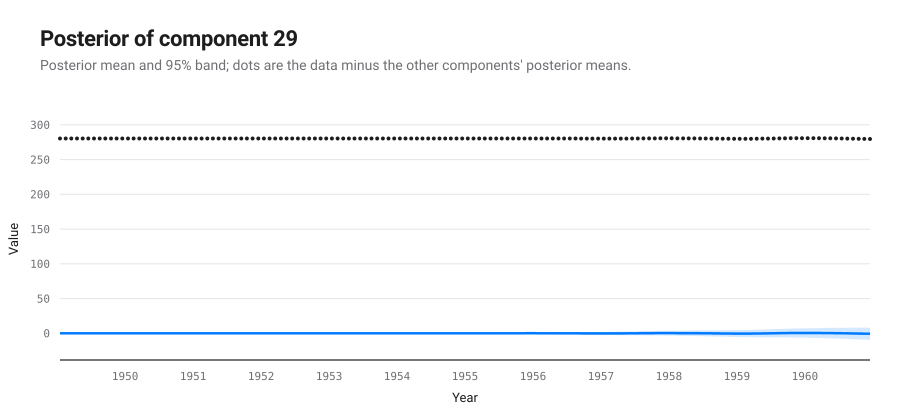

### Component 30: A rough function with quadraticly varying marginal standard deviation

This component is a rough function with a typical lengthscale of 4.5 months. The marginal standard deviation of the function varies quadraticly. Its sample paths are continuous but not differentiable (gamma-exponential exponent 0.96).

This component explains -0.0% of the data's variance on its own; with the components above it, 99.9%. Adding it changes the cross-validated MAE by 0.0%.

*Extrapolation.* This component is assumed to continue roughly but is also assumed to be stationary so its distribution will return to the prior. The prior distribution places mass on rough functions with a marginal mean of zero and a typical lengthscale of 4.5 months. The marginal standard deviation of the function is assumed to continue to vary quadraticly.

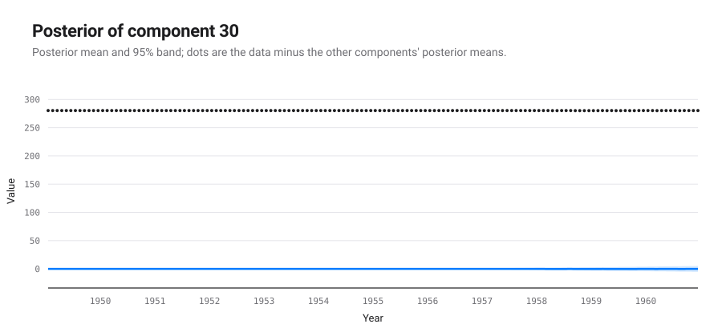

### Component 31: A cubic polynomial

This component is a cubic polynomial.

This component explains -0.0% of the data's variance on its own; with the components above it, 99.9%. Adding it changes the cross-validated MAE by 0.0%.

*Extrapolation.* This component is assumed to continue as a cubic polynomial.

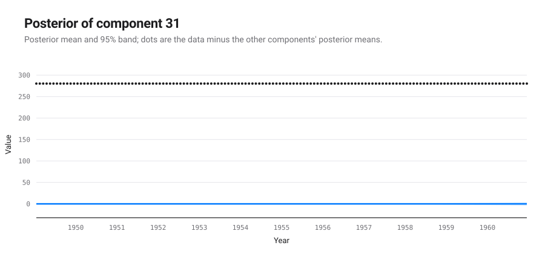

### Component 32: A periodic function with a period of 2.0 years

This component is periodic with a period of 2.0 years. The shape of this function within each period has a typical lengthscale of 6.2 months.

This component explains -0.2% of the data's variance on its own; with the components above it, 99.9%. Adding it changes the cross-validated MAE by 0.0%.

*Extrapolation.* This component is assumed to continue periodically with a period of 2.0 years.

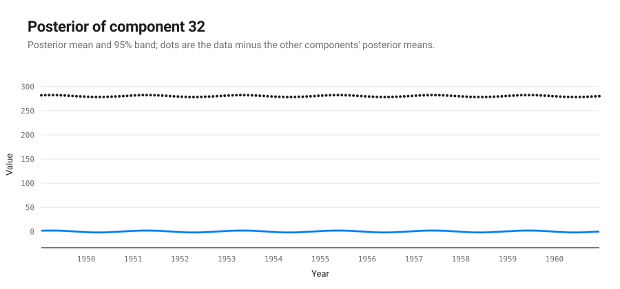

### Component 33: A rough function with marginal standard deviation increasing linearly away from Jul 1954

This component is a rough function with a typical lengthscale of 4.5 months. The marginal standard deviation of the function increases linearly away from Jul 1954. Its sample paths are continuous but not differentiable (gamma-exponential exponent 0.96).

This component explains 0.0% of the data's variance on its own; with the components above it, 99.9%. Adding it changes the cross-validated MAE by 0.0%.

*Extrapolation.* This component is assumed to continue roughly but is also assumed to be stationary so its distribution will return to the prior. The prior distribution places mass on rough functions with a marginal mean of zero and a typical lengthscale of 4.5 months. The marginal standard deviation of the function is assumed to continue to increase linearly.

### Component 34: A periodic function with a period of 2.0 years but with quadraticly varying amplitude

This component is periodic with a period of 2.0 years but with varying amplitude. The amplitude of the function varies quadraticly. The shape of this function within each period has a typical lengthscale of 6.2 months.

This component explains -0.0% of the data's variance on its own; with the components above it, 99.9%. Adding it changes the cross-validated MAE by 0.0%.

*Extrapolation.* This component is assumed to continue periodically with a period of 2.0 years but with varying amplitude. The amplitude of the function is assumed to continue to vary quadraticly.

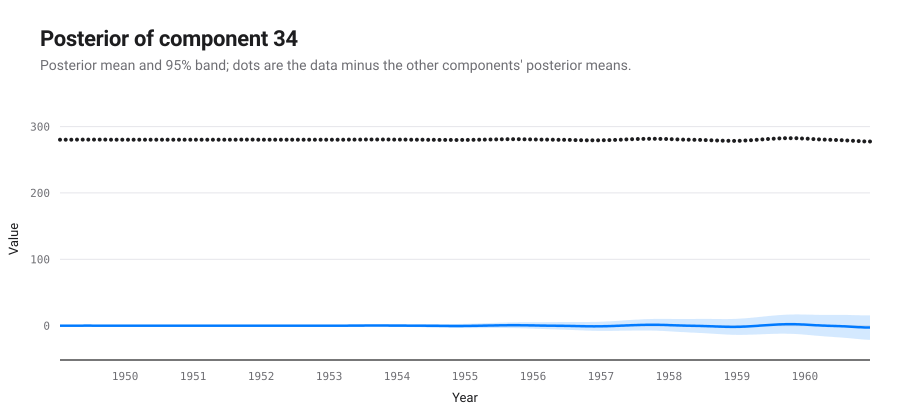

### Component 35: A quartic polynomial

This component is a quartic polynomial.

This component explains -0.0% of the data's variance on its own; with the components above it, 99.9%. Adding it changes the cross-validated MAE by 0.0%.

*Extrapolation.* This component is assumed to continue as a quartic polynomial.

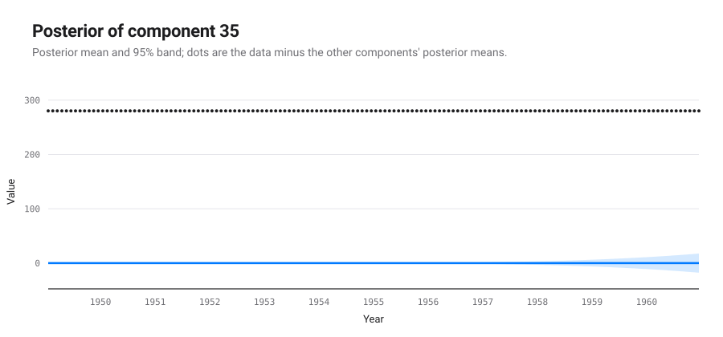

### Component 36: A rough function with quadraticly varying marginal standard deviation

This component is a rough function with a typical lengthscale of 4.5 months. The marginal standard deviation of the function varies quadraticly. Its sample paths are continuous but not differentiable (gamma-exponential exponent 0.96).

This component explains -0.1% of the data's variance on its own; with the components above it, 99.9%. Adding it changes the cross-validated MAE by 0.0%.

*Extrapolation.* This component is assumed to continue roughly but is also assumed to be stationary so its distribution will return to the prior. The prior distribution places mass on rough functions with a marginal mean of zero and a typical lengthscale of 4.5 months. The marginal standard deviation of the function is assumed to continue to vary quadraticly.

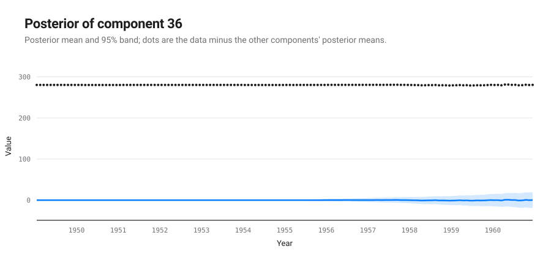

### Component 37: A cubic polynomial

This component is a cubic polynomial.

This component explains -0.1% of the data's variance on its own; with the components above it, 99.9%. Adding it changes the cross-validated MAE by 0.0%.

*Extrapolation.* This component is assumed to continue as a cubic polynomial.

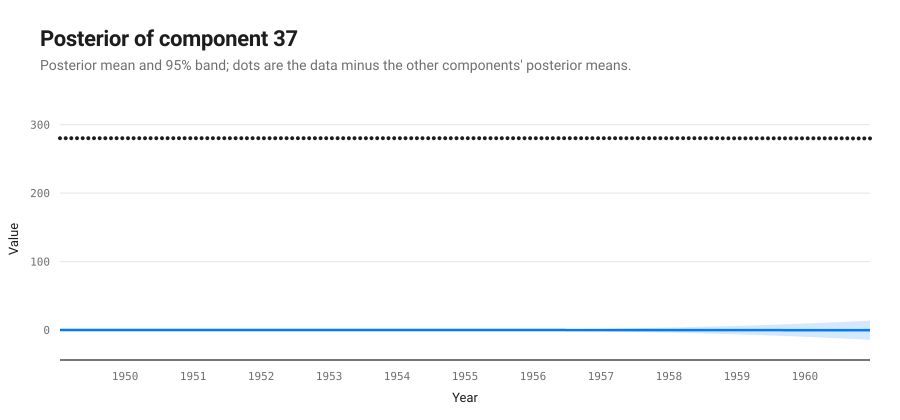

### Component 38: A periodic function with a period of 2.0 years but with amplitude increasing linearly away from Apr 1950

This component is periodic with a period of 2.0 years but with varying amplitude. The amplitude of the function increases linearly away from Apr 1950. The shape of this function within each period has a typical lengthscale of 6.2 months.

This component explains -0.1% of the data's variance on its own; with the components above it, 99.9%. Adding it changes the cross-validated MAE by 0.0%.

*Extrapolation.* This component is assumed to continue periodically with a period of 2.0 years but with varying amplitude. The amplitude of the function is assumed to continue to increase linearly.

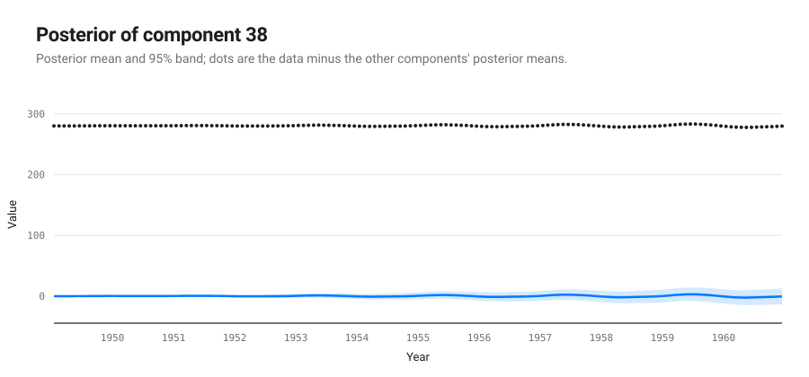

### Component 39: A rough function with cubicly varying marginal standard deviation

This component is a rough function with a typical lengthscale of 4.5 months. The marginal standard deviation of the function varies cubicly. Its sample paths are continuous but not differentiable (gamma-exponential exponent 0.96).

This component explains -0.1% of the data's variance on its own; with the components above it, 99.9%. Adding it changes the cross-validated MAE by 0.1%.

*Extrapolation.* This component is assumed to continue roughly but is also assumed to be stationary so its distribution will return to the prior. The prior distribution places mass on rough functions with a marginal mean of zero and a typical lengthscale of 4.5 months. The marginal standard deviation of the function is assumed to continue to vary cubicly.

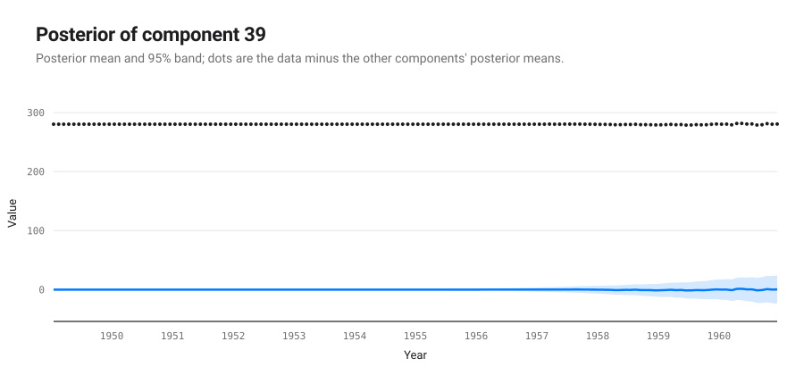

### Component 40: A cubic polynomial

This component is a cubic polynomial.

This component explains -0.2% of the data's variance on its own; with the components above it, 99.9%. Adding it changes the cross-validated MAE by 0.1%.

*Extrapolation.* This component is assumed to continue as a cubic polynomial.

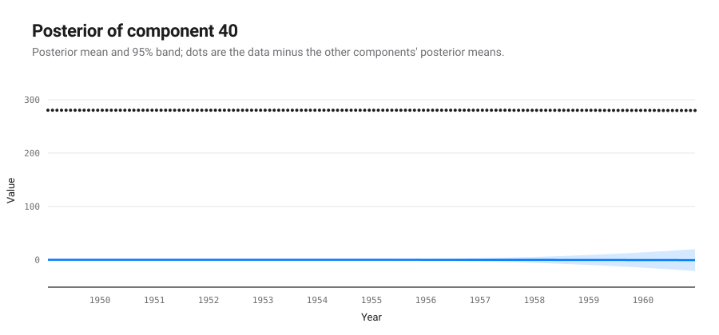

### Component 41: A rough function with quadraticly varying marginal standard deviation

This component is a rough function with a typical lengthscale of 4.5 months. The marginal standard deviation of the function varies quadraticly. Its sample paths are continuous but not differentiable (gamma-exponential exponent 0.96).

This component explains -0.5% of the data's variance on its own; with the components above it, 100.0%. Adding it changes the cross-validated MAE by 0.1%.

*Extrapolation.* This component is assumed to continue roughly but is also assumed to be stationary so its distribution will return to the prior. The prior distribution places mass on rough functions with a marginal mean of zero and a typical lengthscale of 4.5 months. The marginal standard deviation of the function is assumed to continue to vary quadraticly.

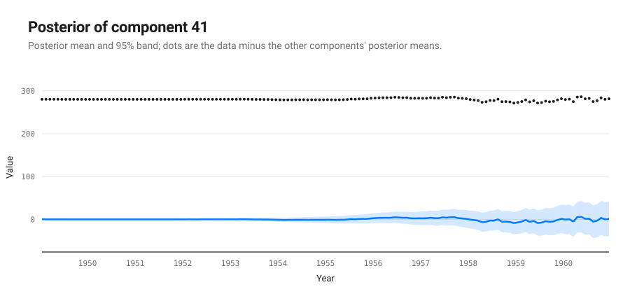

### Component 42: A cubic polynomial

This component is a cubic polynomial.

This component explains -0.3% of the data's variance on its own; with the components above it, 100.0%. Adding it changes the cross-validated MAE by 0.1%.

*Extrapolation.* This component is assumed to continue as a cubic polynomial.

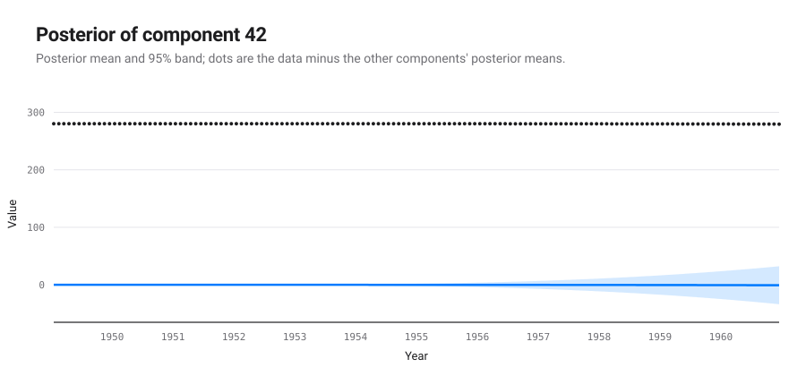

### Component 43: A constant

This component is constant.

This component explains -0.0% of the data's variance on its own; with the components above it, 100.0%. Adding it changes the cross-validated MAE by 79.2%.

*Extrapolation.* This component is assumed to stay constant.

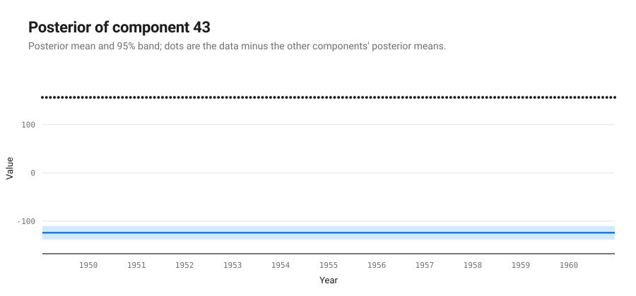

## Model checking

Each statistic compares draws of a component's posterior with draws of its prior. A small p-value (bold below 0.05) points at a property of the data that the component's prior does not reproduce.

| # | QQ max | QQ min | ACF min | ACF min lag | Periodogram max | Periodogram peak | MMD |
|---|---|---|---|---|---|---|---|
| 1 | 0.808 | 0.582 | 0.982 | 0.988 | 0.960 | 0.974 | **0.000** |
| 2 | 0.778 | 0.698 | 0.972 | 0.968 | 0.972 | 0.998 | **0.000** |
| 3 | 0.470 | 0.640 | 0.978 | 0.994 | 0.880 | 0.998 | **0.000** |
| 4 | 0.974 | 0.934 | 0.988 | 0.970 | 0.954 | 0.980 | 0.525 |
| 5 | 1.000 | 0.956 | 0.936 | 0.984 | 0.950 | 0.904 | 0.345 |
| 6 | 0.968 | 0.946 | 0.920 | 0.948 | 0.978 | 0.980 | **0.013** |
| 7 | 0.996 | 0.980 | 0.980 | 0.990 | 0.956 | 0.954 | 0.176 |
| 8 | 0.452 | 0.616 | 0.492 | 0.894 | 0.728 | 0.620 | **0.002** |
| 9 | 0.560 | 0.388 | 0.986 | 0.826 | 0.780 | 0.686 | 0.168 |
| 10 | 0.938 | 0.742 | 0.944 | 0.984 | 0.712 | 0.724 | **0.000** |
| 11 | 0.946 | 0.946 | 0.874 | 0.996 | 0.982 | 0.954 | 0.532 |
| 12 | 0.938 | 0.994 | 0.958 | 0.980 | 0.962 | 1.000 | 0.922 |
| 13 | 0.996 | 0.990 | 0.992 | 0.990 | 0.972 | 0.938 | 0.366 |
| 14 | 0.936 | 0.958 | 0.966 | 0.962 | 0.936 | 0.982 | **0.007** |
| 15 | 0.980 | 0.966 | 0.998 | 0.996 | 0.976 | 0.974 | 0.800 |
| 16 | 0.986 | 0.976 | 0.996 | 0.982 | 0.964 | 0.990 | 0.413 |
| 17 | 0.980 | 0.986 | 0.970 | 0.982 | 0.986 | 0.992 | 0.277 |
| 18 | 0.974 | 0.980 | 0.962 | 0.998 | 0.994 | 0.990 | 0.540 |
| 19 | 0.900 | 0.942 | 0.966 | 0.996 | 0.982 | 0.982 | 0.701 |
| 20 | 0.968 | 0.992 | 0.942 | 0.958 | 0.968 | 0.952 | 0.551 |
| 21 | 0.978 | 0.980 | 0.994 | 0.940 | 0.968 | 0.942 | 0.803 |
| 22 | 0.986 | 0.948 | 0.990 | 0.944 | 0.996 | 0.984 | 0.159 |
| 23 | 0.916 | 0.928 | 0.990 | 0.972 | 0.974 | 0.988 | 0.504 |
| 24 | 0.996 | 0.990 | 0.974 | 0.990 | 0.988 | 0.980 | 0.339 |
| 25 | 0.954 | 0.988 | 0.966 | 0.992 | 0.978 | 0.976 | 0.692 |
| 26 | 0.990 | 0.992 | 0.974 | 0.994 | 0.980 | 0.962 | 0.434 |
| 27 | 0.946 | 0.950 | 0.944 | 0.974 | 0.942 | 0.968 | 0.353 |
| 28 | 0.980 | 0.992 | 0.950 | 0.982 | 0.984 | 0.968 | 0.916 |
| 29 | 0.962 | 0.954 | 0.998 | 0.954 | 0.986 | 0.922 | 0.777 |
| 30 | 0.970 | 0.994 | 0.994 | 0.966 | 0.998 | 0.990 | 0.433 |
| 31 | 0.956 | 0.966 | 0.982 | 0.976 | 0.990 | 1.000 | 0.918 |
| 32 | 0.900 | 0.850 | 0.912 | 0.996 | 0.828 | 0.880 | 0.533 |
| 33 | 0.998 | 0.996 | 0.982 | 0.986 | 0.986 | 0.998 | 0.125 |
| 34 | 0.992 | 0.976 | 0.920 | 0.936 | 0.836 | 0.998 | 0.653 |
| 35 | 0.974 | 0.940 | 0.968 | 0.998 | 0.992 | 0.988 | 0.232 |
| 36 | 0.982 | 0.950 | 0.956 | 0.984 | 0.968 | 0.998 | 0.093 |
| 37 | 0.970 | 0.960 | 0.976 | 0.982 | 0.996 | 0.972 | 0.553 |
| 38 | 0.876 | 0.890 | 0.842 | 0.990 | 0.714 | 0.970 | 0.542 |
| 39 | 0.996 | 0.984 | 0.978 | 0.980 | 0.986 | 0.976 | 0.558 |
| 40 | 0.986 | 0.944 | 0.972 | 0.990 | 0.996 | 0.954 | 0.051 |
| 41 | 0.976 | 0.870 | 0.992 | 0.954 | 0.884 | 0.936 | 0.164 |
| 42 | 0.918 | 0.994 | 0.972 | 0.976 | 0.984 | 0.948 | 0.207 |
| 43 | 0.358 | 0.358 | 0.868 | 0.914 | 0.802 | 0.982 | **0.000** |

QQ: quantile-quantile gaps. ACF: autocorrelation function. MMD: maximum mean discrepancy two-sample test.
