# An automatic report for the dataset: airline passengers, structure 2 of the posterior

*Produced by `autostat` (automatic-statistician-revisited), a Python 3 port of the Automatic Bayesian Covariance Discovery system of Lloyd et al. (AAAI 2014).*

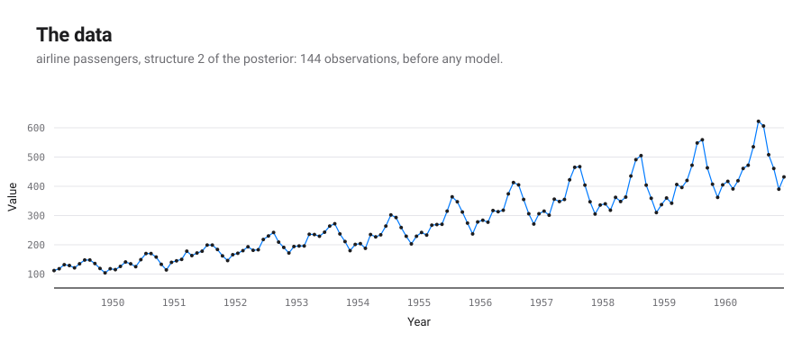

## Executive summary

With posterior weight 0.276, AutoGP kept `WN + (C + Lin + Lin + Per + GE x (C + Lin)) x (C + Lin) x (C + Lin)` (Bayesian information criterion 1207.1; negative log likelihood 558.8 on 144 points). It decomposes into 25 additive components, listed by how much each reduces extrapolation error:

1. A linearly increasing function.
2. A quadratic polynomial.
3. A linearly increasing function.
4. A quadratic polynomial.
5. A linearly increasing function.
6. A quadratic polynomial.
7. A rough function with marginal standard deviation increasing linearly away from Dec 1950.
8. A cubic polynomial.
9. A quadratic polynomial.
10. A quadratic polynomial.
11. A rough function with marginal standard deviation increasing linearly away from Nov 1951.
12. A periodic function with a period of 1.0 years.
13. A rough function with quadraticly varying marginal standard deviation.
14. A periodic function with a period of 1.0 years but with quadraticly varying amplitude.
15. A periodic function with a period of 1.0 years but with amplitude increasing linearly away from Dec 1950.
16. A rough function with quadraticly varying marginal standard deviation.
17. A rough function with marginal standard deviation increasing linearly away from Aug 1953.
18. A periodic function with a period of 1.0 years but with amplitude increasing linearly away from Nov 1951.
19. A rough function with quadraticly varying marginal standard deviation.
20. Uncorrelated noise.
21. A rough function with cubicly varying marginal standard deviation.
22. A cubic polynomial.
23. A rough function.
24. A linearly increasing function.
25. A constant.

| # | R² cumulative (%) | Residual variance explained (%) | Cross-validated MAE | MAE reduction (%) |
|---|---|---|---|---|
| data | | | 280 | |
| 1 | 49.3 | 49.3 | 234 | 16.5 |
| 2 | 69.0 | 38.7 | 213 | 9.1 |
| 3 | 81.1 | 39.2 | 193 | 9.5 |
| 4 | 82.4 | 6.7 | 190 | 1.6 |
| 5 | 85.4 | 17.1 | 187 | 1.4 |
| 6 | 85.5 | 1.0 | 186 | 0.7 |
| 7 | 85.9 | 2.2 | 185 | 0.5 |
| 8 | 85.9 | 0.6 | 184 | 0.5 |
| 9 | 86.0 | 0.6 | 183 | 0.4 |
| 10 | 86.1 | 0.6 | 182 | 0.4 |
| 11 | 86.2 | 0.7 | 182 | 0.2 |
| 12 | 93.0 | 49.3 | 182 | 0.2 |
| 13 | 93.1 | 0.8 | 181 | 0.2 |
| 14 | 96.8 | 53.9 | 181 | 0.1 |
| 15 | 99.2 | 76.3 | 181 | 0.1 |
| 16 | 99.3 | 4.8 | 181 | 0.1 |
| 17 | 99.3 | 9.6 | 181 | 0.1 |
| 18 | 99.5 | 29.1 | 180 | 0.1 |
| 19 | 99.5 | 2.4 | 180 | 0.0 |
| 20 | 99.7 | 37.6 | 180 | 0.0 |
| 21 | 99.7 | 1.7 | 181 | -0.0 |
| 22 | 99.7 | 9.2 | 181 | -0.2 |
| 23 | 99.9 | 67.9 | 182 | -0.6 |
| 24 | 100.0 | 100.0 | 192 | -5.5 |
| 25 | 100.0 | -4.7 | 281 | -46.5 |

MAE: mean absolute error over ten contiguous held-out blocks.

## The formula found

The structure search is a symbolic regression: it searches a grammar of expressions over kernels and keeps the one with the lowest Bayesian information criterion. This is the expression it kept, with every fitted parameter in place; $t$ is in years.

$$y(t) = 280.3 + f_{1}(t) + f_{2}(t) + f_{3}(t) + f_{4}(t) + f_{5}(t) + f_{6}(t) + f_{7}(t) + f_{8}(t) + f_{9}(t) + f_{10}(t) + f_{11}(t) + f_{12}(t) + f_{13}(t) + f_{14}(t) + f_{15}(t) + f_{16}(t) + f_{17}(t) + f_{18}(t) + f_{19}(t) + f_{20}(t) + f_{21}(t) + f_{22}(t) + f_{23}(t) + f_{24}(t) + f_{25}(t)$$

Each component is a Gaussian process with its own covariance:

$$f_{1}(t) \sim \mathrm{GP}\!\left(0,\ 62.76\,(t - 1951)(t' - 1951)\right)$$

$$f_{2}(t) \sim \mathrm{GP}\!\left(0,\ 0.8172\,(t - 1951)(t' - 1951) \cdot (t - 1952)(t' - 1952)\right)$$

$$f_{3}(t) \sim \mathrm{GP}\!\left(0,\ 30.82\,(t - 1952)(t' - 1952)\right)$$

$$f_{4}(t) \sim \mathrm{GP}\!\left(0,\ 0.3222\,(t - 1954)(t' - 1954) \cdot (t - 1951)(t' - 1951)\right)$$

$$f_{5}(t) \sim \mathrm{GP}\!\left(0,\ 12.15\,(t - 1954)(t' - 1954)\right)$$

$$f_{6}(t) \sim \mathrm{GP}\!\left(0,\ 0.03642\,(t - 1965)(t' - 1965) \cdot (t - 1951)(t' - 1951)\right)$$

$$f_{7}(t) \sim \mathrm{GP}\!\left(0,\ 1.937\,\exp\!\left(-\left(\frac{|t - t'|}{5.643}\right)^{0.6898}\right) \cdot (t - 1951)(t' - 1951)\right)$$

$$f_{8}(t) \sim \mathrm{GP}\!\left(0,\ 4.742 \times 10^{-4}\,(t - 1951)(t' - 1951) \cdot (t - 1965)(t' - 1965) \cdot (t - 1952)(t' - 1952)\right)$$

$$f_{9}(t) \sim \mathrm{GP}\!\left(0,\ 0.1582\,(t - 1954)(t' - 1954) \cdot (t - 1952)(t' - 1952)\right)$$

$$f_{10}(t) \sim \mathrm{GP}\!\left(0,\ 0.01789\,(t - 1965)(t' - 1965) \cdot (t - 1952)(t' - 1952)\right)$$

$$f_{11}(t) \sim \mathrm{GP}\!\left(0,\ 0.951\,\exp\!\left(-\left(\frac{|t - t'|}{5.643}\right)^{0.6898}\right) \cdot (t - 1952)(t' - 1952)\right)$$

$$f_{12}(t) \sim \mathrm{GP}\!\left(0,\ 660.9\,\frac{\exp\!\left(4.213\cos\frac{2\pi (t - t')}{0.9981}\right) - I_0(4.213)}{e^{4.213} - I_0(4.213)}\right)$$

$$f_{13}(t) \sim \mathrm{GP}\!\left(0,\ 0.02522\,\exp\!\left(-\left(\frac{|t - t'|}{5.643}\right)^{0.6898}\right) \cdot (t - 1951)(t' - 1951) \cdot (t - 1952)(t' - 1952)\right)$$

$$f_{14}(t) \sim \mathrm{GP}\!\left(0,\ 0.2282\,(t - 1951)(t' - 1951) \cdot (t - 1952)(t' - 1952) \cdot \frac{\exp\!\left(4.213\cos\frac{2\pi (t - t')}{0.9981}\right) - I_0(4.213)}{e^{4.213} - I_0(4.213)}\right)$$

$$f_{15}(t) \sim \mathrm{GP}\!\left(0,\ 17.53\,(t - 1951)(t' - 1951) \cdot \frac{\exp\!\left(4.213\cos\frac{2\pi (t - t')}{0.9981}\right) - I_0(4.213)}{e^{4.213} - I_0(4.213)}\right)$$

$$f_{16}(t) \sim \mathrm{GP}\!\left(0,\ 0.03018\,\exp\!\left(-\left(\frac{|t - t'|}{5.643}\right)^{0.6898}\right) \cdot (t - 1951)(t' - 1951) \cdot (t - 1954)(t' - 1954)\right)$$

$$f_{17}(t) \sim \mathrm{GP}\!\left(0,\ 1.138\,\exp\!\left(-\left(\frac{|t - t'|}{5.643}\right)^{0.6898}\right) \cdot (t - 1954)(t' - 1954)\right)$$

$$f_{18}(t) \sim \mathrm{GP}\!\left(0,\ 8.605\,(t - 1952)(t' - 1952) \cdot \frac{\exp\!\left(4.213\cos\frac{2\pi (t - t')}{0.9981}\right) - I_0(4.213)}{e^{4.213} - I_0(4.213)}\right)$$

$$f_{19}(t) \sim \mathrm{GP}\!\left(0,\ 0.01482\,\exp\!\left(-\left(\frac{|t - t'|}{5.643}\right)^{0.6898}\right) \cdot (t - 1954)(t' - 1954) \cdot (t - 1952)(t' - 1952)\right)$$

$$f_{20}(t) \sim \mathrm{GP}\!\left(0,\ 32.15\,\delta_{t t'}\right)$$

$$f_{21}(t) \sim \mathrm{GP}\!\left(0,\ 3.93 \times 10^{-4}\,\exp\!\left(-\left(\frac{|t - t'|}{5.643}\right)^{0.6898}\right) \cdot (t - 1951)(t' - 1951) \cdot (t - 1954)(t' - 1954) \cdot (t - 1952)(t' - 1952)\right)$$

$$f_{22}(t) \sim \mathrm{GP}\!\left(0,\ 0.004195\,(t - 1951)(t' - 1951) \cdot (t - 1954)(t' - 1954) \cdot (t - 1952)(t' - 1952)\right)$$

$$f_{23}(t) \sim \mathrm{GP}\!\left(0,\ 73.04\,\exp\!\left(-\left(\frac{|t - t'|}{5.643}\right)^{0.6898}\right)\right)$$

$$f_{24}(t) \sim \mathrm{GP}\!\left(0,\ 1.374\,(t - 1965)(t' - 1965)\right)$$

$$f_{25}(t) \sim \mathrm{GP}\!\left(0,\ 2367\right)$$

Polynomial and periodic components have a closed form, read from their posterior mean:

$$f_{1}(t) = -21.47 + 11.17\,(t - 1949)$$

$$f_{2}(t) = 4.821 - 4.206\,(t - 1949) + 0.8831\,(t - 1949)^{2}$$

$$f_{3}(t) = -18.64 + 6.559\,(t - 1949)$$

$$f_{4}(t) = 2.125 - 1.514\,(t - 1949) + 0.2124\,(t - 1949)^{2}$$

$$f_{5}(t) = -19.13 + 3.672\,(t - 1949)$$

$$f_{6}(t) = -1.449 + 0.8439\,(t - 1949) - 0.04677\,(t - 1949)^{2}$$

$$f_{8}(t) = 0.4651 - 0.4346\,(t - 1949) + 0.1103\,(t - 1949)^{2} - 0.005283\,(t - 1949)^{3}$$

$$f_{9}(t) = 0.892 - 0.4851\,(t - 1949) + 0.06024\,(t - 1949)^{2}$$

$$f_{10}(t) = -1.592 + 0.6587\,(t - 1949) - 0.03473\,(t - 1949)^{2}$$

$$f_{12}(t) \approx 19.82\cos\!\left(\frac{2\pi \cdot (t - 1949)}{0.9981} - 3.112\right) + 12.81\cos\!\left(\frac{2\pi \cdot 2 \cdot (t - 1949)}{0.9981} - 1.541\right) + 4.908\cos\!\left(\frac{2\pi \cdot 3 \cdot (t - 1949)}{0.9981} + 1.252\right) + 5.664\cos\!\left(\frac{2\pi \cdot 4 \cdot (t - 1949)}{0.9981} + 0.2723\right) + 2.459\cos\!\left(\frac{2\pi \cdot 5 \cdot (t - 1949)}{0.9981} - 0.08673\right) + 0.3101\cos\!\left(\frac{2\pi \cdot 6 \cdot (t - 1949)}{0.9981} + 1.735\right) + 0.437\cos\!\left(\frac{2\pi \cdot 7 \cdot (t - 1949)}{0.9981} + 2.349\right) + 0.1038\cos\!\left(\frac{2\pi \cdot 8 \cdot (t - 1949)}{0.9981} + 1.763\right)$$

$$f_{22}(t) = -0.07817 + 0.0832\,(t - 1949) - 0.02741\,(t - 1949)^{2} + 0.002748\,(t - 1949)^{3}$$

$$f_{24}(t) = -15.82 + 0.9813\,(t - 1949)$$

$$f_{25}(t) = -89.38$$

A periodic kernel is exactly a sum of cosines, so a periodic component is a Fourier series in its period; it is written up to the harmonic after which the rest weighs less than 0.1 % of the component, hence the approximate sign.

The other components are smooth, quasi-periodic or noise: a draw from such a process has no finite closed form; its covariance above is the formula.

Closed form of each component:

| # | component | closed form |
|---|---|---|
| 1 | A linearly increasing function | exact polynomial of degree 1 |
| 2 | A quadratic polynomial | exact polynomial of degree 2 |
| 3 | A linearly increasing function | exact polynomial of degree 1 |
| 4 | A quadratic polynomial | exact polynomial of degree 2 |
| 5 | A linearly increasing function | exact polynomial of degree 1 |
| 6 | A quadratic polynomial | exact polynomial of degree 2 |
| 7 | A rough function with marginal standard deviation increasing linearly away from Dec 1950 | none: the covariance is the formula |
| 8 | A cubic polynomial | exact polynomial of degree 3 |
| 9 | A quadratic polynomial | exact polynomial of degree 2 |
| 10 | A quadratic polynomial | exact polynomial of degree 2 |
| 11 | A rough function with marginal standard deviation increasing linearly away from Nov 1951 | none: the covariance is the formula |
| 12 | A periodic function with a period of 1.0 years | Fourier series, 8 harmonics, largest gap 0.017 % of the component |
| 13 | A rough function with quadraticly varying marginal standard deviation | none: the covariance is the formula |
| 14 | A periodic function with a period of 1.0 years but with quadraticly varying amplitude | none: the covariance is the formula |
| 15 | A periodic function with a period of 1.0 years but with amplitude increasing linearly away from Dec 1950 | none: the covariance is the formula |
| 16 | A rough function with quadraticly varying marginal standard deviation | none: the covariance is the formula |
| 17 | A rough function with marginal standard deviation increasing linearly away from Aug 1953 | none: the covariance is the formula |
| 18 | A periodic function with a period of 1.0 years but with amplitude increasing linearly away from Nov 1951 | none: the covariance is the formula |
| 19 | A rough function with quadraticly varying marginal standard deviation | none: the covariance is the formula |
| 20 | Uncorrelated noise | none: the covariance is the formula |
| 21 | A rough function with cubicly varying marginal standard deviation | none: the covariance is the formula |
| 22 | A cubic polynomial | exact polynomial of degree 3 |
| 23 | A rough function | none: the covariance is the formula |
| 24 | A linearly increasing function | exact polynomial of degree 1 |
| 25 | A constant | exact polynomial of degree 0 |

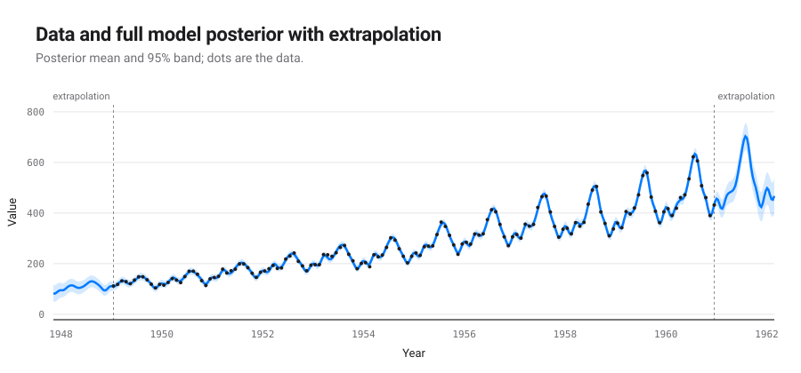

## Detailed discussion of the components

### Component 1: A linearly increasing function

This component is linearly increasing.

This component explains 49.3% of the data's variance on its own; with the components above it, 49.3%. Adding it changes the cross-validated MAE by -16.5%.

*Extrapolation.* This component is assumed to continue to increase linearly.

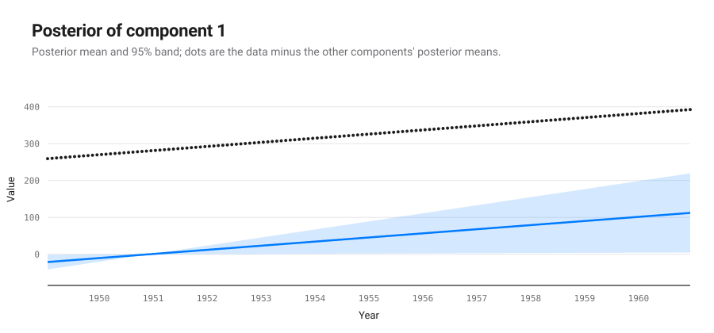

### Component 2: A quadratic polynomial

This component is a quadratic polynomial.

This component explains 31.6% of the data's variance on its own; with the components above it, 69.0%. Adding it changes the cross-validated MAE by -9.1%.

*Extrapolation.* This component is assumed to continue as a quadratic polynomial.

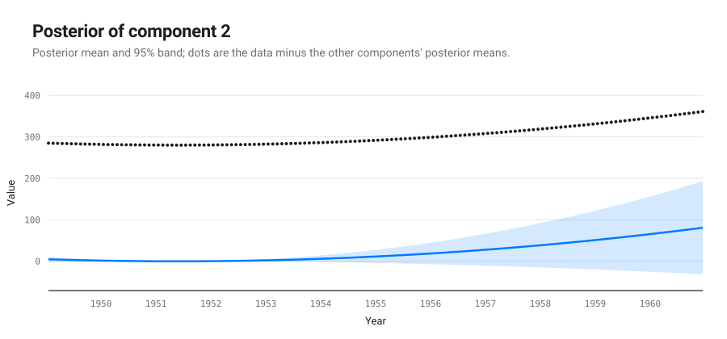

### Component 3: A linearly increasing function

This component is linearly increasing.

This component explains 31.5% of the data's variance on its own; with the components above it, 81.1%. Adding it changes the cross-validated MAE by -9.5%.

*Extrapolation.* This component is assumed to continue to increase linearly.

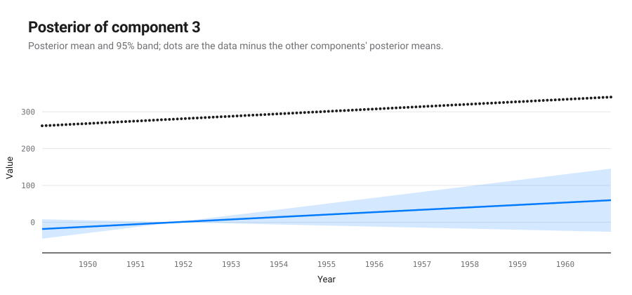

### Component 4: A quadratic polynomial

This component is a quadratic polynomial.

This component explains 5.8% of the data's variance on its own; with the components above it, 82.4%. Adding it changes the cross-validated MAE by -1.6%.

*Extrapolation.* This component is assumed to continue as a quadratic polynomial.

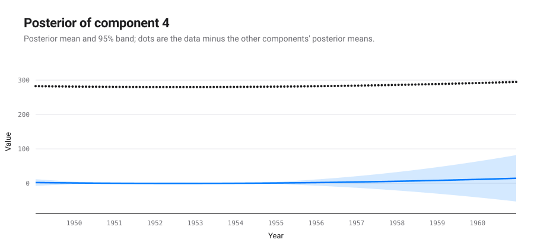

### Component 5: A linearly increasing function

This component is linearly increasing.

This component explains 18.5% of the data's variance on its own; with the components above it, 85.4%. Adding it changes the cross-validated MAE by -1.4%.

*Extrapolation.* This component is assumed to continue to increase linearly.

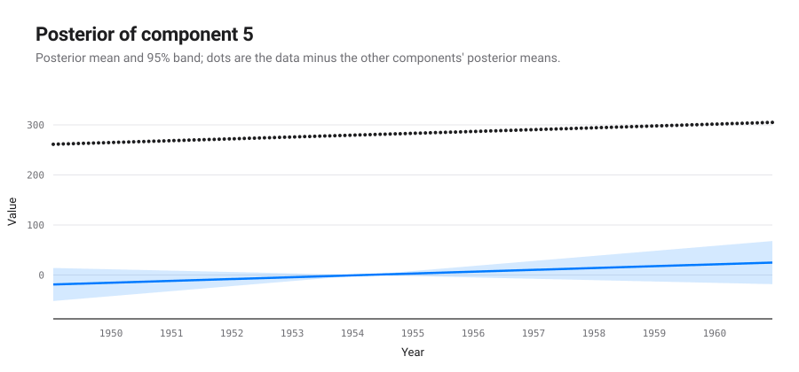

### Component 6: A quadratic polynomial

This component is a quadratic polynomial.

This component explains 1.4% of the data's variance on its own; with the components above it, 85.5%. Adding it changes the cross-validated MAE by -0.7%.

*Extrapolation.* This component is assumed to continue as a quadratic polynomial.

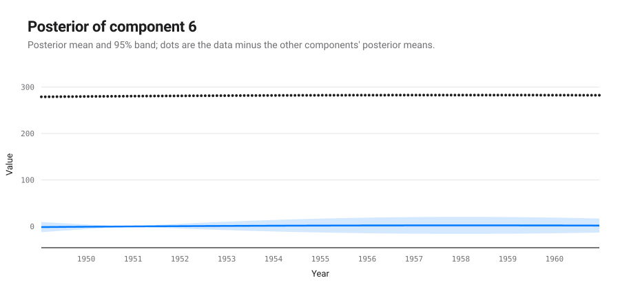

### Component 7: A rough function with marginal standard deviation increasing linearly away from Dec 1950

This component is a rough function with a typical lengthscale of 2.1 years. The marginal standard deviation of the function increases linearly away from Dec 1950. Its sample paths are continuous but not differentiable (gamma-exponential exponent 0.69).

This component explains 1.3% of the data's variance on its own; with the components above it, 85.9%. Adding it changes the cross-validated MAE by -0.5%.

*Extrapolation.* This component is assumed to continue roughly but is also assumed to be stationary so its distribution will return to the prior. The prior distribution places mass on rough functions with a marginal mean of zero and a typical lengthscale of 2.1 years. The marginal standard deviation of the function is assumed to continue to increase linearly.

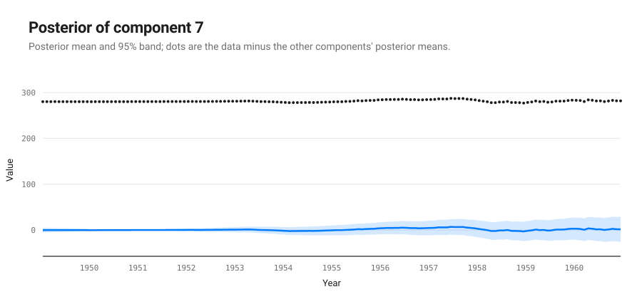

### Component 8: A cubic polynomial

This component is a cubic polynomial.

This component explains 1.1% of the data's variance on its own; with the components above it, 85.9%. Adding it changes the cross-validated MAE by -0.5%.

*Extrapolation.* This component is assumed to continue as a cubic polynomial.

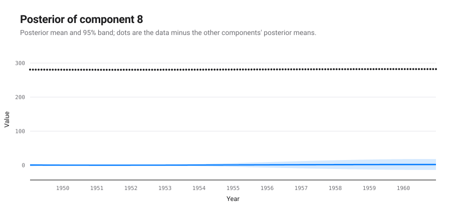

### Component 9: A quadratic polynomial

This component is a quadratic polynomial.

This component explains 1.4% of the data's variance on its own; with the components above it, 86.0%. Adding it changes the cross-validated MAE by -0.4%.

*Extrapolation.* This component is assumed to continue as a quadratic polynomial.

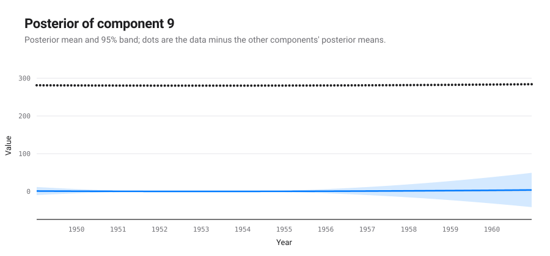

### Component 10: A quadratic polynomial

This component is a quadratic polynomial.

This component explains 1.2% of the data's variance on its own; with the components above it, 86.1%. Adding it changes the cross-validated MAE by -0.4%.

*Extrapolation.* This component is assumed to continue as a quadratic polynomial.

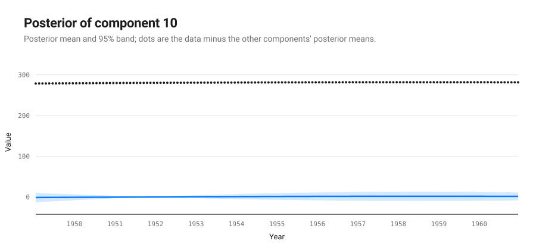

### Component 11: A rough function with marginal standard deviation increasing linearly away from Nov 1951

This component is a rough function with a typical lengthscale of 2.1 years. The marginal standard deviation of the function increases linearly away from Nov 1951. Its sample paths are continuous but not differentiable (gamma-exponential exponent 0.69).

This component explains 0.6% of the data's variance on its own; with the components above it, 86.2%. Adding it changes the cross-validated MAE by -0.2%.

*Extrapolation.* This component is assumed to continue roughly but is also assumed to be stationary so its distribution will return to the prior. The prior distribution places mass on rough functions with a marginal mean of zero and a typical lengthscale of 2.1 years. The marginal standard deviation of the function is assumed to continue to increase linearly.

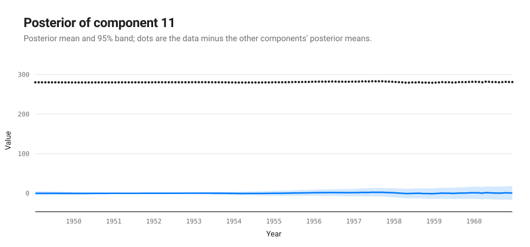

### Component 12: A periodic function with a period of 1.0 years

This component is periodic with a period of 1.0 years. The shape of this function within each period has a typical lengthscale of 4.0 weeks.

This component explains 6.4% of the data's variance on its own; with the components above it, 93.0%. Adding it changes the cross-validated MAE by -0.2%.

*Extrapolation.* This component is assumed to continue periodically with a period of 1.0 years.

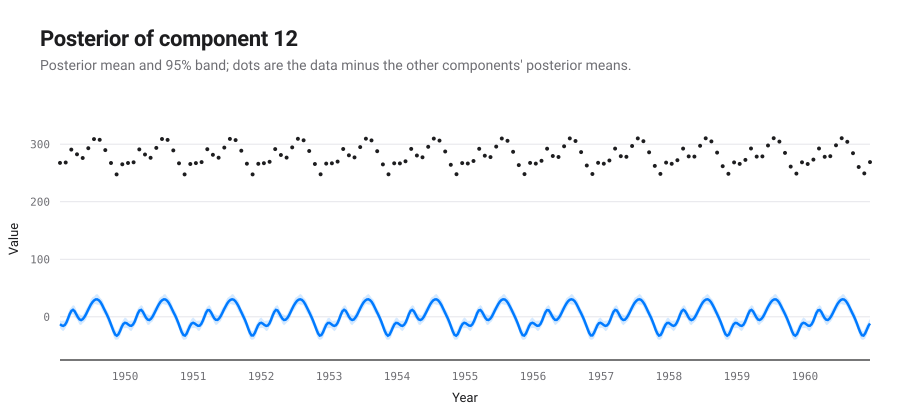

### Component 13: A rough function with quadraticly varying marginal standard deviation

This component is a rough function with a typical lengthscale of 2.1 years. The marginal standard deviation of the function varies quadraticly. Its sample paths are continuous but not differentiable (gamma-exponential exponent 0.69).

This component explains 0.4% of the data's variance on its own; with the components above it, 93.1%. Adding it changes the cross-validated MAE by -0.2%.

*Extrapolation.* This component is assumed to continue roughly but is also assumed to be stationary so its distribution will return to the prior. The prior distribution places mass on rough functions with a marginal mean of zero and a typical lengthscale of 2.1 years. The marginal standard deviation of the function is assumed to continue to vary quadraticly.

### Component 14: A periodic function with a period of 1.0 years but with quadraticly varying amplitude

This component is periodic with a period of 1.0 years but with varying amplitude. The amplitude of the function varies quadraticly. The shape of this function within each period has a typical lengthscale of 4.0 weeks.

This component explains 5.5% of the data's variance on its own; with the components above it, 96.8%. Adding it changes the cross-validated MAE by -0.1%.

*Extrapolation.* This component is assumed to continue periodically with a period of 1.0 years but with varying amplitude. The amplitude of the function is assumed to continue to vary quadraticly.

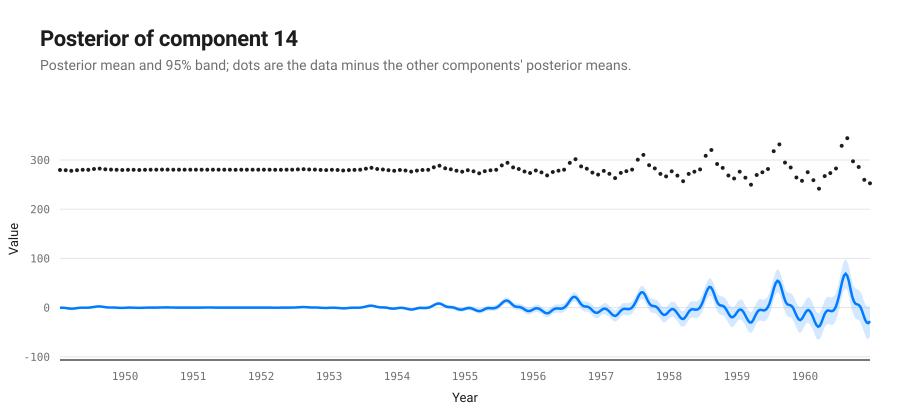

### Component 15: A periodic function with a period of 1.0 years but with amplitude increasing linearly away from Dec 1950

This component is periodic with a period of 1.0 years but with varying amplitude. The amplitude of the function increases linearly away from Dec 1950. The shape of this function within each period has a typical lengthscale of 4.0 weeks.

This component explains 6.8% of the data's variance on its own; with the components above it, 99.2%. Adding it changes the cross-validated MAE by -0.1%.

*Extrapolation.* This component is assumed to continue periodically with a period of 1.0 years but with varying amplitude. The amplitude of the function is assumed to continue to increase linearly.

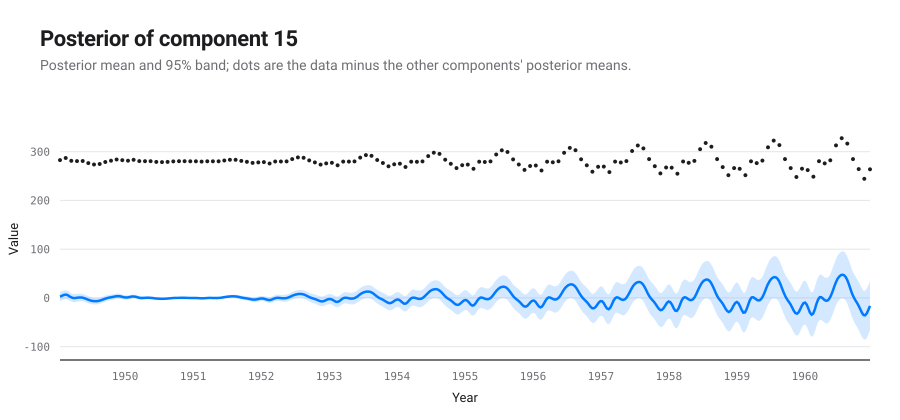

### Component 16: A rough function with quadraticly varying marginal standard deviation

This component is a rough function with a typical lengthscale of 2.1 years. The marginal standard deviation of the function varies quadraticly. Its sample paths are continuous but not differentiable (gamma-exponential exponent 0.69).

This component explains 0.2% of the data's variance on its own; with the components above it, 99.3%. Adding it changes the cross-validated MAE by -0.1%.

*Extrapolation.* This component is assumed to continue roughly but is also assumed to be stationary so its distribution will return to the prior. The prior distribution places mass on rough functions with a marginal mean of zero and a typical lengthscale of 2.1 years. The marginal standard deviation of the function is assumed to continue to vary quadraticly.

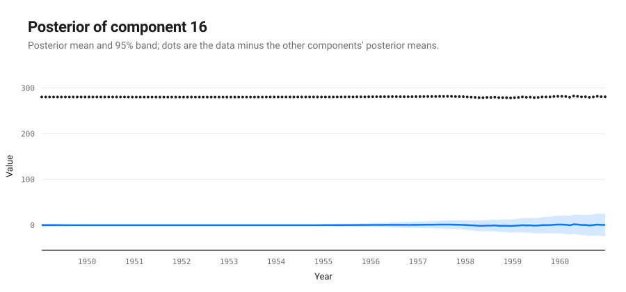

### Component 17: A rough function with marginal standard deviation increasing linearly away from Aug 1953

This component is a rough function with a typical lengthscale of 2.1 years. The marginal standard deviation of the function increases linearly away from Aug 1953. Its sample paths are continuous but not differentiable (gamma-exponential exponent 0.69).

This component explains 0.9% of the data's variance on its own; with the components above it, 99.3%. Adding it changes the cross-validated MAE by -0.1%.

*Extrapolation.* This component is assumed to continue roughly but is also assumed to be stationary so its distribution will return to the prior. The prior distribution places mass on rough functions with a marginal mean of zero and a typical lengthscale of 2.1 years. The marginal standard deviation of the function is assumed to continue to increase linearly.

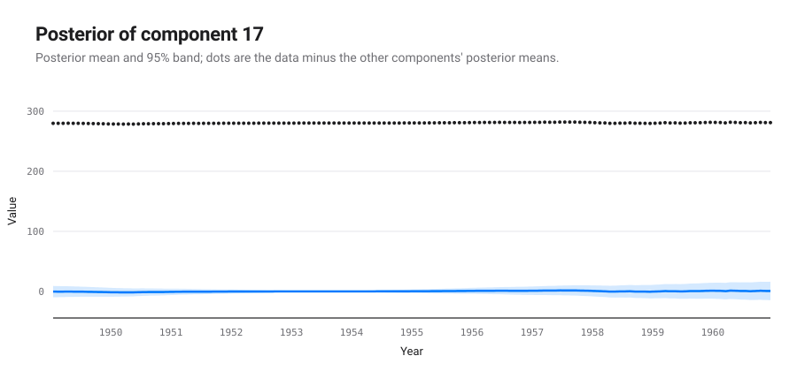

### Component 18: A periodic function with a period of 1.0 years but with amplitude increasing linearly away from Nov 1951

This component is periodic with a period of 1.0 years but with varying amplitude. The amplitude of the function increases linearly away from Nov 1951. The shape of this function within each period has a typical lengthscale of 4.0 weeks.

This component explains 2.7% of the data's variance on its own; with the components above it, 99.5%. Adding it changes the cross-validated MAE by -0.1%.

*Extrapolation.* This component is assumed to continue periodically with a period of 1.0 years but with varying amplitude. The amplitude of the function is assumed to continue to increase linearly.

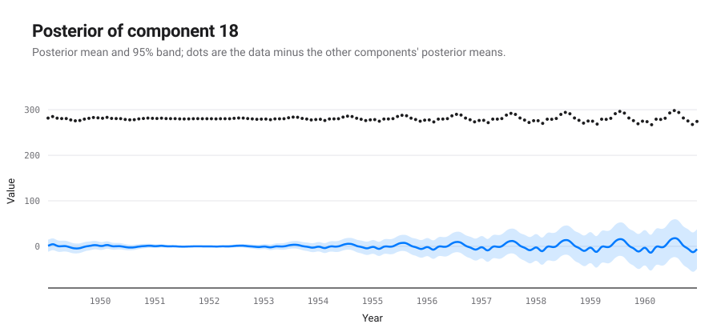

### Component 19: A rough function with quadraticly varying marginal standard deviation

This component is a rough function with a typical lengthscale of 2.1 years. The marginal standard deviation of the function varies quadraticly. Its sample paths are continuous but not differentiable (gamma-exponential exponent 0.69).

This component explains 0.0% of the data's variance on its own; with the components above it, 99.5%. Adding it changes the cross-validated MAE by -0.0%.

*Extrapolation.* This component is assumed to continue roughly but is also assumed to be stationary so its distribution will return to the prior. The prior distribution places mass on rough functions with a marginal mean of zero and a typical lengthscale of 2.1 years. The marginal standard deviation of the function is assumed to continue to vary quadraticly.

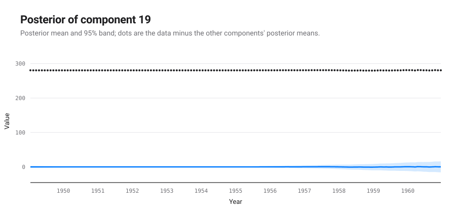

### Component 20: Uncorrelated noise

This component models uncorrelated noise.

This component explains 0.3% of the data's variance on its own; with the components above it, 99.7%. Adding it changes the cross-validated MAE by -0.0%.

*Extrapolation.* This component assumes the uncorrelated noise will continue indefinitely.

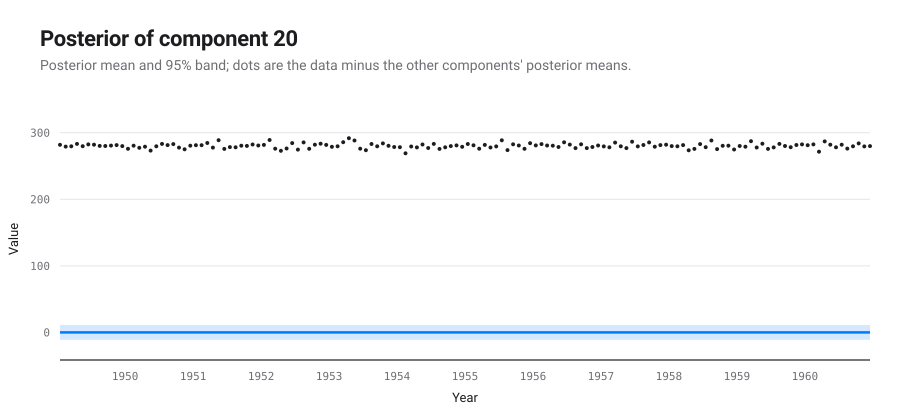

### Component 21: A rough function with cubicly varying marginal standard deviation

This component is a rough function with a typical lengthscale of 2.1 years. The marginal standard deviation of the function varies cubicly. Its sample paths are continuous but not differentiable (gamma-exponential exponent 0.69).

This component explains -0.0% of the data's variance on its own; with the components above it, 99.7%. Adding it changes the cross-validated MAE by 0.0%.

*Extrapolation.* This component is assumed to continue roughly but is also assumed to be stationary so its distribution will return to the prior. The prior distribution places mass on rough functions with a marginal mean of zero and a typical lengthscale of 2.1 years. The marginal standard deviation of the function is assumed to continue to vary cubicly.

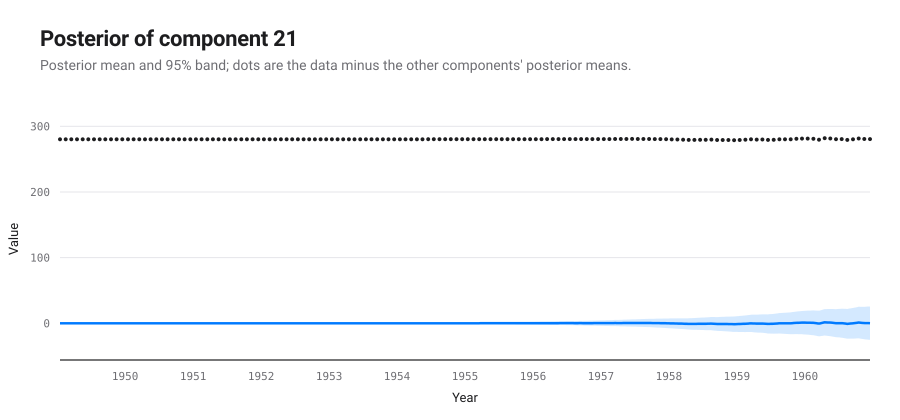

### Component 22: A cubic polynomial

This component is a cubic polynomial.

This component explains 0.6% of the data's variance on its own; with the components above it, 99.7%. Adding it changes the cross-validated MAE by 0.2%.

*Extrapolation.* This component is assumed to continue as a cubic polynomial.

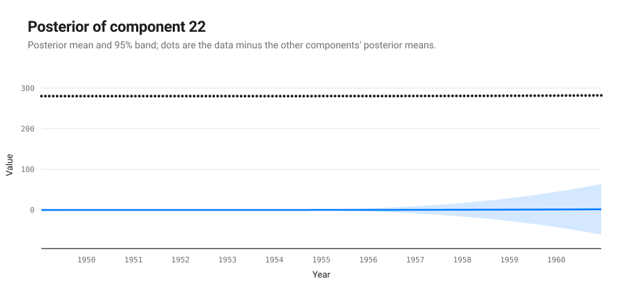

### Component 23: A rough function

This component is a rough function with a typical lengthscale of 2.1 years. Its sample paths are continuous but not differentiable (gamma-exponential exponent 0.69).

This component explains 2.5% of the data's variance on its own; with the components above it, 99.9%. Adding it changes the cross-validated MAE by 0.6%.

*Extrapolation.* This component is assumed to continue roughly but is also assumed to be stationary so its distribution will return to the prior. The prior distribution places mass on rough functions with a marginal mean of zero and a typical lengthscale of 2.1 years.

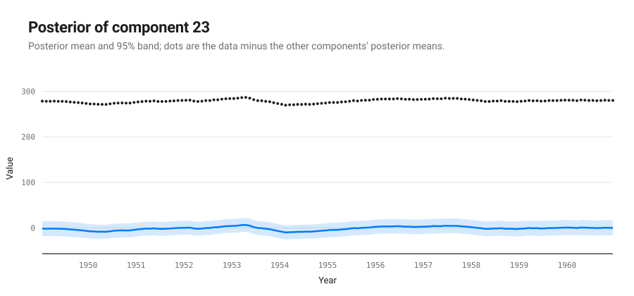

### Component 24: A linearly increasing function

This component is linearly increasing.

This component explains 5.2% of the data's variance on its own; with the components above it, 100.0%. Adding it changes the cross-validated MAE by 5.5%.

*Extrapolation.* This component is assumed to continue to increase linearly.

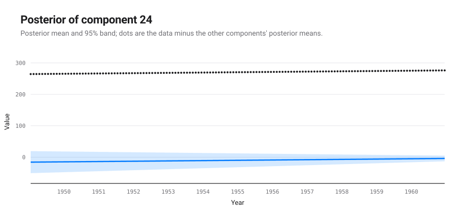

### Component 25: A constant

This component is constant.

This component explains 0.0% of the data's variance on its own; with the components above it, 100.0%. Adding it changes the cross-validated MAE by 46.5%.

*Extrapolation.* This component is assumed to stay constant.

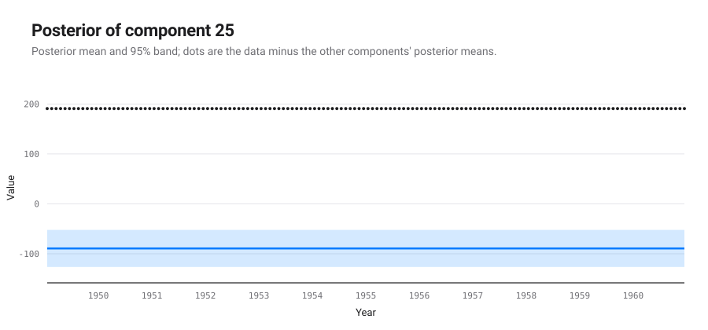

## Model checking

Each statistic compares draws of a component's posterior with draws of its prior. A small p-value (bold below 0.05) points at a property of the data that the component's prior does not reproduce.

| # | QQ max | QQ min | ACF min | ACF min lag | Periodogram max | Periodogram peak | MMD |
|---|---|---|---|---|---|---|---|
| 1 | 0.920 | 0.228 | 0.980 | 0.988 | 0.480 | 0.974 | **0.000** |
| 2 | 0.700 | 0.490 | 0.974 | 0.968 | 0.796 | 0.998 | **0.011** |
| 3 | 0.878 | 0.366 | 0.980 | 0.994 | 0.590 | 0.998 | **0.004** |
| 4 | 0.842 | 0.820 | 0.988 | 0.970 | 0.986 | 0.980 | 0.395 |
| 5 | 0.990 | 0.712 | 0.936 | 0.984 | 0.732 | 0.904 | 0.601 |
| 6 | 0.870 | 0.956 | 0.916 | 0.946 | 0.954 | 0.980 | **0.013** |
| 7 | 0.924 | 0.886 | 0.986 | 0.974 | 0.944 | 0.980 | 0.083 |
| 8 | 0.918 | 0.928 | 0.974 | 0.960 | 0.996 | 0.938 | 0.125 |
| 9 | 0.880 | 0.910 | 0.974 | 0.990 | 0.922 | 0.990 | 0.647 |
| 10 | 0.976 | 0.934 | 0.972 | 0.960 | 0.978 | 0.996 | 0.392 |
| 11 | 0.906 | 0.930 | 0.978 | 0.950 | 0.976 | 0.988 | 0.897 |
| 12 | 0.606 | 0.494 | 0.694 | 0.966 | 0.504 | 0.466 | **0.003** |
| 13 | 0.960 | 0.972 | 0.996 | 0.966 | 0.976 | 0.930 | 0.431 |
| 14 | 0.678 | 0.424 | 0.926 | 0.990 | 0.842 | 0.570 | **0.001** |
| 15 | 0.896 | 0.912 | 0.932 | 0.962 | 0.870 | 0.730 | **0.000** |
| 16 | 0.956 | 0.974 | 0.956 | 0.962 | 0.988 | 0.994 | 0.234 |
| 17 | 0.974 | 0.962 | 0.982 | 0.996 | 0.992 | 0.980 | 0.241 |
| 18 | 0.988 | 0.956 | 0.992 | 0.930 | 0.910 | 0.886 | **0.031** |
| 19 | 0.990 | 0.982 | 0.996 | 1.000 | 0.990 | 0.990 | 0.692 |
| 20 | 0.982 | 0.898 | 0.966 | 0.970 | 0.986 | 0.986 | 0.233 |
| 21 | 0.982 | 0.972 | 0.992 | 0.984 | 0.974 | 0.966 | 0.788 |
| 22 | 0.896 | 0.986 | 0.988 | 0.944 | 0.862 | 0.984 | **0.022** |
| 23 | 0.724 | 0.890 | 0.894 | 0.912 | 0.934 | 0.968 | 0.051 |
| 24 | 0.480 | 0.478 | 0.976 | 0.992 | 0.818 | 0.996 | 0.239 |
| 25 | 0.080 | 0.080 | 0.948 | 0.742 | 0.170 | 0.982 | **0.000** |

QQ: quantile-quantile gaps. ACF: autocorrelation function. MMD: maximum mean discrepancy two-sample test.
