# An automatic report for the dataset: airline passengers, structure 3 of the posterior

*Produced by `autostat` (automatic-statistician-revisited), a Python 3 port of the Automatic Bayesian Covariance Discovery system of Lloyd et al. (AAAI 2014).*

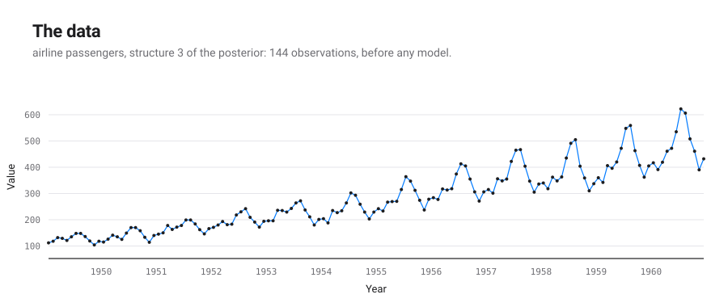

## Executive summary

With posterior weight 0.089, AutoGP kept `WN + (C + Lin + Per + GE x (C + Lin) x (C + GE + Lin)) x (C + Lin) x (C + Lin)` (Bayesian information criterion 1221.6; negative log likelihood 558.6 on 144 points). It decomposes into 37 additive components, listed by how much each reduces extrapolation error:

1. A linearly increasing function.
2. A linearly increasing function.
3. A quadratic polynomial.
4. A quadratic polynomial.
5. A linearly increasing function.
6. A quadratic polynomial.
7. A periodic function with a period of 1.0 years but with amplitude increasing linearly away from Nov 1951.
8. A periodic function with a period of 1.0 years.
9. A rough function with marginal standard deviation increasing linearly away from Feb 1950.
10. A periodic function with a period of 1.0 years but with amplitude increasing linearly away from Jun 1954.
11. A periodic function with a period of 1.0 years but with quadraticly varying amplitude.
12. A rough function.
13. A rough function with quadraticly varying marginal standard deviation.
14. A rough function with marginal standard deviation increasing linearly away from Nov 1951.
15. A rough function.
16. A rough function with marginal standard deviation increasing linearly away from Nov 1951.
17. A rough function with quadraticly varying marginal standard deviation.
18. A rough function with marginal standard deviation increasing linearly away from Dec 1951.
19. A rough function with marginal standard deviation increasing linearly away from Dec 1951.
20. A rough function with quadraticly varying marginal standard deviation.
21. A rough function with quadraticly varying marginal standard deviation.
22. Uncorrelated noise.
23. A rough function with cubicly varying marginal standard deviation.
24. A rough function with quadraticly varying marginal standard deviation.
25. A rough function with cubicly varying marginal standard deviation.
26. A rough function with quadraticly varying marginal standard deviation.
27. A rough function with quadraticly varying marginal standard deviation.
28. A rough function with quarticly varying marginal standard deviation.
29. A rough function with cubicly varying marginal standard deviation.
30. A rough function with quadraticly varying marginal standard deviation.
31. A rough function with cubicly varying marginal standard deviation.
32. A rough function with marginal standard deviation increasing linearly away from Jun 1954.
33. A rough function with quadraticly varying marginal standard deviation.
34. A rough function with cubicly varying marginal standard deviation.
35. A rough function with marginal standard deviation increasing linearly away from Jun 1954.
36. A cubic polynomial.
37. A constant.

| # | R² cumulative (%) | Residual variance explained (%) | Cross-validated MAE | MAE reduction (%) |
|---|---|---|---|---|
| data | | | 280 | |
| 1 | 32.4 | 32.4 | 247 | 12.0 |
| 2 | 63.3 | 45.7 | 219 | 11.1 |
| 3 | 76.9 | 37.0 | 200 | 8.7 |
| 4 | 80.0 | 13.6 | 195 | 2.5 |
| 5 | 86.2 | 30.9 | 191 | 2.1 |
| 6 | 86.1 | -0.8 | 189 | 1.2 |
| 7 | 92.8 | 48.3 | 189 | 0.2 |
| 8 | 98.2 | 75.6 | 188 | 0.1 |
| 9 | 98.6 | 18.1 | 188 | 0.1 |
| 10 | 99.2 | 42.1 | 188 | 0.1 |
| 11 | 99.5 | 40.3 | 188 | 0.1 |
| 12 | 99.7 | 33.1 | 188 | 0.0 |
| 13 | 99.7 | 21.3 | 188 | 0.0 |
| 14 | 99.8 | 8.9 | 188 | 0.0 |
| 15 | 99.8 | 7.9 | 188 | 0.0 |
| 16 | 99.8 | 2.0 | 188 | 0.0 |
| 17 | 99.8 | 3.3 | 188 | 0.0 |
| 18 | 99.8 | 1.3 | 188 | 0.0 |
| 19 | 99.8 | 0.3 | 188 | 0.0 |
| 20 | 99.8 | 0.7 | 188 | 0.0 |
| 21 | 99.8 | 0.2 | 188 | 0.0 |
| 22 | 99.9 | 43.7 | 188 | 0.0 |
| 23 | 99.9 | 0.0 | 188 | -0.0 |
| 24 | 99.9 | 0.1 | 188 | -0.0 |
| 25 | 99.9 | 0.1 | 188 | -0.0 |
| 26 | 99.9 | 0.2 | 188 | -0.0 |
| 27 | 99.9 | 0.3 | 188 | -0.0 |
| 28 | 99.9 | 0.2 | 188 | -0.0 |
| 29 | 99.9 | 0.5 | 188 | -0.0 |
| 30 | 99.9 | 1.1 | 188 | -0.0 |
| 31 | 99.9 | 1.8 | 188 | -0.0 |
| 32 | 99.9 | 0.5 | 188 | -0.0 |
| 33 | 99.9 | 4.6 | 188 | -0.0 |
| 34 | 99.9 | 1.3 | 188 | -0.0 |
| 35 | 99.9 | 0.5 | 188 | -0.0 |
| 36 | 100.0 | 100.0 | 190 | -1.5 |
| 37 | 100.0 | 2.9 | 281 | -47.4 |

MAE: mean absolute error over ten contiguous held-out blocks.

## The formula found

The structure search is a symbolic regression: it searches a grammar of expressions over kernels and keeps the one with the lowest Bayesian information criterion. This is the expression it kept, with every fitted parameter in place; $t$ is in years.

$$y(t) = 280.3 + f_{1}(t) + f_{2}(t) + f_{3}(t) + f_{4}(t) + f_{5}(t) + f_{6}(t) + f_{7}(t) + f_{8}(t) + f_{9}(t) + f_{10}(t) + f_{11}(t) + f_{12}(t) + f_{13}(t) + f_{14}(t) + f_{15}(t) + f_{16}(t) + f_{17}(t) + f_{18}(t) + f_{19}(t) + f_{20}(t) + f_{21}(t) + f_{22}(t) + f_{23}(t) + f_{24}(t) + f_{25}(t) + f_{26}(t) + f_{27}(t) + f_{28}(t) + f_{29}(t) + f_{30}(t) + f_{31}(t) + f_{32}(t) + f_{33}(t) + f_{34}(t) + f_{35}(t) + f_{36}(t) + f_{37}(t)$$

Each component is a Gaussian process with its own covariance:

$$f_{1}(t) \sim \mathrm{GP}\!\left(0,\ 107.1\,(t - 1950)(t' - 1950)\right)$$

$$f_{2}(t) \sim \mathrm{GP}\!\left(0,\ 110.3\,(t - 1952)(t' - 1952)\right)$$

$$f_{3}(t) \sim \mathrm{GP}\!\left(0,\ 1.394\,(t - 1950)(t' - 1950) \cdot (t - 1952)(t' - 1952)\right)$$

$$f_{4}(t) \sim \mathrm{GP}\!\left(0,\ 1.025\,(t - 1954)(t' - 1954) \cdot (t - 1950)(t' - 1950)\right)$$

$$f_{5}(t) \sim \mathrm{GP}\!\left(0,\ 81.05\,(t - 1954)(t' - 1954)\right)$$

$$f_{6}(t) \sim \mathrm{GP}\!\left(0,\ 1.055\,(t - 1954)(t' - 1954) \cdot (t - 1952)(t' - 1952)\right)$$

$$f_{7}(t) \sim \mathrm{GP}\!\left(0,\ 14.13\,(t - 1952)(t' - 1952) \cdot \frac{\exp\!\left(4.213\cos\frac{2\pi (t - t')}{0.9981}\right) - I_0(4.213)}{e^{4.213} - I_0(4.213)}\right)$$

$$f_{8}(t) \sim \mathrm{GP}\!\left(0,\ 1085\,\frac{\exp\!\left(4.213\cos\frac{2\pi (t - t')}{0.9981}\right) - I_0(4.213)}{e^{4.213} - I_0(4.213)}\right)$$

$$f_{9}(t) \sim \mathrm{GP}\!\left(0,\ 1.114\,\exp\!\left(-\left(\frac{|t - t'|}{0.6954}\right)^{1.031}\right) \cdot (t - 1950)(t' - 1950)\right)$$

$$f_{10}(t) \sim \mathrm{GP}\!\left(0,\ 10.38\,(t - 1954)(t' - 1954) \cdot \frac{\exp\!\left(4.213\cos\frac{2\pi (t - t')}{0.9981}\right) - I_0(4.213)}{e^{4.213} - I_0(4.213)}\right)$$

$$f_{11}(t) \sim \mathrm{GP}\!\left(0,\ 0.1352\,(t - 1954)(t' - 1954) \cdot (t - 1952)(t' - 1952) \cdot \frac{\exp\!\left(4.213\cos\frac{2\pi (t - t')}{0.9981}\right) - I_0(4.213)}{e^{4.213} - I_0(4.213)}\right)$$

$$f_{12}(t) \sim \mathrm{GP}\!\left(0,\ 27.01\,\exp\!\left(-\left(\frac{|t - t'|}{0.6954}\right)^{1.031}\right) \cdot \exp\!\left(-\left(\frac{|t - t'|}{13.16}\right)^{0.5159}\right)\right)$$

$$f_{13}(t) \sim \mathrm{GP}\!\left(0,\ 0.01451\,\exp\!\left(-\left(\frac{|t - t'|}{0.6954}\right)^{1.031}\right) \cdot (t - 1950)(t' - 1950) \cdot (t - 1952)(t' - 1952)\right)$$

$$f_{14}(t) \sim \mathrm{GP}\!\left(0,\ 0.3516\,\exp\!\left(-\left(\frac{|t - t'|}{0.6954}\right)^{1.031}\right) \cdot \exp\!\left(-\left(\frac{|t - t'|}{13.16}\right)^{0.5159}\right) \cdot (t - 1952)(t' - 1952)\right)$$

$$f_{15}(t) \sim \mathrm{GP}\!\left(0,\ 7.358\,\exp\!\left(-\left(\frac{|t - t'|}{0.6954}\right)^{1.031}\right)\right)$$

$$f_{16}(t) \sim \mathrm{GP}\!\left(0,\ 0.0958\,\exp\!\left(-\left(\frac{|t - t'|}{0.6954}\right)^{1.031}\right) \cdot (t - 1952)(t' - 1952)\right)$$

$$f_{17}(t) \sim \mathrm{GP}\!\left(0,\ 0.002485\,\exp\!\left(-\left(\frac{|t - t'|}{0.6954}\right)^{1.031}\right) \cdot (t - 1950)(t' - 1950) \cdot (t - 1952)(t' - 1952)\right)$$

$$f_{18}(t) \sim \mathrm{GP}\!\left(0,\ 0.06023\,\exp\!\left(-\left(\frac{|t - t'|}{0.6954}\right)^{1.031}\right) \cdot \exp\!\left(-\left(\frac{|t - t'|}{13.16}\right)^{0.5159}\right) \cdot (t - 1952)(t' - 1952)\right)$$

$$f_{19}(t) \sim \mathrm{GP}\!\left(0,\ 0.01641\,\exp\!\left(-\left(\frac{|t - t'|}{0.6954}\right)^{1.031}\right) \cdot (t - 1952)(t' - 1952)\right)$$

$$f_{20}(t) \sim \mathrm{GP}\!\left(0,\ 7.842 \times 10^{-4}\,\exp\!\left(-\left(\frac{|t - t'|}{0.6954}\right)^{1.031}\right) \cdot \exp\!\left(-\left(\frac{|t - t'|}{13.16}\right)^{0.5159}\right) \cdot (t - 1952)(t' - 1952) \cdot (t - 1952)(t' - 1952)\right)$$

$$f_{21}(t) \sim \mathrm{GP}\!\left(0,\ 2.136 \times 10^{-4}\,\exp\!\left(-\left(\frac{|t - t'|}{0.6954}\right)^{1.031}\right) \cdot (t - 1952)(t' - 1952) \cdot (t - 1952)(t' - 1952)\right)$$

$$f_{22}(t) \sim \mathrm{GP}\!\left(0,\ 30.7\,\delta_{t t'}\right)$$

$$f_{23}(t) \sim \mathrm{GP}\!\left(0,\ 2.044 \times 10^{-6}\,\exp\!\left(-\left(\frac{|t - t'|}{0.6954}\right)^{1.031}\right) \cdot (t - 1954)(t' - 1954) \cdot (t - 1952)(t' - 1952) \cdot (t - 1952)(t' - 1952)\right)$$

$$f_{24}(t) \sim \mathrm{GP}\!\left(0,\ 1.57 \times 10^{-4}\,\exp\!\left(-\left(\frac{|t - t'|}{0.6954}\right)^{1.031}\right) \cdot (t - 1954)(t' - 1954) \cdot (t - 1952)(t' - 1952)\right)$$

$$f_{25}(t) \sim \mathrm{GP}\!\left(0,\ 7.504 \times 10^{-6}\,\exp\!\left(-\left(\frac{|t - t'|}{0.6954}\right)^{1.031}\right) \cdot \exp\!\left(-\left(\frac{|t - t'|}{13.16}\right)^{0.5159}\right) \cdot (t - 1954)(t' - 1954) \cdot (t - 1952)(t' - 1952) \cdot (t - 1952)(t' - 1952)\right)$$

$$f_{26}(t) \sim \mathrm{GP}\!\left(0,\ 5.764 \times 10^{-4}\,\exp\!\left(-\left(\frac{|t - t'|}{0.6954}\right)^{1.031}\right) \cdot \exp\!\left(-\left(\frac{|t - t'|}{13.16}\right)^{0.5159}\right) \cdot (t - 1954)(t' - 1954) \cdot (t - 1952)(t' - 1952)\right)$$

$$f_{27}(t) \sim \mathrm{GP}\!\left(0,\ 9.167 \times 10^{-4}\,\exp\!\left(-\left(\frac{|t - t'|}{0.6954}\right)^{1.031}\right) \cdot (t - 1954)(t' - 1954) \cdot (t - 1952)(t' - 1952)\right)$$

$$f_{28}(t) \sim \mathrm{GP}\!\left(0,\ 3.096 \times 10^{-7}\,\exp\!\left(-\left(\frac{|t - t'|}{0.6954}\right)^{1.031}\right) \cdot (t - 1950)(t' - 1950) \cdot (t - 1954)(t' - 1954) \cdot (t - 1952)(t' - 1952) \cdot (t - 1952)(t' - 1952)\right)$$

$$f_{29}(t) \sim \mathrm{GP}\!\left(0,\ 2.378 \times 10^{-5}\,\exp\!\left(-\left(\frac{|t - t'|}{0.6954}\right)^{1.031}\right) \cdot (t - 1950)(t' - 1950) \cdot (t - 1954)(t' - 1954) \cdot (t - 1952)(t' - 1952)\right)$$

$$f_{30}(t) \sim \mathrm{GP}\!\left(0,\ 0.003365\,\exp\!\left(-\left(\frac{|t - t'|}{0.6954}\right)^{1.031}\right) \cdot \exp\!\left(-\left(\frac{|t - t'|}{13.16}\right)^{0.5159}\right) \cdot (t - 1954)(t' - 1954) \cdot (t - 1952)(t' - 1952)\right)$$

$$f_{31}(t) \sim \mathrm{GP}\!\left(0,\ 3.235 \times 10^{-5}\,\exp\!\left(-\left(\frac{|t - t'|}{0.6954}\right)^{1.031}\right) \cdot (t - 1950)(t' - 1950) \cdot (t - 1952)(t' - 1952) \cdot (t - 1952)(t' - 1952)\right)$$

$$f_{32}(t) \sim \mathrm{GP}\!\left(0,\ 0.07041\,\exp\!\left(-\left(\frac{|t - t'|}{0.6954}\right)^{1.031}\right) \cdot (t - 1954)(t' - 1954)\right)$$

$$f_{33}(t) \sim \mathrm{GP}\!\left(0,\ 0.01066\,\exp\!\left(-\left(\frac{|t - t'|}{0.6954}\right)^{1.031}\right) \cdot (t - 1950)(t' - 1950) \cdot (t - 1954)(t' - 1954)\right)$$

$$f_{34}(t) \sim \mathrm{GP}\!\left(0,\ 1.388 \times 10^{-4}\,\exp\!\left(-\left(\frac{|t - t'|}{0.6954}\right)^{1.031}\right) \cdot (t - 1950)(t' - 1950) \cdot (t - 1954)(t' - 1954) \cdot (t - 1952)(t' - 1952)\right)$$

$$f_{35}(t) \sim \mathrm{GP}\!\left(0,\ 0.2585\,\exp\!\left(-\left(\frac{|t - t'|}{0.6954}\right)^{1.031}\right) \cdot \exp\!\left(-\left(\frac{|t - t'|}{13.16}\right)^{0.5159}\right) \cdot (t - 1954)(t' - 1954)\right)$$

$$f_{36}(t) \sim \mathrm{GP}\!\left(0,\ 0.01334\,(t - 1950)(t' - 1950) \cdot (t - 1954)(t' - 1954) \cdot (t - 1952)(t' - 1952)\right)$$

$$f_{37}(t) \sim \mathrm{GP}\!\left(0,\ 8469\right)$$

Polynomial and periodic components have a closed form, read from their posterior mean:

$$f_{1}(t) = -8.199 + 6.779\,(t - 1949)$$

$$f_{2}(t) = -25.29 + 8.9\,(t - 1949)$$

$$f_{3}(t) = 2.471 - 2.912\,(t - 1949) + 0.7189\,(t - 1949)^{2}$$

$$f_{4}(t) = 2.368 - 2.392\,(t - 1949) + 0.3593\,(t - 1949)^{2}$$

$$f_{5}(t) = -47.91 + 8.794\,(t - 1949)$$

$$f_{6}(t) = 2.834 - 1.517\,(t - 1949) + 0.183\,(t - 1949)^{2}$$

$$f_{8}(t) \approx 28.14\cos\!\left(\frac{2\pi \cdot (t - 1949)}{0.9981} + 3.04\right) + 15.96\cos\!\left(\frac{2\pi \cdot 2 \cdot (t - 1949)}{0.9981} - 1.443\right) + 6.531\cos\!\left(\frac{2\pi \cdot 3 \cdot (t - 1949)}{0.9981} + 1.143\right) + 6.615\cos\!\left(\frac{2\pi \cdot 4 \cdot (t - 1949)}{0.9981} + 0.06367\right) + 3.463\cos\!\left(\frac{2\pi \cdot 5 \cdot (t - 1949)}{0.9981} - 0.4439\right) + 0.2155\cos\!\left(\frac{2\pi \cdot 6 \cdot (t - 1949)}{0.9981} + 1.217\right) + 0.6769\cos\!\left(\frac{2\pi \cdot 7 \cdot (t - 1949)}{0.9981} + 2.257\right) + 0.1764\cos\!\left(\frac{2\pi \cdot 8 \cdot (t - 1949)}{0.9981} + 1.745\right)$$

$$f_{36}(t) = 0.4151 - 0.5655\,(t - 1949) + 0.2106\,(t - 1949)^{2} - 0.02217\,(t - 1949)^{3}$$

$$f_{37}(t) = -90.33$$

A periodic kernel is exactly a sum of cosines, so a periodic component is a Fourier series in its period; it is written up to the harmonic after which the rest weighs less than 0.1 % of the component, hence the approximate sign.

The other components are smooth, quasi-periodic or noise: a draw from such a process has no finite closed form; its covariance above is the formula.

Closed form of each component:

| # | component | closed form |
|---|---|---|
| 1 | A linearly increasing function | exact polynomial of degree 1 |
| 2 | A linearly increasing function | exact polynomial of degree 1 |
| 3 | A quadratic polynomial | exact polynomial of degree 2 |
| 4 | A quadratic polynomial | exact polynomial of degree 2 |
| 5 | A linearly increasing function | exact polynomial of degree 1 |
| 6 | A quadratic polynomial | exact polynomial of degree 2 |
| 7 | A periodic function with a period of 1.0 years but with amplitude increasing linearly away from Nov 1951 | none: the covariance is the formula |
| 8 | A periodic function with a period of 1.0 years | Fourier series, 8 harmonics, largest gap 0.028 % of the component |
| 9 | A rough function with marginal standard deviation increasing linearly away from Feb 1950 | none: the covariance is the formula |
| 10 | A periodic function with a period of 1.0 years but with amplitude increasing linearly away from Jun 1954 | none: the covariance is the formula |
| 11 | A periodic function with a period of 1.0 years but with quadraticly varying amplitude | none: the covariance is the formula |
| 12 | A rough function | none: the covariance is the formula |
| 13 | A rough function with quadraticly varying marginal standard deviation | none: the covariance is the formula |
| 14 | A rough function with marginal standard deviation increasing linearly away from Nov 1951 | none: the covariance is the formula |
| 15 | A rough function | none: the covariance is the formula |
| 16 | A rough function with marginal standard deviation increasing linearly away from Nov 1951 | none: the covariance is the formula |
| 17 | A rough function with quadraticly varying marginal standard deviation | none: the covariance is the formula |
| 18 | A rough function with marginal standard deviation increasing linearly away from Dec 1951 | none: the covariance is the formula |
| 19 | A rough function with marginal standard deviation increasing linearly away from Dec 1951 | none: the covariance is the formula |
| 20 | A rough function with quadraticly varying marginal standard deviation | none: the covariance is the formula |
| 21 | A rough function with quadraticly varying marginal standard deviation | none: the covariance is the formula |
| 22 | Uncorrelated noise | none: the covariance is the formula |
| 23 | A rough function with cubicly varying marginal standard deviation | none: the covariance is the formula |
| 24 | A rough function with quadraticly varying marginal standard deviation | none: the covariance is the formula |
| 25 | A rough function with cubicly varying marginal standard deviation | none: the covariance is the formula |
| 26 | A rough function with quadraticly varying marginal standard deviation | none: the covariance is the formula |
| 27 | A rough function with quadraticly varying marginal standard deviation | none: the covariance is the formula |
| 28 | A rough function with quarticly varying marginal standard deviation | none: the covariance is the formula |
| 29 | A rough function with cubicly varying marginal standard deviation | none: the covariance is the formula |
| 30 | A rough function with quadraticly varying marginal standard deviation | none: the covariance is the formula |
| 31 | A rough function with cubicly varying marginal standard deviation | none: the covariance is the formula |
| 32 | A rough function with marginal standard deviation increasing linearly away from Jun 1954 | none: the covariance is the formula |
| 33 | A rough function with quadraticly varying marginal standard deviation | none: the covariance is the formula |
| 34 | A rough function with cubicly varying marginal standard deviation | none: the covariance is the formula |
| 35 | A rough function with marginal standard deviation increasing linearly away from Jun 1954 | none: the covariance is the formula |
| 36 | A cubic polynomial | exact polynomial of degree 3 |
| 37 | A constant | exact polynomial of degree 0 |

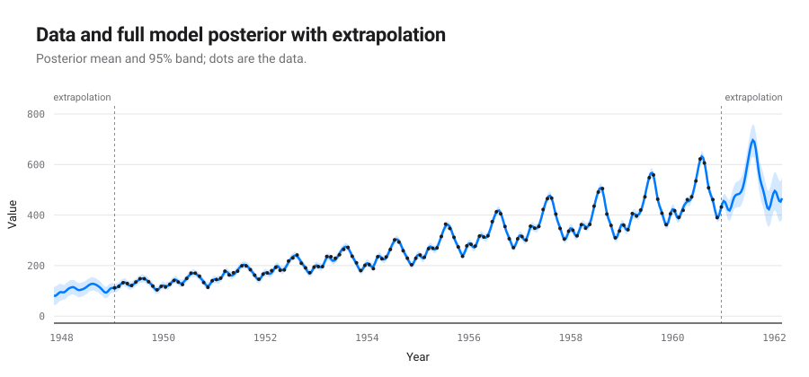

## Detailed discussion of the components

### Component 1: A linearly increasing function

This component is linearly increasing.

This component explains 32.4% of the data's variance on its own; with the components above it, 32.4%. Adding it changes the cross-validated MAE by -12.0%.

*Extrapolation.* This component is assumed to continue to increase linearly.

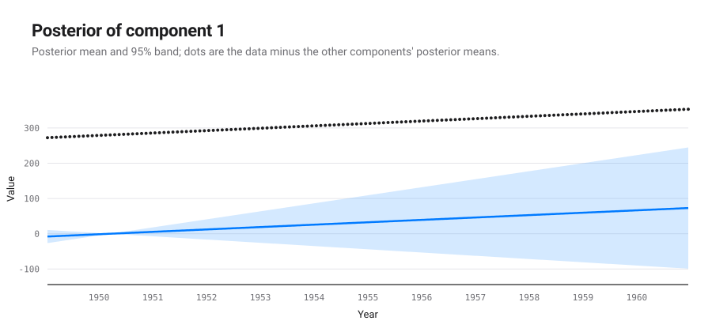

### Component 2: A linearly increasing function

This component is linearly increasing.

This component explains 41.0% of the data's variance on its own; with the components above it, 63.3%. Adding it changes the cross-validated MAE by -11.1%.

*Extrapolation.* This component is assumed to continue to increase linearly.

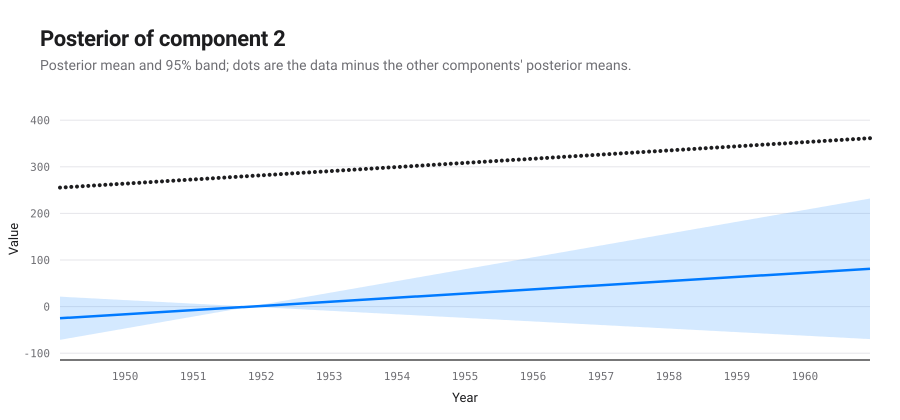

### Component 3: A quadratic polynomial

This component is a quadratic polynomial.

This component explains 28.6% of the data's variance on its own; with the components above it, 76.9%. Adding it changes the cross-validated MAE by -8.7%.

*Extrapolation.* This component is assumed to continue as a quadratic polynomial.

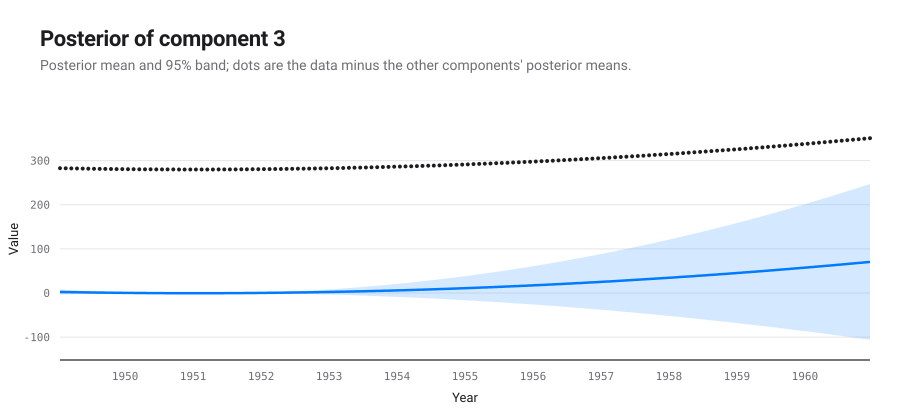

### Component 4: A quadratic polynomial

This component is a quadratic polynomial.

This component explains 10.4% of the data's variance on its own; with the components above it, 80.0%. Adding it changes the cross-validated MAE by -2.5%.

*Extrapolation.* This component is assumed to continue as a quadratic polynomial.

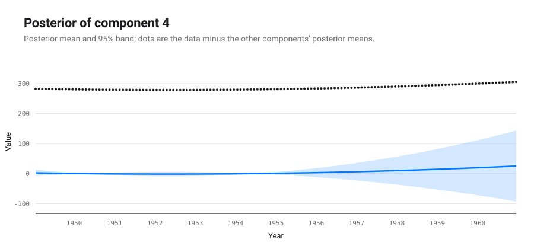

### Component 5: A linearly increasing function

This component is linearly increasing.

This component explains 40.6% of the data's variance on its own; with the components above it, 86.2%. Adding it changes the cross-validated MAE by -2.1%.

*Extrapolation.* This component is assumed to continue to increase linearly.

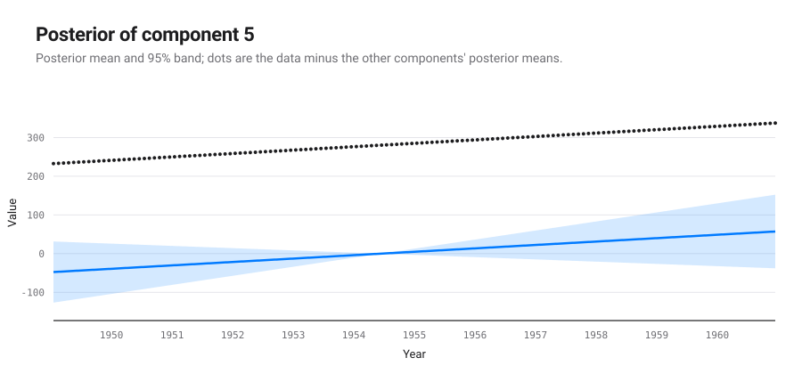

### Component 6: A quadratic polynomial

This component is a quadratic polynomial.

This component explains 3.9% of the data's variance on its own; with the components above it, 86.1%. Adding it changes the cross-validated MAE by -1.2%.

*Extrapolation.* This component is assumed to continue as a quadratic polynomial.

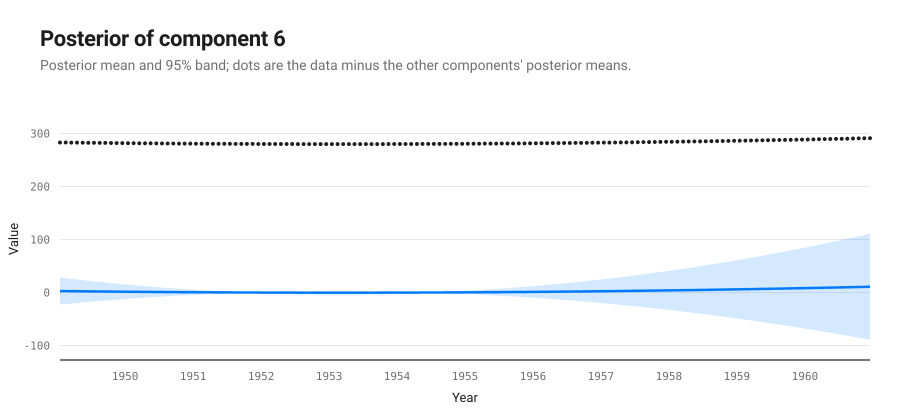

### Component 7: A periodic function with a period of 1.0 years but with amplitude increasing linearly away from Nov 1951

This component is periodic with a period of 1.0 years but with varying amplitude. The amplitude of the function increases linearly away from Nov 1951. The shape of this function within each period has a typical lengthscale of 4.0 weeks.

This component explains 6.8% of the data's variance on its own; with the components above it, 92.8%. Adding it changes the cross-validated MAE by -0.2%.

*Extrapolation.* This component is assumed to continue periodically with a period of 1.0 years but with varying amplitude. The amplitude of the function is assumed to continue to increase linearly.

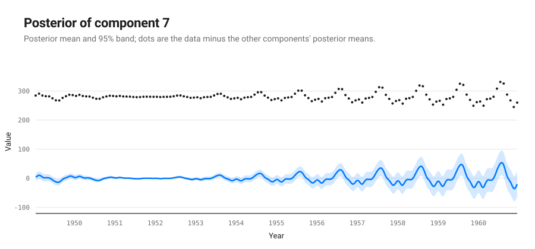

### Component 8: A periodic function with a period of 1.0 years

This component is periodic with a period of 1.0 years. The shape of this function within each period has a typical lengthscale of 4.0 weeks.

This component explains 8.3% of the data's variance on its own; with the components above it, 98.2%. Adding it changes the cross-validated MAE by -0.1%.

*Extrapolation.* This component is assumed to continue periodically with a period of 1.0 years.

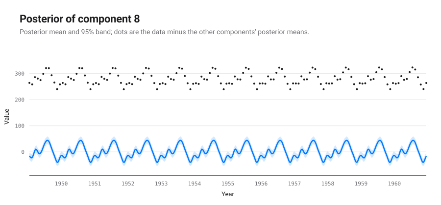

### Component 9: A rough function with marginal standard deviation increasing linearly away from Feb 1950

This component is a rough function with a typical lengthscale of 4.3 months. The marginal standard deviation of the function increases linearly away from Feb 1950. Its sample paths are continuous but not differentiable (gamma-exponential exponent 1.03).

This component explains 0.3% of the data's variance on its own; with the components above it, 98.6%. Adding it changes the cross-validated MAE by -0.1%.

*Extrapolation.* This component is assumed to continue roughly but is also assumed to be stationary so its distribution will return to the prior. The prior distribution places mass on rough functions with a marginal mean of zero and a typical lengthscale of 4.3 months. The marginal standard deviation of the function is assumed to continue to increase linearly.

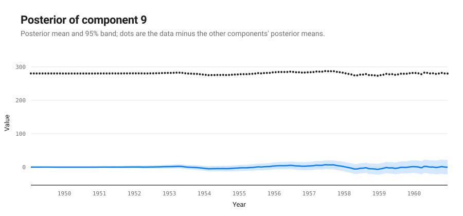

### Component 10: A periodic function with a period of 1.0 years but with amplitude increasing linearly away from Jun 1954

This component is periodic with a period of 1.0 years but with varying amplitude. The amplitude of the function increases linearly away from Jun 1954. The shape of this function within each period has a typical lengthscale of 4.0 weeks.

This component explains 1.9% of the data's variance on its own; with the components above it, 99.2%. Adding it changes the cross-validated MAE by -0.1%.

*Extrapolation.* This component is assumed to continue periodically with a period of 1.0 years but with varying amplitude. The amplitude of the function is assumed to continue to increase linearly.

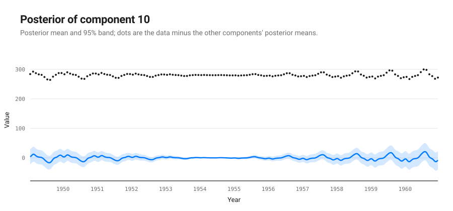

### Component 11: A periodic function with a period of 1.0 years but with quadraticly varying amplitude

This component is periodic with a period of 1.0 years but with varying amplitude. The amplitude of the function varies quadraticly. The shape of this function within each period has a typical lengthscale of 4.0 weeks.

This component explains 3.1% of the data's variance on its own; with the components above it, 99.5%. Adding it changes the cross-validated MAE by -0.1%.

*Extrapolation.* This component is assumed to continue periodically with a period of 1.0 years but with varying amplitude. The amplitude of the function is assumed to continue to vary quadraticly.

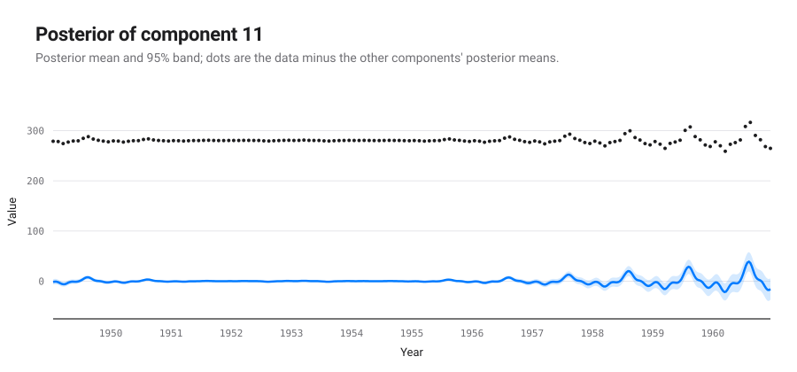

### Component 12: A rough function

This component is a rough function with a typical lengthscale of 4.2 months. Its sample paths are continuous but not differentiable (gamma-exponential exponent 0.52).

This component explains 0.5% of the data's variance on its own; with the components above it, 99.7%. Adding it changes the cross-validated MAE by -0.0%.

*Extrapolation.* This component is assumed to continue roughly but is also assumed to be stationary so its distribution will return to the prior. The prior distribution places mass on rough functions with a marginal mean of zero and a typical lengthscale of 4.2 months.

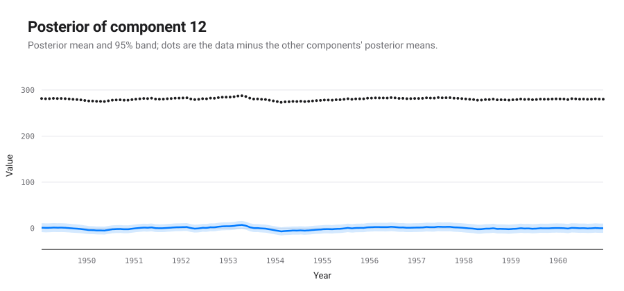

### Component 13: A rough function with quadraticly varying marginal standard deviation

This component is a rough function with a typical lengthscale of 4.3 months. The marginal standard deviation of the function varies quadraticly. Its sample paths are continuous but not differentiable (gamma-exponential exponent 1.03).

This component explains -0.0% of the data's variance on its own; with the components above it, 99.7%. Adding it changes the cross-validated MAE by -0.0%.

*Extrapolation.* This component is assumed to continue roughly but is also assumed to be stationary so its distribution will return to the prior. The prior distribution places mass on rough functions with a marginal mean of zero and a typical lengthscale of 4.3 months. The marginal standard deviation of the function is assumed to continue to vary quadraticly.

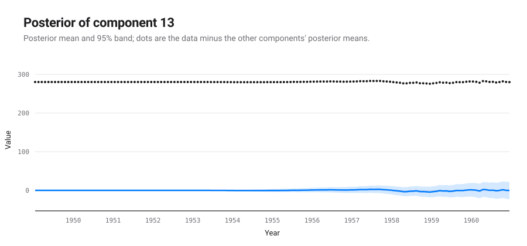

### Component 14: A rough function with marginal standard deviation increasing linearly away from Nov 1951

This component is a rough function with a typical lengthscale of 4.2 months. The marginal standard deviation of the function increases linearly away from Nov 1951. Its sample paths are continuous but not differentiable (gamma-exponential exponent 0.52).

This component explains 0.1% of the data's variance on its own; with the components above it, 99.8%. Adding it changes the cross-validated MAE by -0.0%.

*Extrapolation.* This component is assumed to continue roughly but is also assumed to be stationary so its distribution will return to the prior. The prior distribution places mass on rough functions with a marginal mean of zero and a typical lengthscale of 4.2 months. The marginal standard deviation of the function is assumed to continue to increase linearly.

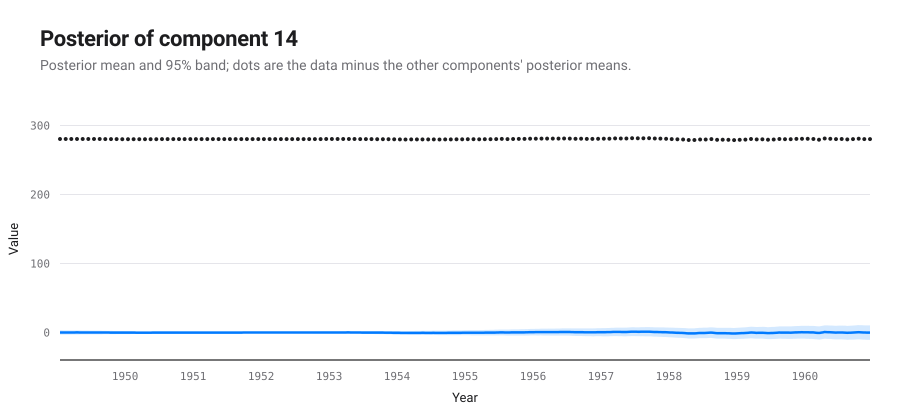

### Component 15: A rough function

This component is a rough function with a typical lengthscale of 4.3 months. Its sample paths are continuous but not differentiable (gamma-exponential exponent 1.03).

This component explains 0.2% of the data's variance on its own; with the components above it, 99.8%. Adding it changes the cross-validated MAE by -0.0%.

*Extrapolation.* This component is assumed to continue roughly but is also assumed to be stationary so its distribution will return to the prior. The prior distribution places mass on rough functions with a marginal mean of zero and a typical lengthscale of 4.3 months.

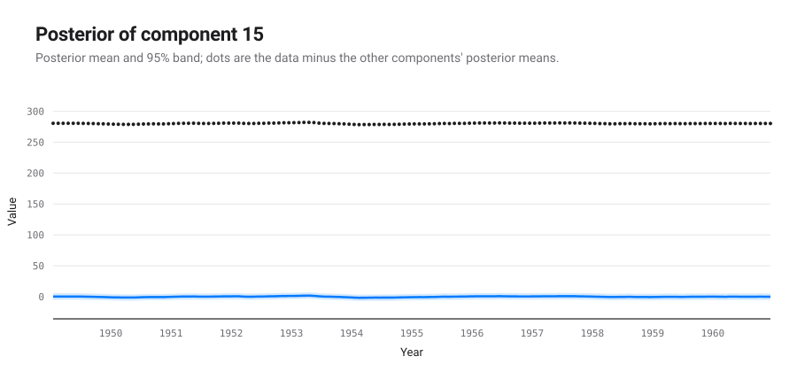

### Component 16: A rough function with marginal standard deviation increasing linearly away from Nov 1951

This component is a rough function with a typical lengthscale of 4.3 months. The marginal standard deviation of the function increases linearly away from Nov 1951. Its sample paths are continuous but not differentiable (gamma-exponential exponent 1.03).

This component explains 0.0% of the data's variance on its own; with the components above it, 99.8%. Adding it changes the cross-validated MAE by -0.0%.

*Extrapolation.* This component is assumed to continue roughly but is also assumed to be stationary so its distribution will return to the prior. The prior distribution places mass on rough functions with a marginal mean of zero and a typical lengthscale of 4.3 months. The marginal standard deviation of the function is assumed to continue to increase linearly.

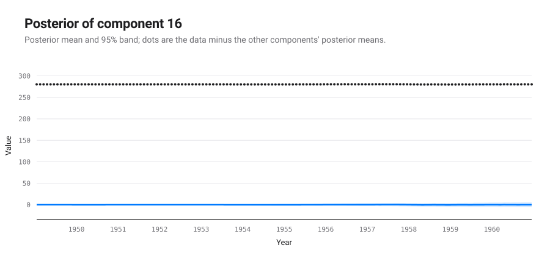

### Component 17: A rough function with quadraticly varying marginal standard deviation

This component is a rough function with a typical lengthscale of 4.3 months. The marginal standard deviation of the function varies quadraticly. Its sample paths are continuous but not differentiable (gamma-exponential exponent 1.03).

This component explains -0.0% of the data's variance on its own; with the components above it, 99.8%. Adding it changes the cross-validated MAE by -0.0%.

*Extrapolation.* This component is assumed to continue roughly but is also assumed to be stationary so its distribution will return to the prior. The prior distribution places mass on rough functions with a marginal mean of zero and a typical lengthscale of 4.3 months. The marginal standard deviation of the function is assumed to continue to vary quadraticly.

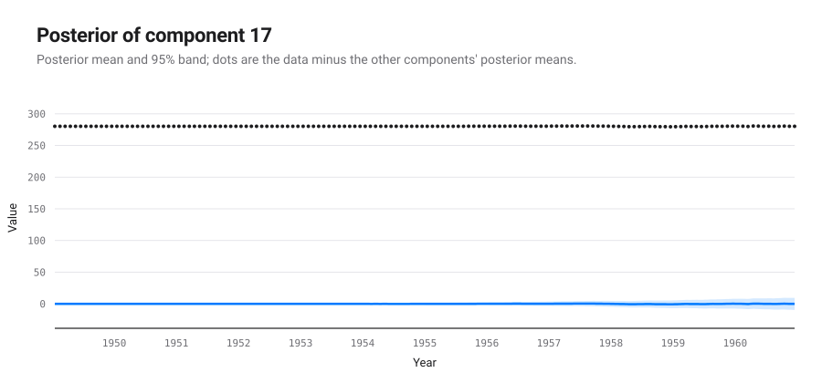

### Component 18: A rough function with marginal standard deviation increasing linearly away from Dec 1951

This component is a rough function with a typical lengthscale of 4.2 months. The marginal standard deviation of the function increases linearly away from Dec 1951. Its sample paths are continuous but not differentiable (gamma-exponential exponent 0.52).

This component explains 0.0% of the data's variance on its own; with the components above it, 99.8%. Adding it changes the cross-validated MAE by -0.0%.

*Extrapolation.* This component is assumed to continue roughly but is also assumed to be stationary so its distribution will return to the prior. The prior distribution places mass on rough functions with a marginal mean of zero and a typical lengthscale of 4.2 months. The marginal standard deviation of the function is assumed to continue to increase linearly.

### Component 19: A rough function with marginal standard deviation increasing linearly away from Dec 1951

This component is a rough function with a typical lengthscale of 4.3 months. The marginal standard deviation of the function increases linearly away from Dec 1951. Its sample paths are continuous but not differentiable (gamma-exponential exponent 1.03).

This component explains 0.0% of the data's variance on its own; with the components above it, 99.8%. Adding it changes the cross-validated MAE by -0.0%.

*Extrapolation.* This component is assumed to continue roughly but is also assumed to be stationary so its distribution will return to the prior. The prior distribution places mass on rough functions with a marginal mean of zero and a typical lengthscale of 4.3 months. The marginal standard deviation of the function is assumed to continue to increase linearly.

### Component 20: A rough function with quadraticly varying marginal standard deviation

This component is a rough function with a typical lengthscale of 4.2 months. The marginal standard deviation of the function varies quadraticly. Its sample paths are continuous but not differentiable (gamma-exponential exponent 0.52).

This component explains -0.0% of the data's variance on its own; with the components above it, 99.8%. Adding it changes the cross-validated MAE by -0.0%.

*Extrapolation.* This component is assumed to continue roughly but is also assumed to be stationary so its distribution will return to the prior. The prior distribution places mass on rough functions with a marginal mean of zero and a typical lengthscale of 4.2 months. The marginal standard deviation of the function is assumed to continue to vary quadraticly.

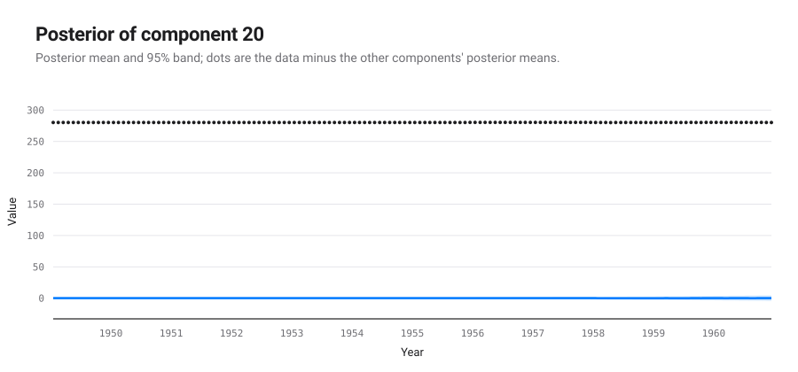

### Component 21: A rough function with quadraticly varying marginal standard deviation

This component is a rough function with a typical lengthscale of 4.3 months. The marginal standard deviation of the function varies quadraticly. Its sample paths are continuous but not differentiable (gamma-exponential exponent 1.03).

This component explains -0.0% of the data's variance on its own; with the components above it, 99.8%. Adding it changes the cross-validated MAE by -0.0%.

*Extrapolation.* This component is assumed to continue roughly but is also assumed to be stationary so its distribution will return to the prior. The prior distribution places mass on rough functions with a marginal mean of zero and a typical lengthscale of 4.3 months. The marginal standard deviation of the function is assumed to continue to vary quadraticly.

### Component 22: Uncorrelated noise

This component models uncorrelated noise.

This component explains 0.3% of the data's variance on its own; with the components above it, 99.9%. Adding it changes the cross-validated MAE by -0.0%.

*Extrapolation.* This component assumes the uncorrelated noise will continue indefinitely.

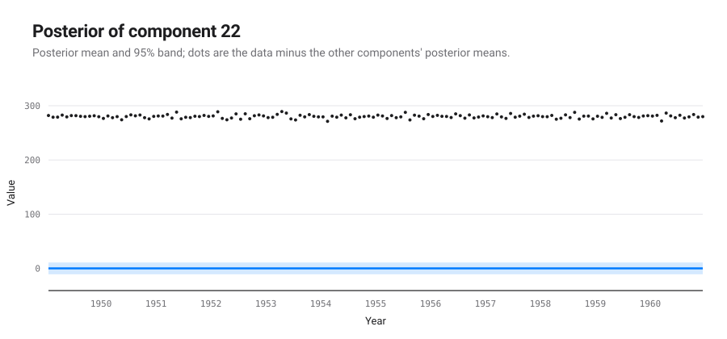

### Component 23: A rough function with cubicly varying marginal standard deviation

This component is a rough function with a typical lengthscale of 4.3 months. The marginal standard deviation of the function varies cubicly. Its sample paths are continuous but not differentiable (gamma-exponential exponent 1.03).

This component explains -0.0% of the data's variance on its own; with the components above it, 99.9%. Adding it changes the cross-validated MAE by 0.0%.

*Extrapolation.* This component is assumed to continue roughly but is also assumed to be stationary so its distribution will return to the prior. The prior distribution places mass on rough functions with a marginal mean of zero and a typical lengthscale of 4.3 months. The marginal standard deviation of the function is assumed to continue to vary cubicly.

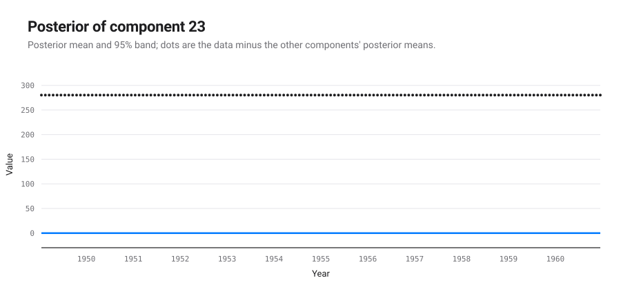

### Component 24: A rough function with quadraticly varying marginal standard deviation

This component is a rough function with a typical lengthscale of 4.3 months. The marginal standard deviation of the function varies quadraticly. Its sample paths are continuous but not differentiable (gamma-exponential exponent 1.03).

This component explains -0.0% of the data's variance on its own; with the components above it, 99.9%. Adding it changes the cross-validated MAE by 0.0%.

*Extrapolation.* This component is assumed to continue roughly but is also assumed to be stationary so its distribution will return to the prior. The prior distribution places mass on rough functions with a marginal mean of zero and a typical lengthscale of 4.3 months. The marginal standard deviation of the function is assumed to continue to vary quadraticly.

### Component 25: A rough function with cubicly varying marginal standard deviation

This component is a rough function with a typical lengthscale of 4.2 months. The marginal standard deviation of the function varies cubicly. Its sample paths are continuous but not differentiable (gamma-exponential exponent 0.52).

This component explains -0.0% of the data's variance on its own; with the components above it, 99.9%. Adding it changes the cross-validated MAE by 0.0%.

*Extrapolation.* This component is assumed to continue roughly but is also assumed to be stationary so its distribution will return to the prior. The prior distribution places mass on rough functions with a marginal mean of zero and a typical lengthscale of 4.2 months. The marginal standard deviation of the function is assumed to continue to vary cubicly.

### Component 26: A rough function with quadraticly varying marginal standard deviation

This component is a rough function with a typical lengthscale of 4.2 months. The marginal standard deviation of the function varies quadraticly. Its sample paths are continuous but not differentiable (gamma-exponential exponent 0.52).

This component explains -0.0% of the data's variance on its own; with the components above it, 99.9%. Adding it changes the cross-validated MAE by 0.0%.

*Extrapolation.* This component is assumed to continue roughly but is also assumed to be stationary so its distribution will return to the prior. The prior distribution places mass on rough functions with a marginal mean of zero and a typical lengthscale of 4.2 months. The marginal standard deviation of the function is assumed to continue to vary quadraticly.

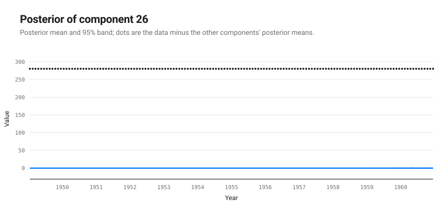

### Component 27: A rough function with quadraticly varying marginal standard deviation

This component is a rough function with a typical lengthscale of 4.3 months. The marginal standard deviation of the function varies quadraticly. Its sample paths are continuous but not differentiable (gamma-exponential exponent 1.03).

This component explains -0.0% of the data's variance on its own; with the components above it, 99.9%. Adding it changes the cross-validated MAE by 0.0%.

*Extrapolation.* This component is assumed to continue roughly but is also assumed to be stationary so its distribution will return to the prior. The prior distribution places mass on rough functions with a marginal mean of zero and a typical lengthscale of 4.3 months. The marginal standard deviation of the function is assumed to continue to vary quadraticly.

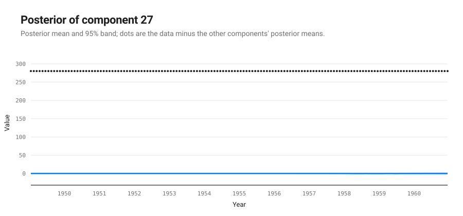

### Component 28: A rough function with quarticly varying marginal standard deviation

This component is a rough function with a typical lengthscale of 4.3 months. The marginal standard deviation of the function varies quarticly. Its sample paths are continuous but not differentiable (gamma-exponential exponent 1.03).

This component explains -0.0% of the data's variance on its own; with the components above it, 99.9%. Adding it changes the cross-validated MAE by 0.0%.

*Extrapolation.* This component is assumed to continue roughly but is also assumed to be stationary so its distribution will return to the prior. The prior distribution places mass on rough functions with a marginal mean of zero and a typical lengthscale of 4.3 months. The marginal standard deviation of the function is assumed to continue to vary quarticly.

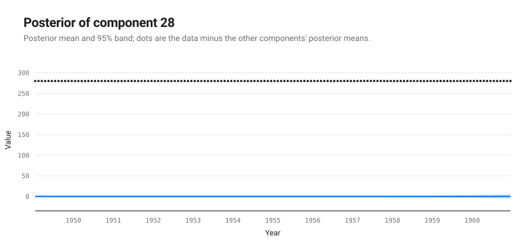

### Component 29: A rough function with cubicly varying marginal standard deviation

This component is a rough function with a typical lengthscale of 4.3 months. The marginal standard deviation of the function varies cubicly. Its sample paths are continuous but not differentiable (gamma-exponential exponent 1.03).

This component explains -0.0% of the data's variance on its own; with the components above it, 99.9%. Adding it changes the cross-validated MAE by 0.0%.

*Extrapolation.* This component is assumed to continue roughly but is also assumed to be stationary so its distribution will return to the prior. The prior distribution places mass on rough functions with a marginal mean of zero and a typical lengthscale of 4.3 months. The marginal standard deviation of the function is assumed to continue to vary cubicly.

### Component 30: A rough function with quadraticly varying marginal standard deviation

This component is a rough function with a typical lengthscale of 4.2 months. The marginal standard deviation of the function varies quadraticly. Its sample paths are continuous but not differentiable (gamma-exponential exponent 0.52).

This component explains -0.0% of the data's variance on its own; with the components above it, 99.9%. Adding it changes the cross-validated MAE by 0.0%.

*Extrapolation.* This component is assumed to continue roughly but is also assumed to be stationary so its distribution will return to the prior. The prior distribution places mass on rough functions with a marginal mean of zero and a typical lengthscale of 4.2 months. The marginal standard deviation of the function is assumed to continue to vary quadraticly.

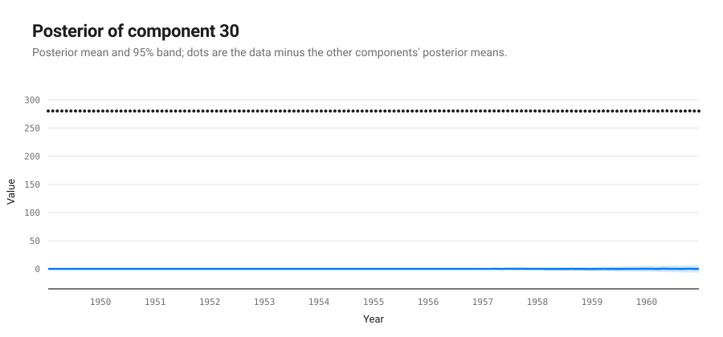

### Component 31: A rough function with cubicly varying marginal standard deviation

This component is a rough function with a typical lengthscale of 4.3 months. The marginal standard deviation of the function varies cubicly. Its sample paths are continuous but not differentiable (gamma-exponential exponent 1.03).

This component explains -0.0% of the data's variance on its own; with the components above it, 99.9%. Adding it changes the cross-validated MAE by 0.0%.

*Extrapolation.* This component is assumed to continue roughly but is also assumed to be stationary so its distribution will return to the prior. The prior distribution places mass on rough functions with a marginal mean of zero and a typical lengthscale of 4.3 months. The marginal standard deviation of the function is assumed to continue to vary cubicly.

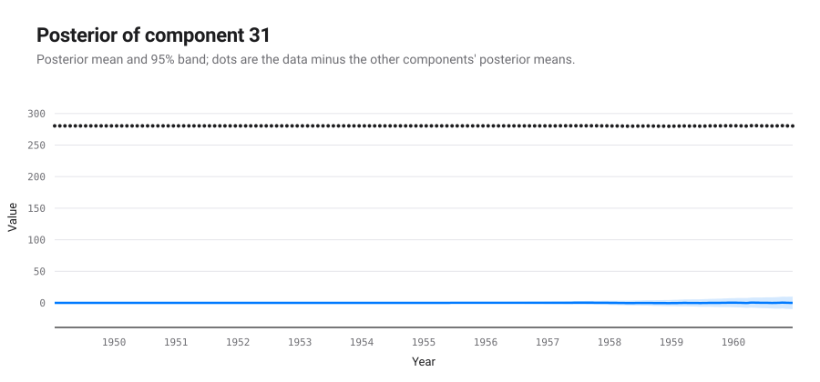

### Component 32: A rough function with marginal standard deviation increasing linearly away from Jun 1954

This component is a rough function with a typical lengthscale of 4.3 months. The marginal standard deviation of the function increases linearly away from Jun 1954. Its sample paths are continuous but not differentiable (gamma-exponential exponent 1.03).

This component explains 0.0% of the data's variance on its own; with the components above it, 99.9%. Adding it changes the cross-validated MAE by 0.0%.

*Extrapolation.* This component is assumed to continue roughly but is also assumed to be stationary so its distribution will return to the prior. The prior distribution places mass on rough functions with a marginal mean of zero and a typical lengthscale of 4.3 months. The marginal standard deviation of the function is assumed to continue to increase linearly.

### Component 33: A rough function with quadraticly varying marginal standard deviation

This component is a rough function with a typical lengthscale of 4.3 months. The marginal standard deviation of the function varies quadraticly. Its sample paths are continuous but not differentiable (gamma-exponential exponent 1.03).

This component explains -0.0% of the data's variance on its own; with the components above it, 99.9%. Adding it changes the cross-validated MAE by 0.0%.

*Extrapolation.* This component is assumed to continue roughly but is also assumed to be stationary so its distribution will return to the prior. The prior distribution places mass on rough functions with a marginal mean of zero and a typical lengthscale of 4.3 months. The marginal standard deviation of the function is assumed to continue to vary quadraticly.

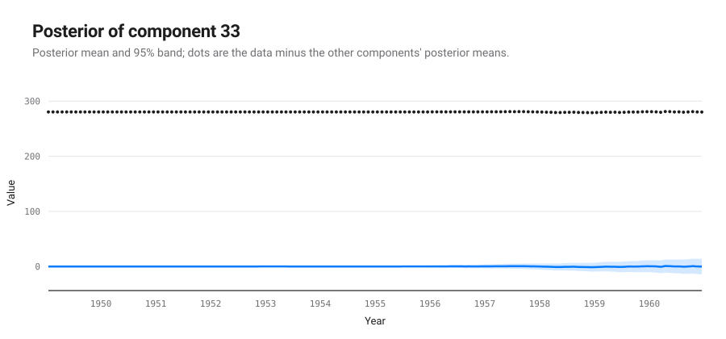

### Component 34: A rough function with cubicly varying marginal standard deviation

This component is a rough function with a typical lengthscale of 4.3 months. The marginal standard deviation of the function varies cubicly. Its sample paths are continuous but not differentiable (gamma-exponential exponent 1.03).

This component explains -0.0% of the data's variance on its own; with the components above it, 99.9%. Adding it changes the cross-validated MAE by 0.0%.

*Extrapolation.* This component is assumed to continue roughly but is also assumed to be stationary so its distribution will return to the prior. The prior distribution places mass on rough functions with a marginal mean of zero and a typical lengthscale of 4.3 months. The marginal standard deviation of the function is assumed to continue to vary cubicly.

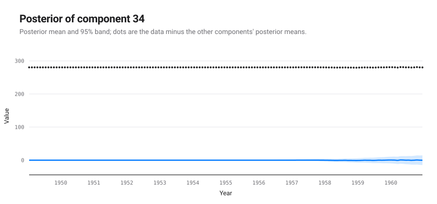

### Component 35: A rough function with marginal standard deviation increasing linearly away from Jun 1954

This component is a rough function with a typical lengthscale of 4.2 months. The marginal standard deviation of the function increases linearly away from Jun 1954. Its sample paths are continuous but not differentiable (gamma-exponential exponent 0.52).

This component explains 0.1% of the data's variance on its own; with the components above it, 99.9%. Adding it changes the cross-validated MAE by 0.0%.

*Extrapolation.* This component is assumed to continue roughly but is also assumed to be stationary so its distribution will return to the prior. The prior distribution places mass on rough functions with a marginal mean of zero and a typical lengthscale of 4.2 months. The marginal standard deviation of the function is assumed to continue to increase linearly.

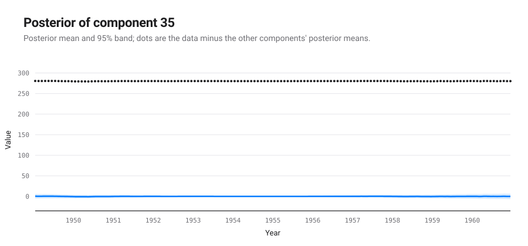

### Component 36: A cubic polynomial

This component is a cubic polynomial.

This component explains -5.3% of the data's variance on its own; with the components above it, 100.0%. Adding it changes the cross-validated MAE by 1.5%.

*Extrapolation.* This component is assumed to continue as a cubic polynomial.

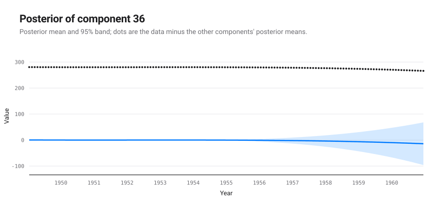

### Component 37: A constant

This component is constant.

This component explains -0.0% of the data's variance on its own; with the components above it, 100.0%. Adding it changes the cross-validated MAE by 47.4%.

*Extrapolation.* This component is assumed to stay constant.

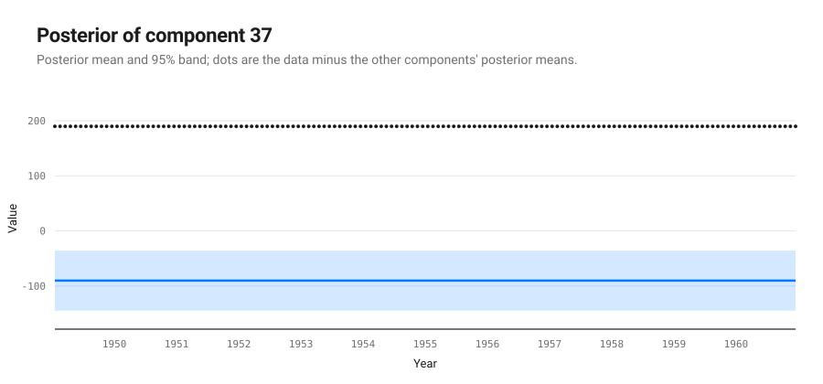

## Model checking

Each statistic compares draws of a component's posterior with draws of its prior. A small p-value (bold below 0.05) points at a property of the data that the component's prior does not reproduce.

| # | QQ max | QQ min | ACF min | ACF min lag | Periodogram max | Periodogram peak | MMD |
|---|---|---|---|---|---|---|---|
| 1 | 0.790 | 0.676 | 0.982 | 0.988 | 0.950 | 0.974 | **0.000** |
| 2 | 0.842 | 0.576 | 0.976 | 0.966 | 0.806 | 0.998 | **0.001** |
| 3 | 0.742 | 0.800 | 0.980 | 0.994 | 0.998 | 0.998 | **0.004** |
| 4 | 0.818 | 0.850 | 0.988 | 0.970 | 0.986 | 0.980 | 0.259 |
| 5 | 0.960 | 0.718 | 0.936 | 0.984 | 0.792 | 0.904 | 0.130 |
| 6 | 0.918 | 0.976 | 0.922 | 0.948 | 0.844 | 0.980 | **0.001** |
| 7 | 0.904 | 0.770 | 0.844 | 0.916 | 0.754 | 0.784 | **0.000** |
| 8 | 0.528 | 0.676 | 0.922 | 0.992 | 0.716 | 0.482 | **0.000** |
| 9 | 0.938 | 0.962 | 0.820 | 0.958 | 0.926 | 0.950 | 0.605 |
| 10 | 0.966 | 0.974 | 0.872 | 0.958 | 0.892 | 0.848 | 0.111 |
| 11 | 0.630 | 0.448 | 0.916 | 0.942 | 0.896 | 0.598 | 0.756 |
| 12 | 0.970 | 0.984 | 0.902 | 0.932 | 0.882 | 0.928 | 0.682 |
| 13 | 0.990 | 0.978 | 0.964 | 0.974 | 1.000 | 0.960 | 0.389 |
| 14 | 0.988 | 0.998 | 0.950 | 0.988 | 0.996 | 0.972 | 0.061 |
| 15 | 0.988 | 0.938 | 0.970 | 0.936 | 0.978 | 0.930 | 0.749 |
| 16 | 0.972 | 0.984 | 0.994 | 0.958 | 0.966 | 0.958 | 0.503 |
| 17 | 0.988 | 0.998 | 0.942 | 0.992 | 0.992 | 0.976 | 0.287 |
| 18 | 0.996 | 0.984 | 0.970 | 0.990 | 1.000 | 0.966 | 0.561 |
| 19 | 0.986 | 0.990 | 0.976 | 0.982 | 0.978 | 0.960 | 0.704 |
| 20 | 0.950 | 0.930 | 0.972 | 0.982 | 0.964 | 0.926 | 0.565 |
| 21 | 0.956 | 0.946 | 0.962 | 0.976 | 0.980 | 0.988 | 0.827 |
| 22 | 0.994 | 0.914 | 0.958 | 0.954 | 0.962 | 0.986 | **0.003** |
| 23 | 0.968 | 0.978 | 0.994 | 0.998 | 0.984 | 0.994 | 0.500 |
| 24 | 0.972 | 0.976 | 0.994 | 0.970 | 0.982 | 0.996 | 0.375 |
| 25 | 0.958 | 0.970 | 0.948 | 0.944 | 0.990 | 0.952 | 0.716 |
| 26 | 0.976 | 0.934 | 0.988 | 0.960 | 0.994 | 0.988 | 0.443 |
| 27 | 0.998 | 0.982 | 0.988 | 0.982 | 0.992 | 0.986 | 0.586 |
| 28 | 0.982 | 0.994 | 0.974 | 1.000 | 0.952 | 0.966 | 0.916 |
| 29 | 0.988 | 0.968 | 0.974 | 0.998 | 0.982 | 0.980 | 0.789 |
| 30 | 0.988 | 0.968 | 0.978 | 1.000 | 0.982 | 0.970 | 0.425 |
| 31 | 0.984 | 0.966 | 0.992 | 0.964 | 0.992 | 0.998 | 0.914 |
| 32 | 0.968 | 0.942 | 0.976 | 0.984 | 0.986 | 0.994 | 0.860 |
| 33 | 0.976 | 0.948 | 0.944 | 0.988 | 0.998 | 0.934 | 0.097 |
| 34 | 0.942 | 0.990 | 0.994 | 0.972 | 0.958 | 0.998 | 0.682 |
| 35 | 0.972 | 0.966 | 0.974 | 0.950 | 0.974 | 0.944 | 0.261 |
| 36 | 0.950 | 0.680 | 0.986 | 0.994 | 0.656 | 0.986 | **0.000** |
| 37 | 0.388 | 0.388 | 0.810 | 0.646 | 0.682 | 0.972 | **0.000** |

QQ: quantile-quantile gaps. ACF: autocorrelation function. MMD: maximum mean discrepancy two-sample test.
