# An automatic report for the dataset: 02-solar

*Produced by `autostat` (automatic-statistician-revisited), a Python 3 port of the Automatic Bayesian Covariance Discovery system of Lloyd et al. (AAAI 2014).*

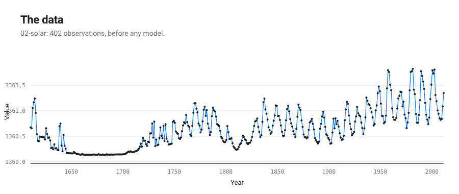

## Executive summary

The structure search selected `CW(Lin x WN + Lin x WN + Per x SE + SE + SE, C + WN) + C` (Bayesian information criterion -870.3; negative log likelihood -489.1 on 402 points). It decomposes into 8 additive components, listed by how much each reduces extrapolation error:

1. A constant.
2. A constant. This function applies from 1643 until 1716.
3. A smooth function. This function applies until 1643 and from 1716 onwards.
4. An approximately periodic function with a period of 10.8 years. This function applies until 1643 and from 1716 onwards.
5. A rapidly varying smooth function. This function applies until 1643 and from 1716 onwards.
6. Uncorrelated noise with standard deviation increasing linearly away from 1952. This function applies until 1643 and from 1716 onwards.
7. Uncorrelated noise with standard deviation increasing linearly away from 1837. This function applies until 1643 and from 1716 onwards.
8. Uncorrelated noise. This function applies from 1643 until 1716.

| # | R² cumulative (%) | Residual variance explained (%) | Cross-validated MAE | MAE reduction (%) |
|---|---|---|---|---|
| data | | | 1.36e+03 | |
| 1 | -0.0 | -0.0 | 0.335 | 100.0 |
| 2 | 37.4 | 37.4 | 0.228 | 32.0 |
| 3 | 72.8 | 56.6 | 0.18 | 21.1 |
| 4 | 92.3 | 71.5 | 0.149 | 16.8 |
| 5 | 98.1 | 75.9 | 0.149 | 0.4 |
| 6 | 99.0 | 47.1 | 0.149 | 0.0 |
| 7 | 100.0 | 99.9 | 0.149 | 0.0 |
| 8 | 100.0 | 100.0 | 0.149 | 0.0 |

MAE: mean absolute error over ten contiguous held-out blocks.

## The formula found

The structure search is a symbolic regression: it searches a grammar of expressions over kernels and keeps the one with the lowest Bayesian information criterion. This is the expression it kept, with every fitted parameter in place; $t$ is in years.

$$y(t) = f_{1}(t) + f_{2}(t) + f_{3}(t) + f_{4}(t) + f_{5}(t) + f_{6}(t) + f_{7}(t) + f_{8}(t)$$

Each component is a Gaussian process with its own covariance:

$$f_{1}(t) \sim \mathrm{GP}\!\left(0,\ 3.139 \times 10^{6}\right)$$

$$f_{2}(t) \sim \mathrm{GP}\!\left(0,\ w_{1}(t)\,w_{1}(t')\left[0.2846\right]\right)$$

$$f_{3}(t) \sim \mathrm{GP}\!\left(0,\ (1 - w_{1}(t))(1 - w_{1}(t'))\left[0.05948\,\exp\!\left(-\frac{(t - t')^2}{2 \cdot 23.1^2}\right)\right]\right)$$

$$f_{4}(t) \sim \mathrm{GP}\!\left(0,\ (1 - w_{1}(t))(1 - w_{1}(t'))\left[0.03376\,\frac{\exp\!\left(4.734 \times 10^{-4}\cos\frac{2\pi (t - t')}{10.76}\right) - I_0(4.734 \times 10^{-4})}{e^{4.734 \times 10^{-4}} - I_0(4.734 \times 10^{-4})} \cdot \exp\!\left(-\frac{(t - t')^2}{2 \cdot 36.86^2}\right)\right]\right)$$

$$f_{5}(t) \sim \mathrm{GP}\!\left(0,\ (1 - w_{1}(t))(1 - w_{1}(t'))\left[0.01394\,\exp\!\left(-\frac{(t - t')^2}{2 \cdot 1.603^2}\right)\right]\right)$$

$$f_{6}(t) \sim \mathrm{GP}\!\left(0,\ (1 - w_{1}(t))(1 - w_{1}(t'))\left[7.6 \times 10^{-8}\,(t - 1953)(t' - 1953) \cdot \delta_{t t'}\right]\right)$$

$$f_{7}(t) \sim \mathrm{GP}\!\left(0,\ (1 - w_{1}(t))(1 - w_{1}(t'))\left[3.812 \times 10^{-7}\,(t - 1837)(t' - 1837) \cdot \delta_{t t'}\right]\right)$$

$$f_{8}(t) \sim \mathrm{GP}\!\left(0,\ w_{1}(t)\,w_{1}(t')\left[8.288 \times 10^{-6}\,\delta_{t t'}\right]\right)$$

The changes of regime weigh the components with:

$$w_{1}(t) = \tfrac{1}{4}\left(1 + \tanh\left(0.1293\,(t - 1643)\right)\right)\left(1 - \tanh\left(0.1293\,(t - 1716)\right)\right)$$

These components have a closed form, read from their posterior mean:

$$f_{1}(t) = 1361$$

$$f_{2}(t) = -0.5964\,w_{1}(t)$$

The other components are smooth, quasi-periodic or noise without a short formula: a draw from such a process has no finite closed form; its covariance above is the formula.

Closed form of each component:

| # | component | closed form |
|---|---|---|
| 1 | A constant | exact polynomial of degree 0 |
| 2 | A constant. This function applies from 1643 until 1716 | exact polynomial of degree 0 |
| 3 | A smooth function. This function applies until 1643 and from 1716 onwards | none: the covariance is the formula |
| 4 | An approximately periodic function with a period of 10.8 years. This function applies until 1643 and from 1716 onwards | none: the covariance is the formula |
| 5 | A rapidly varying smooth function. This function applies until 1643 and from 1716 onwards | none: the covariance is the formula |
| 6 | Uncorrelated noise with standard deviation increasing linearly away from 1952. This function applies until 1643 and from 1716 onwards | none: the covariance is the formula |
| 7 | Uncorrelated noise with standard deviation increasing linearly away from 1837. This function applies until 1643 and from 1716 onwards | none: the covariance is the formula |
| 8 | Uncorrelated noise. This function applies from 1643 until 1716 | none: the covariance is the formula |

## Search path and stopping criterion

The 2014 configuration searches a fixed number of levels and keeps the lowest BIC; it has no stopping rule. The table follows the winner of each level. A change of structure adds or removes terms; a level that keeps the structure only refits its parameters. BIC differences read on the scale of Kass and Raftery (1995): under 2 barely worth mentioning, 2 to 6 positive, 6 to 10 strong, over 10 very strong.

| level | BIC | change | structure | components | closed | params |
|---|---|---|---|---|---|---|
| 1 | 59.6 |  | WN + SE | 2 | 0 | 3 |
| 2 | -313.0 | -372.6 | CW(WN, C) + SE | 3 | 1 | 7 |
| 3 | -381.8 | -68.8 | CW(WN + SE, C) + SE | 4 | 1 | 9 |
| 4 | -676.6 | -294.9 | CW(WN + Per x SE + SE, C) + SE | 5 | 1 | 13 |
| 5 | -786.5 | -109.8 | CW(WN + Per x SE + SE, C + WN) + SE | 6 | 1 | 14 |
| 6 | -826.1 | -39.6 | CW(WN + Per x SE + SE + SE, C + WN) + SE | 7 | 1 | 16 |
| 7 | -859.2 | -33.1 | CW(Lin x WN + Per x SE + SE + SE, C + WN) + SE | 7 | 1 | 17 |
| 8 | -865.8 | -6.6 | CW(Lin x WN + Per x SE + SE + SE, C + WN) + C | 7 | 2 | 16 |
| 9 | -869.4 | -3.6 | CW(Lin x WN + Lin x WN + Per x SE + SE + SE, C + WN) + C | 8 | 2 | 18 |
| 10 (kept) | -870.3 | -0.9 | CW(Lin x WN + Lin x WN + Per x SE + SE + SE, C + WN) + C | 8 | 2 | 18 |

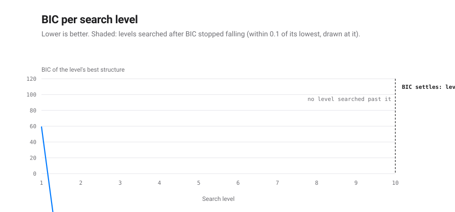

Posterior weight of each structure met, exp(-BIC/2) normalised under a flat prior, after the Bayesian machine scientist (Guimerà et al., 2020): where the search keeps one structure, the weights say how much the data prefer it to the others. The 6 structure(s) under 0.001 are left out.

| structure | lowest BIC | weight |
|---|---|---|
| CW(Lin x WN + Lin x WN + Per x SE + SE + SE, C + WN) + C | -870.3 | 0.900 |
| CW(Lin x WN + Per x SE + SE + SE, C + WN) + C | -865.8 | 0.096 |
| CW(Lin x WN + Per x SE + SE + SE, C + WN) + SE | -859.2 | 0.004 |

- The search ran 10 levels (the published 2014 search: ten levels, no stopping rule) and keeps the model of level 10, CW(Lin x WN + Lin x WN + Per x SE + SE + SE, C + WN) + C, BIC -870.3.
- That structure was first reached at level 9; the levels after it only refitted its parameters, lowering BIC by 0.9 in all.
- The best different structure, CW(Lin x WN + Per x SE + SE + SE, C + WN) + C (level 8), is 4.5 above it: positive evidence for the kept one on the Kass and Raftery scale.
- Weighed by exp(-BIC/2) under a flat prior, as the Bayesian machine scientist weighs expressions, the structures met give the kept one a posterior weight of 0.900 and the next, CW(Lin x WN + Per x SE + SE + SE, C + WN) + C, 0.096: the data favour the kept one without ruling the next out.
- The last level lowered BIC by 0.9 through its parameters only: the structure had settled, its fit had not quite.
- A rule stopping after 1 level(s) without a fall above 0.1 would not have stopped within these 10 levels.
- A rule stopping after 2 level(s) without a fall above 0.1 would not have stopped within these 10 levels.
- The kept expression has 18 parameters for 402 points: its BIC is a fit term 2 NLL = -978.2 plus a complexity term p ln n = 107.9, each extra parameter costing 6.00; it splits into 8 components, 2 of them with a closed form.

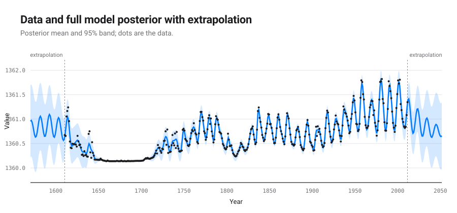

## Detailed discussion of the components

### Component 1: A constant

This component is constant.

This component explains -0.0% of the data's variance on its own; with the components above it, -0.0%. Adding it changes the cross-validated MAE by -100.0%.

*Extrapolation.* This component is assumed to stay constant.

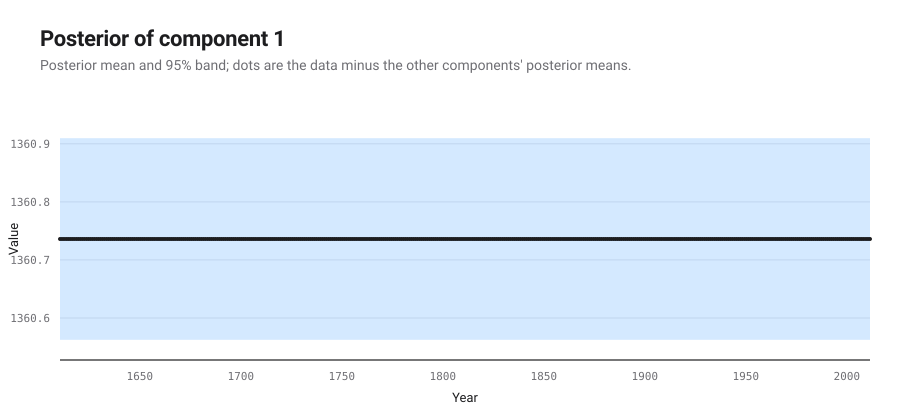

### Component 2: A constant. This function applies from 1643 until 1716

This component is constant. This component applies from 1643 until 1716.

This component explains 37.4% of the data's variance on its own; with the components above it, 37.4%. Adding it changes the cross-validated MAE by -32.0%.

*Extrapolation.* This component is assumed to stop before the end of the data and will therefore be extrapolated as zero.

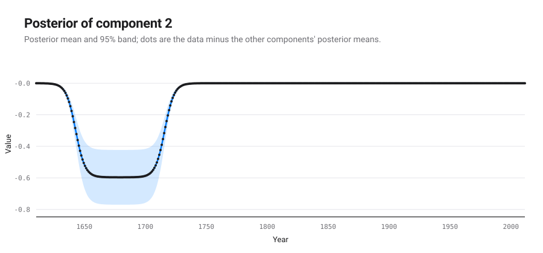

### Component 3: A smooth function. This function applies until 1643 and from 1716 onwards

This component is a smooth function with a typical lengthscale of 23.1 years. This component applies until 1643 and from 1716 onwards.

This component explains 41.8% of the data's variance on its own; with the components above it, 72.8%. Adding it changes the cross-validated MAE by -21.1%.

*Extrapolation.* This component is assumed to continue smoothly but is also assumed to be stationary so its distribution will return to the prior. The prior distribution places mass on smooth functions with a marginal mean of zero and a typical lengthscale of 23.1 years.

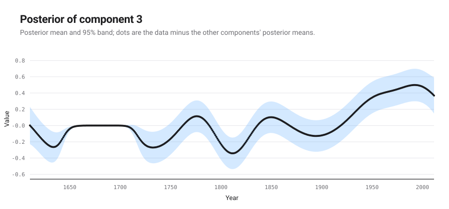

### Component 4: An approximately periodic function with a period of 10.8 years. This function applies until 1643 and from 1716 onwards

This component is approximately periodic with a period of 10.8 years. Across periods the shape of this function varies smoothly with a typical lengthscale of 36.9 years. The shape of this function within each period is very smooth and resembles a sinusoid. This component applies until 1643 and from 1716 onwards.

This component explains 19.0% of the data's variance on its own; with the components above it, 92.3%. Adding it changes the cross-validated MAE by -16.8%.

*Extrapolation.* This component is assumed to continue to be approximately periodic. The shape of the function is assumed to vary smoothly between periods but will return to the prior. The prior is entirely uncertain about the phase of the periodic function. Consequently the pointwise posterior will appear to lose its periodicity, but this merely reflects the uncertainty in the shape and phase of the function.

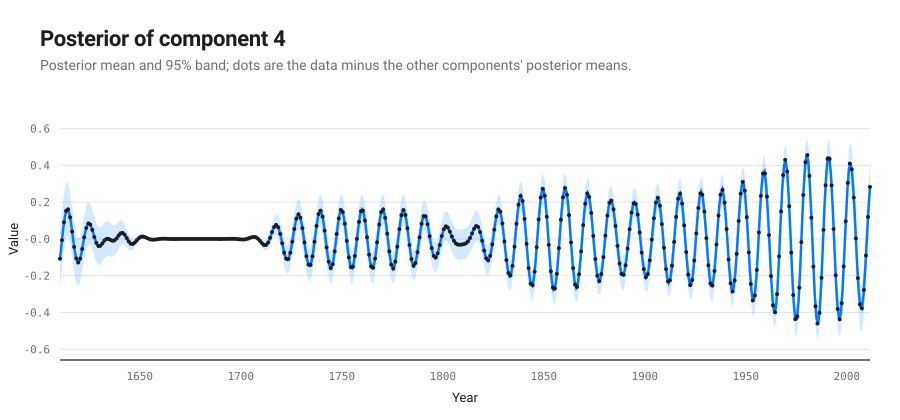

### Component 5: A rapidly varying smooth function. This function applies until 1643 and from 1716 onwards

This component is a rapidly varying but smooth function with a typical lengthscale of 1.6 years. This component applies until 1643 and from 1716 onwards.

This component explains 10.9% of the data's variance on its own; with the components above it, 98.1%. Adding it changes the cross-validated MAE by -0.4%.

*Extrapolation.* This component is assumed to continue smoothly but its distribution is assumed to quickly return to the prior. The prior distribution places mass on smooth functions with a marginal mean of zero and a typical lengthscale of 1.6 years.

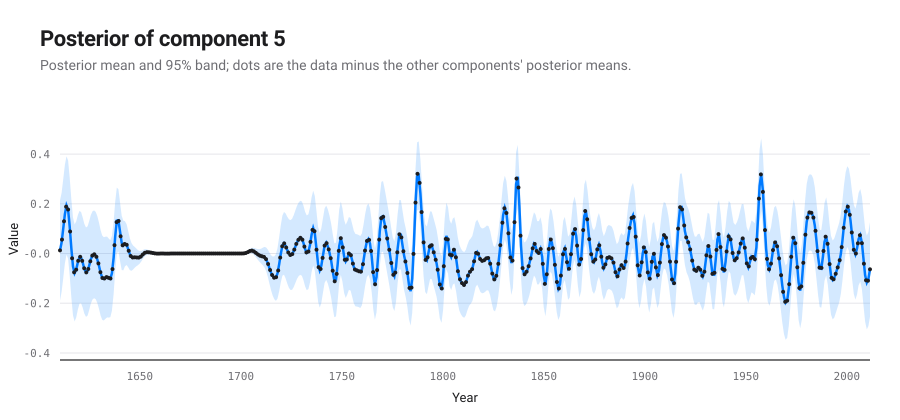

### Component 6: Uncorrelated noise with standard deviation increasing linearly away from 1952. This function applies until 1643 and from 1716 onwards

This component models uncorrelated noise. The standard deviation of the noise increases linearly away from 1952. This component applies until 1643 and from 1716 onwards.

This component explains 1.6% of the data's variance on its own; with the components above it, 99.0%. Adding it changes the cross-validated MAE by -0.0%.

*Extrapolation.* This component assumes the uncorrelated noise will continue indefinitely. The standard deviation of the noise is assumed to continue to increase linearly.

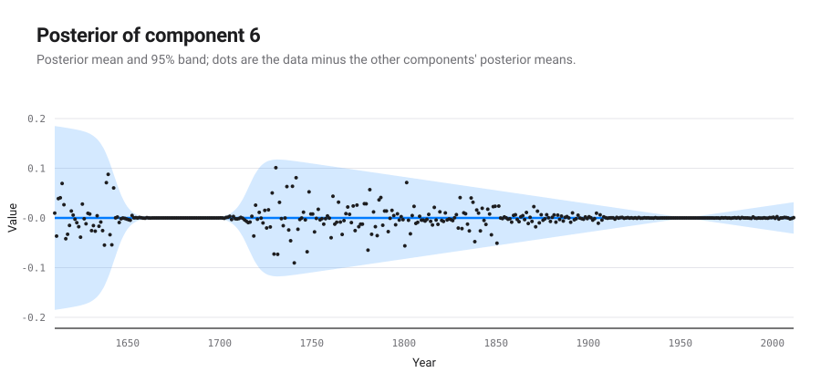

### Component 7: Uncorrelated noise with standard deviation increasing linearly away from 1837. This function applies until 1643 and from 1716 onwards

This component models uncorrelated noise. The standard deviation of the noise increases linearly away from 1837. This component applies until 1643 and from 1716 onwards.

This component explains 3.6% of the data's variance on its own; with the components above it, 100.0%. Adding it changes the cross-validated MAE by -0.0%.

*Extrapolation.* This component assumes the uncorrelated noise will continue indefinitely. The standard deviation of the noise is assumed to continue to increase linearly.

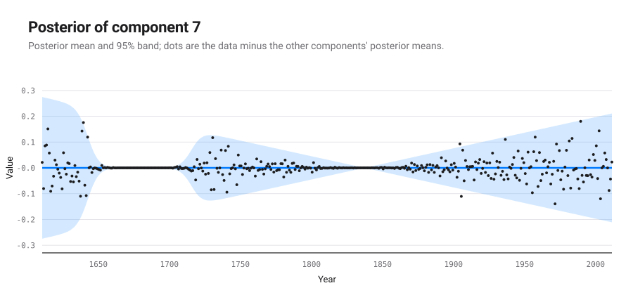

### Component 8: Uncorrelated noise. This function applies from 1643 until 1716

This component models uncorrelated noise. This component applies from 1643 until 1716.

This component explains 0.0% of the data's variance on its own; with the components above it, 100.0%. Adding it changes the cross-validated MAE by -0.0%.

*Extrapolation.* This component is assumed to stop before the end of the data and will therefore be extrapolated as zero.

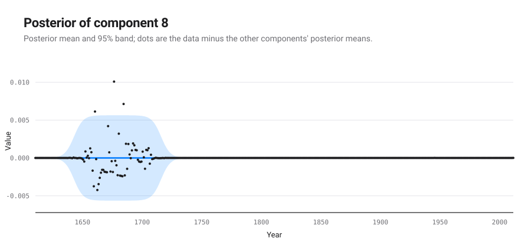

## Model checking

Each statistic compares draws of a component's posterior with draws of its prior. A small p-value (bold below 0.05) points at a property of the data that the component's prior does not reproduce.

| # | QQ max | QQ min | ACF min | ACF min lag | Periodogram max | Periodogram peak | MMD |
|---|---|---|---|---|---|---|---|
| 1 | 0.468 | 0.468 | **0.000** | **0.000** | 0.876 | 0.934 | **0.000** |
| 2 | 0.244 | 0.556 | 0.992 | 0.968 | 0.482 | 0.980 | **0.000** |
| 3 | 0.776 | 0.500 | 0.066 | 0.194 | 0.550 | 0.472 | **0.000** |
| 4 | 0.408 | 0.400 | 0.900 | 0.990 | 0.856 | 0.734 | **0.000** |
| 5 | 0.324 | 0.514 | 0.862 | 0.984 | 0.788 | 0.928 | **0.000** |
| 6 | 0.968 | 0.856 | 0.978 | 0.956 | 0.956 | 0.988 | **0.009** |
| 7 | 0.988 | 0.612 | 0.914 | 0.964 | 0.978 | 0.950 | **0.005** |
| 8 | **0.024** | 0.618 | 0.992 | 0.964 | 0.960 | 0.978 | 0.650 |

QQ: quantile-quantile gaps. ACF: autocorrelation function. MMD: maximum mean discrepancy two-sample test.
