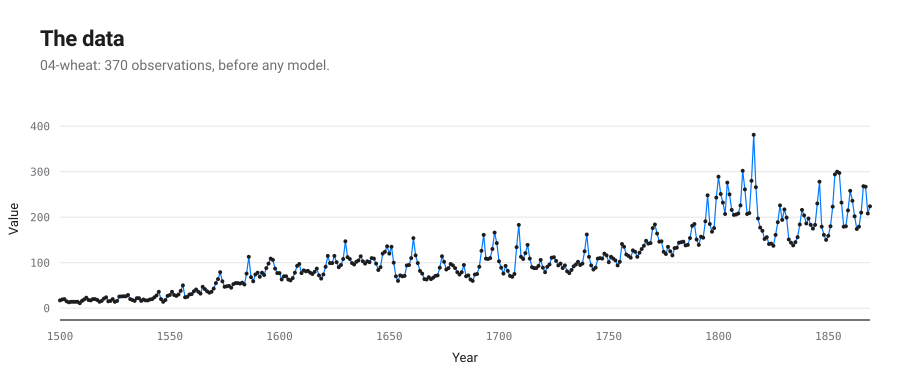
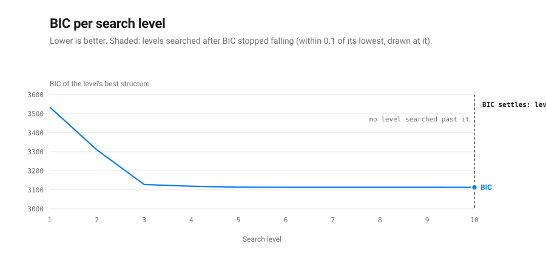
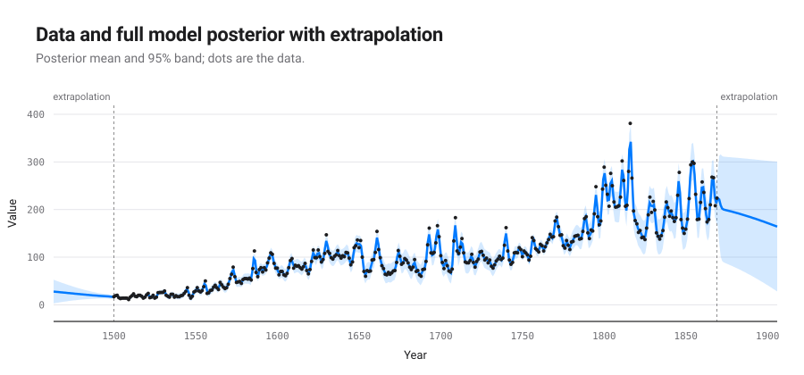
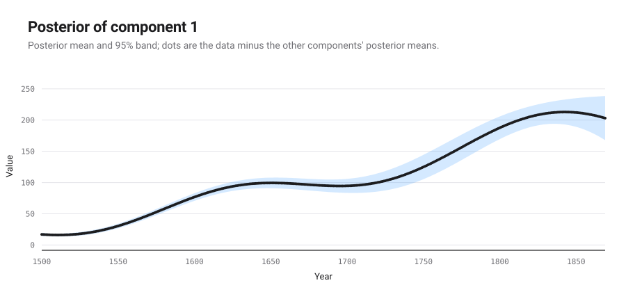
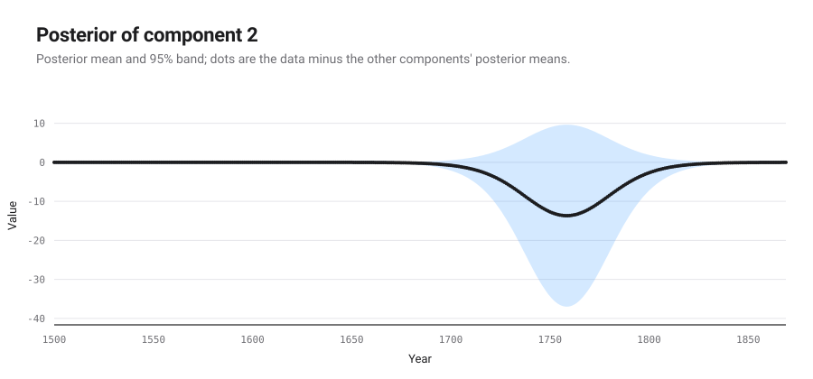
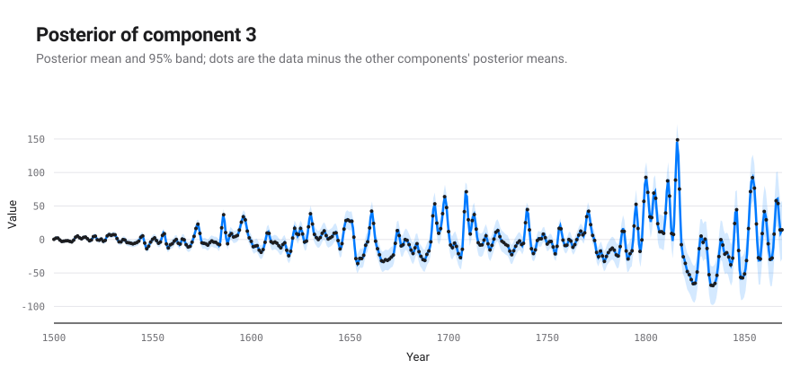
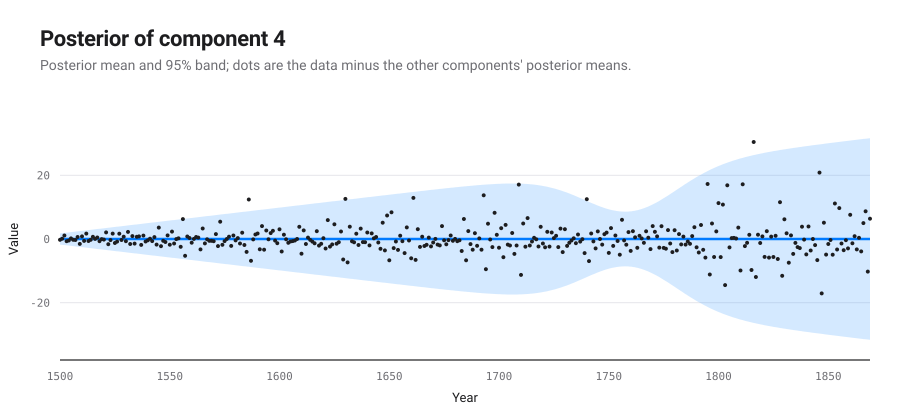

# An automatic report for the dataset: 04-wheat

*Produced by `autostat` (automatic-statistician-revisited), a Python 3 port of the Automatic Bayesian Covariance Discovery system of Lloyd et al. (AAAI 2014).*

## Executive summary

The structure search selected `CW(Lin x SE + Lin x WN, C) + SE` (Bayesian information criterion 3113.0; negative log likelihood 1524.0 on 370 points). It decomposes into 4 additive components, listed by how much each reduces extrapolation error:

1. A smooth function.
2. A constant. This function applies from 1741 until 1775.
3. A rapidly varying smooth function with linearly increasing marginal standard deviation. This function applies until 1741 and from 1775 onwards.
4. Uncorrelated noise with linearly increasing standard deviation. This function applies until 1741 and from 1775 onwards.

| # | R² cumulative (%) | Residual variance explained (%) | Cross-validated MAE | MAE reduction (%) |
|---|---|---|---|---|
| data | | | 108 | |
| 1 | 81.7 | 81.7 | 22.5 | 79.1 |
| 2 | 82.1 | 2.2 | 21.4 | 5.1 |
| 3 | 99.5 | 97.2 | 21 | 1.5 |
| 4 | 100.0 | 100.0 | 21 | 0.0 |

MAE: mean absolute error over ten contiguous held-out blocks.

## The formula found

The structure search is a symbolic regression: it searches a grammar of expressions over kernels and keeps the one with the lowest Bayesian information criterion. This is the expression it kept, with every fitted parameter in place; $t$ is in years.

$$y(t) = f_{1}(t) + f_{2}(t) + f_{3}(t) + f_{4}(t)$$

Each component is a Gaussian process with its own covariance:

$$f_{1}(t) \sim \mathrm{GP}\!\left(0,\ 10983\,\exp\!\left(-\frac{(t - t')^2}{2 \cdot 91.79^2}\right)\right)$$

$$f_{2}(t) \sim \mathrm{GP}\!\left(0,\ w_{1}(t)\,w_{1}(t')\left[901.9\right]\right)$$

$$f_{3}(t) \sim \mathrm{GP}\!\left(0,\ (1 - w_{1}(t))(1 - w_{1}(t'))\left[0.01706\,(t - 1487)(t' - 1487) \cdot \exp\!\left(-\frac{(t - t')^2}{2 \cdot 1.2^2}\right)\right]\right)$$

$$f_{4}(t) \sim \mathrm{GP}\!\left(0,\ (1 - w_{1}(t))(1 - w_{1}(t'))\left[0.001711\,(t - 1478)(t' - 1478) \cdot \delta_{t t'}\right]\right)$$

The changes of regime weigh the components with:

$$w_{1}(t) = \tfrac{1}{4}\left(1 + \tanh\left(0.03948\,(t - 1742)\right)\right)\left(1 - \tanh\left(0.03948\,(t - 1775)\right)\right)$$

These components have a closed form, read from their posterior mean:

$$f_{2}(t) = -22\,w_{1}(t)$$

The other components are smooth, quasi-periodic or noise without a short formula: a draw from such a process has no finite closed form; its covariance above is the formula.

Closed form of each component:

| # | component | closed form |
|---|---|---|
| 1 | A smooth function | none: the covariance is the formula |
| 2 | A constant. This function applies from 1741 until 1775 | exact polynomial of degree 0 |
| 3 | A rapidly varying smooth function with linearly increasing marginal standard deviation. This function applies until 1741 and from 1775 onwards | none: the covariance is the formula |
| 4 | Uncorrelated noise with linearly increasing standard deviation. This function applies until 1741 and from 1775 onwards | none: the covariance is the formula |

## Search path and stopping criterion

The 2014 configuration searches a fixed number of levels and keeps the lowest BIC; it has no stopping rule. The table follows the winner of each level. A change of structure adds or removes terms; a level that keeps the structure only refits its parameters. BIC differences read on the scale of Kass and Raftery (1995): under 2 barely worth mentioning, 2 to 6 positive, 6 to 10 strong, over 10 very strong.

| level | BIC | change | structure | components | closed | params |
|---|---|---|---|---|---|---|
| 1 | 3534.8 |  | WN + SE | 2 | 0 | 3 |
| 2 | 3309.6 | -225.3 | WN + Lin x WN + Lin x SE + SE | 4 | 0 | 8 |
| 3 | 3127.9 | -181.6 | WN + Lin x WN + Lin x SE + SE | 4 | 0 | 8 |
| 4 | 3119.1 | -8.8 | CW(Lin x SE + Lin x WN, C) + WN + SE | 5 | 1 | 12 |
| 5 | 3114.1 | -5.0 | CW(Lin x SE + Lin x WN, C) + SE | 4 | 1 | 11 |
| 6 | 3113.4 | -0.6 | CW(Lin x SE + Lin x WN, C) + SE | 4 | 1 | 11 |
| 7 | 3113.2 | -0.2 | CW(Lin x SE + Lin x WN, C) + SE | 4 | 1 | 11 |
| 8 | 3113.2 | +0.0 | CW(Lin x SE + Lin x WN, C) + SE | 4 | 1 | 11 |
| 9 | 3113.2 | -0.1 | CW(Lin x SE + Lin x WN, C) + SE | 4 | 1 | 11 |
| 10 (kept) | 3113.0 | -0.2 | CW(Lin x SE + Lin x WN, C) + SE | 4 | 1 | 11 |

Posterior weight of each structure met, exp(-BIC/2) normalised under a flat prior, after the Bayesian machine scientist (Guimerà et al., 2020): where the search keeps one structure, the weights say how much the data prefer it to the others. The 2 structure(s) under 0.001 are left out.

| structure | lowest BIC | weight |
|---|---|---|
| CW(Lin x SE + Lin x WN, C) + SE | 3113.0 | 0.953 |
| CW(Lin x SE + Lin x WN, C) + WN + SE | 3119.1 | 0.046 |

- The search ran 10 levels (the published 2014 search: ten levels, no stopping rule) and keeps the model of level 10, CW(Lin x SE + Lin x WN, C) + SE, BIC 3113.0.
- That structure was first reached at level 5; the levels after it only refitted its parameters, lowering BIC by 1.1 in all.
- The best different structure, CW(Lin x SE + Lin x WN, C) + WN + SE (level 4), is 6.0 above it: strong evidence for the kept one on the Kass and Raftery scale.
- Weighed by exp(-BIC/2) under a flat prior, as the Bayesian machine scientist weighs expressions, the structures met give the kept one a posterior weight of 0.953 and the next, CW(Lin x SE + Lin x WN, C) + WN + SE, 0.046: the kept one takes almost all the weight.
- The last level lowered BIC by 0.2 through its parameters only: the structure had settled, its fit had not quite.
- A rule stopping after 1 level(s) without a fall above 0.1 would have ended the search at level 8 and kept the same structure, less refitted.
- A rule stopping after 2 level(s) without a fall above 0.1 would have ended the search at level 9 and kept the same structure, less refitted.
- The kept expression has 11 parameters for 370 points: its BIC is a fit term 2 NLL = 3048.0 plus a complexity term p ln n = 65.0, each extra parameter costing 5.91; it splits into 4 components, 1 of them with a closed form.

## Detailed discussion of the components

### Component 1: A smooth function

This component is a smooth function with a typical lengthscale of 91.8 years.

This component explains 81.7% of the data's variance on its own; with the components above it, 81.7%. Adding it changes the cross-validated MAE by -79.1%.

*Extrapolation.* This component is assumed to continue smoothly but is also assumed to be stationary so its distribution will return to the prior. The prior distribution places mass on smooth functions with a marginal mean of zero and a typical lengthscale of 91.8 years.

### Component 2: A constant. This function applies from 1741 until 1775

This component is constant. This component applies from 1741 until 1775.

This component explains -2.3% of the data's variance on its own; with the components above it, 82.1%. Adding it changes the cross-validated MAE by -5.1%.

*Extrapolation.* This component is assumed to stop before the end of the data and will therefore be extrapolated as zero.

### Component 3: A rapidly varying smooth function with linearly increasing marginal standard deviation. This function applies until 1741 and from 1775 onwards

This component is a rapidly varying but smooth function with a typical lengthscale of 1.2 years. The marginal standard deviation of the function increases linearly. This component applies until 1741 and from 1775 onwards.

This component explains 18.5% of the data's variance on its own; with the components above it, 99.5%. Adding it changes the cross-validated MAE by -1.5%.

*Extrapolation.* This component is assumed to continue smoothly but its distribution is assumed to quickly return to the prior. The prior distribution places mass on smooth functions with a marginal mean of zero and a typical lengthscale of 1.2 years. The marginal standard deviation of the function is assumed to continue to increase linearly.

### Component 4: Uncorrelated noise with linearly increasing standard deviation. This function applies until 1741 and from 1775 onwards

This component models uncorrelated noise. The standard deviation of the noise increases linearly. This component applies until 1741 and from 1775 onwards.

This component explains 2.7% of the data's variance on its own; with the components above it, 100.0%. Adding it changes the cross-validated MAE by -0.0%.

*Extrapolation.* This component assumes the uncorrelated noise will continue indefinitely. The standard deviation of the noise is assumed to continue to increase linearly.

## Model checking

Each statistic compares draws of a component's posterior with draws of its prior. A small p-value (bold below 0.05) points at a property of the data that the component's prior does not reproduce.

| # | QQ max | QQ min | ACF min | ACF min lag | Periodogram max | Periodogram peak | MMD |
|---|---|---|---|---|---|---|---|
| 1 | 0.142 | 0.190 | 0.836 | 0.136 | 0.498 | 0.332 | **0.000** |
| 2 | 0.590 | 0.592 | 0.970 | 0.990 | 0.928 | 0.952 | **0.000** |
| 3 | 0.136 | 0.422 | 0.284 | 0.798 | 0.050 | 0.420 | **0.000** |
| 4 | 0.746 | 0.676 | 0.996 | 0.990 | 0.986 | 0.978 | **0.000** |

QQ: quantile-quantile gaps. ACF: autocorrelation function. MMD: maximum mean discrepancy two-sample test.
