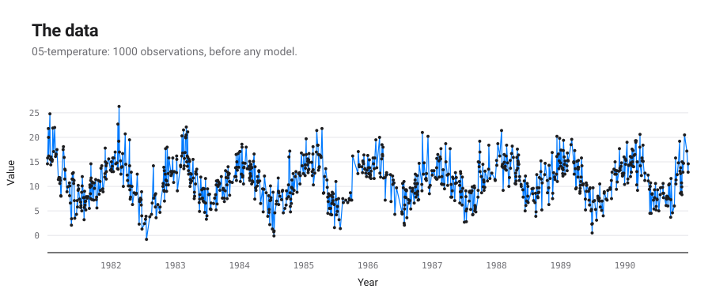
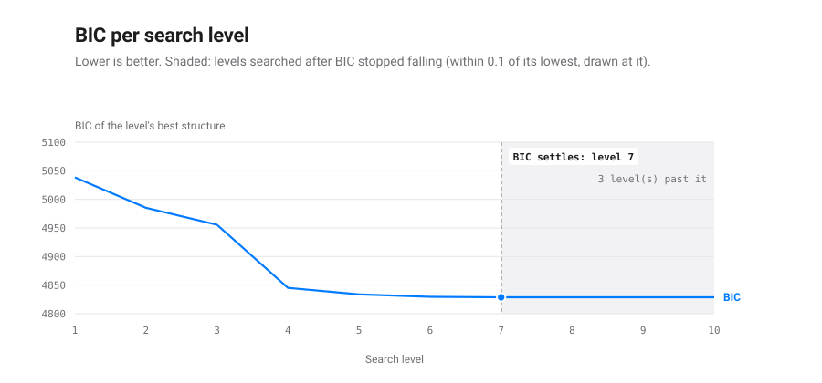
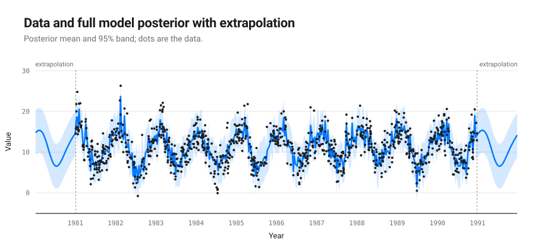
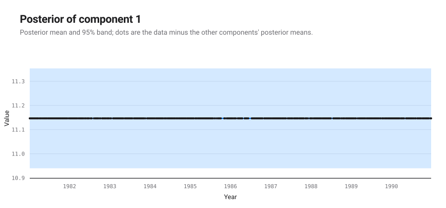
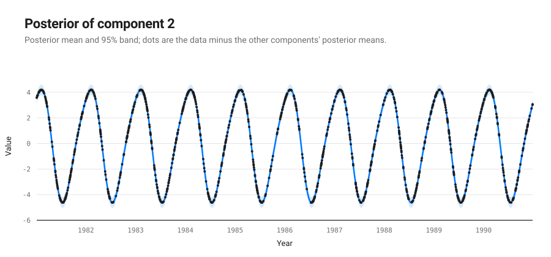
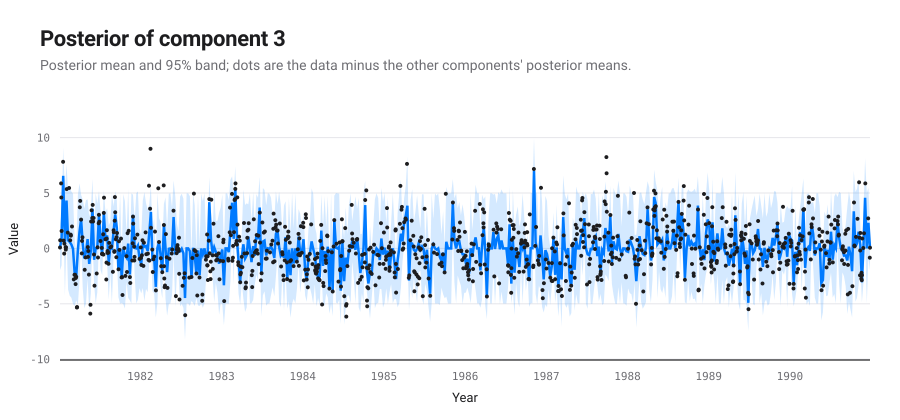
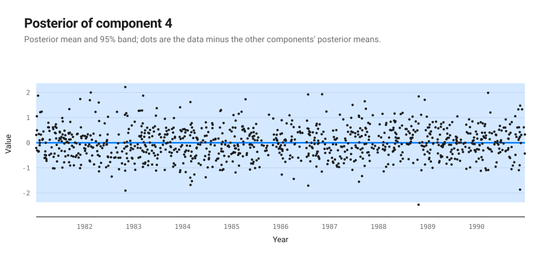

# An automatic report for the dataset: 05-temperature

*Produced by `autostat` (automatic-statistician-revisited), a Python 3 port of the Automatic Bayesian Covariance Discovery system of Lloyd et al. (AAAI 2014).*

## Executive summary

The structure search selected `C + WN + Per + SE` (Bayesian information criterion 4828.7; negative log likelihood 2390.2 on 1000 points). It decomposes into 4 additive components, listed by how much each reduces extrapolation error:

1. A constant.
2. A periodic function with a period of 1.0 years.
3. A rapidly varying smooth function.
4. Uncorrelated noise.

| # | R² cumulative (%) | Residual variance explained (%) | Cross-validated MAE | MAE reduction (%) |
|---|---|---|---|---|
| data | | | 11.2 | |
| 1 | 0.0 | 0.0 | 3.34 | 70.2 |
| 2 | 54.6 | 54.6 | 2.23 | 33.4 |
| 3 | 97.8 | 95.1 | 2.22 | 0.1 |
| 4 | 100.0 | 100.0 | 2.22 | 0.0 |

MAE: mean absolute error over ten contiguous held-out blocks.

## The formula found

The structure search is a symbolic regression: it searches a grammar of expressions over kernels and keeps the one with the lowest Bayesian information criterion. This is the expression it kept, with every fitted parameter in place; $t$ is in years.

$$y(t) = f_{1}(t) + f_{2}(t) + f_{3}(t) + f_{4}(t)$$

Each component is a Gaussian process with its own covariance:

$$f_{1}(t) \sim \mathrm{GP}\!\left(0,\ 147.7\right)$$

$$f_{2}(t) \sim \mathrm{GP}\!\left(0,\ 7.967\,\frac{\exp\!\left(0.1033\cos\frac{2\pi (t - t')}{1.001}\right) - I_0(0.1033)}{e^{0.1033} - I_0(0.1033)}\right)$$

$$f_{3}(t) \sim \mathrm{GP}\!\left(0,\ 6.432\,\exp\!\left(-\frac{(t - t')^2}{2 \cdot 0.003448^2}\right)\right)$$

$$f_{4}(t) \sim \mathrm{GP}\!\left(0,\ 1.459\,\delta_{t t'}\right)$$

These components have a closed form, read from their posterior mean:

$$f_{1}(t) = 11.15$$

$$f_{2}(t) \approx 4.293\cos\!\left(\frac{2\pi \cdot (t - 1981)}{1.001} - 0.3861\right) + 0.5723\cos\!\left(\frac{2\pi \cdot 2 \cdot (t - 1981)}{1.001} - 2.754\right) + 0.009047\cos\!\left(\frac{2\pi \cdot 3 \cdot (t - 1981)}{1.001} + 1.623\right)$$

A periodic kernel is exactly a sum of cosines, so a periodic component is a Fourier series in its period; it is written up to the harmonic after which the rest weighs less than 0.1 % of the component, hence the approximate sign.

The other components are smooth, quasi-periodic or noise without a short formula: a draw from such a process has no finite closed form; its covariance above is the formula.

Closed form of each component:

| # | component | closed form |
|---|---|---|
| 1 | A constant | exact polynomial of degree 0 |
| 2 | A periodic function with a period of 1.0 years | Fourier series, 3 harmonics, largest gap 0.011 % of the component |
| 3 | A rapidly varying smooth function | none: the covariance is the formula |
| 4 | Uncorrelated noise | none: the covariance is the formula |

## Search path and stopping criterion

The 2014 configuration searches a fixed number of levels and keeps the lowest BIC; it has no stopping rule. The table follows the winner of each level. A change of structure adds or removes terms; a level that keeps the structure only refits its parameters. BIC differences read on the scale of Kass and Raftery (1995): under 2 barely worth mentioning, 2 to 6 positive, 6 to 10 strong, over 10 very strong.

| level | BIC | change | structure | components | closed | params |
|---|---|---|---|---|---|---|
| 1 | 5038.5 |  | SE + WN | 2 | 0 | 3 |
| 2 | 4985.2 | -53.3 | Per + SE + WN | 3 | 1 | 6 |
| 3 | 4955.6 | -29.6 | Per + Per x SE + SE + SE + WN | 5 | 1 | 12 |
| 4 | 4845.2 | -110.4 | Per + SE + SE + WN | 4 | 1 | 8 |
| 5 | 4833.9 | -11.3 | C + Per + SE | 3 | 2 | 6 |
| 6 | 4829.5 | -4.4 | C + Per + SE + WN | 4 | 2 | 7 |
| 7 | 4828.8 | -0.7 | C + Per + SE + WN | 4 | 2 | 7 |
| 8 | 4828.8 | +0.0 | C + Per + SE + WN | 4 | 2 | 7 |
| 9 (kept) | 4828.7 | -0.1 | C + Per + SE + WN | 4 | 2 | 7 |
| 10 | 4828.7 | +0.0 | C + Per + SE + WN | 4 | 2 | 7 |

Posterior weight of each structure met, exp(-BIC/2) normalised under a flat prior, after the Bayesian machine scientist (Guimerà et al., 2020): where the search keeps one structure, the weights say how much the data prefer it to the others. The 4 structure(s) under 0.001 are left out.

| structure | lowest BIC | weight |
|---|---|---|
| C + Per + SE + WN | 4828.7 | 0.931 |
| C + Per + SE | 4833.9 | 0.069 |

- The search ran 10 levels (the published 2014 search: ten levels, no stopping rule) and keeps the model of level 9, C + Per + SE + WN, BIC 4828.7.
- That structure was first reached at level 6; the levels after it only refitted its parameters, lowering BIC by 0.8 in all.
- The best different structure, C + Per + SE (level 5), is 5.2 above it: positive evidence for the kept one on the Kass and Raftery scale.
- Weighed by exp(-BIC/2) under a flat prior, as the Bayesian machine scientist weighs expressions, the structures met give the kept one a posterior weight of 0.931 and the next, C + Per + SE, 0.069: the data favour the kept one without ruling the next out.
- BIC stopped falling at level 7. The 3 level(s) searched past it kept its structure and lowered BIC by 0.09 in all, less than the tolerance of 0.1: going on buys nothing the data pay for.
- A rule stopping after 1 level(s) without a fall above 0.1 would have ended the search at level 8 and kept the same structure, less refitted.
- A rule stopping after 2 level(s) without a fall above 0.1 would have ended the search at level 9 and kept the same model.
- The kept expression has 7 parameters for 1000 points: its BIC is a fit term 2 NLL = 4780.3 plus a complexity term p ln n = 48.4, each extra parameter costing 6.91; it splits into 4 components, 2 of them with a closed form.

## Detailed discussion of the components

### Component 1: A constant

This component is constant.

This component explains 0.0% of the data's variance on its own; with the components above it, 0.0%. Adding it changes the cross-validated MAE by -70.2%.

*Extrapolation.* This component is assumed to stay constant.

### Component 2: A periodic function with a period of 1.0 years

This component is periodic with a period of 1.0 years. The shape of this function within each period has a typical lengthscale of 5.9 months.

This component explains 54.6% of the data's variance on its own; with the components above it, 54.6%. Adding it changes the cross-validated MAE by -33.4%.

*Extrapolation.* This component is assumed to continue periodically with a period of 1.0 years.

### Component 3: A rapidly varying smooth function

This component is a rapidly varying but smooth function with a typical lengthscale of 30.2 hours.

This component explains 41.8% of the data's variance on its own; with the components above it, 97.8%. Adding it changes the cross-validated MAE by -0.1%.

*Extrapolation.* This component is assumed to continue smoothly but its distribution is assumed to quickly return to the prior. The prior distribution places mass on smooth functions with a marginal mean of zero and a typical lengthscale of 30.2 hours.

### Component 4: Uncorrelated noise

This component models uncorrelated noise.

This component explains 14.8% of the data's variance on its own; with the components above it, 100.0%. Adding it changes the cross-validated MAE by -0.0%.

*Extrapolation.* This component assumes the uncorrelated noise will continue indefinitely.

## Model checking

Each statistic compares draws of a component's posterior with draws of its prior. A small p-value (bold below 0.05) points at a property of the data that the component's prior does not reproduce.

| # | QQ max | QQ min | ACF min | ACF min lag | Periodogram max | Periodogram peak | MMD |
|---|---|---|---|---|---|---|---|
| 1 | 0.330 | 0.330 | 0.992 | 0.954 | 0.728 | 0.966 | **0.000** |
| 2 | 0.508 | 0.680 | 0.876 | 0.460 | 0.646 | 0.990 | **0.000** |
| 3 | 0.214 | 0.280 | 0.906 | 0.772 | 0.894 | 0.734 | **0.000** |
| 4 | 0.834 | 0.896 | 0.992 | 0.990 | 0.954 | 0.998 | **0.000** |

QQ: quantile-quantile gaps. ACF: autocorrelation function. MMD: maximum mean discrepancy two-sample test.
