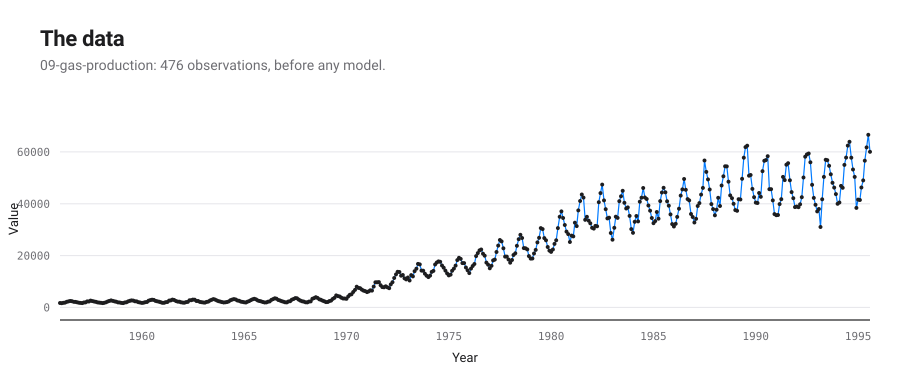
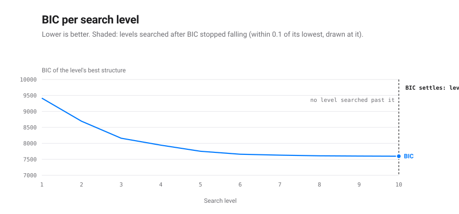
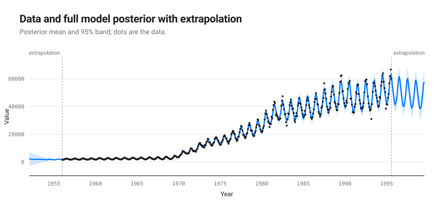
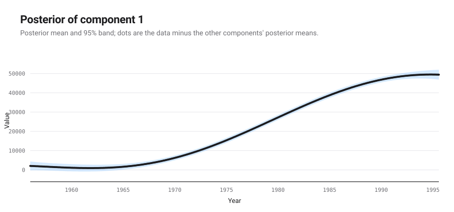
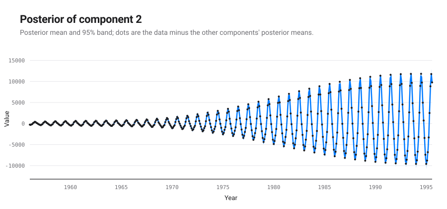
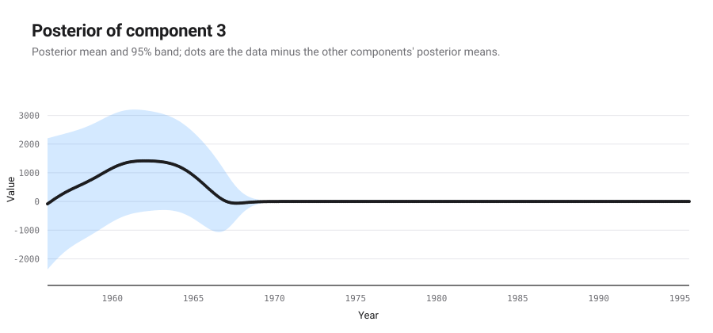
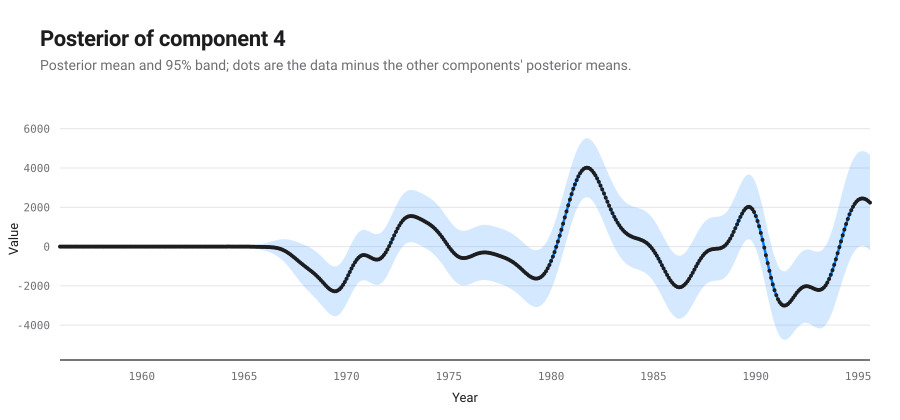
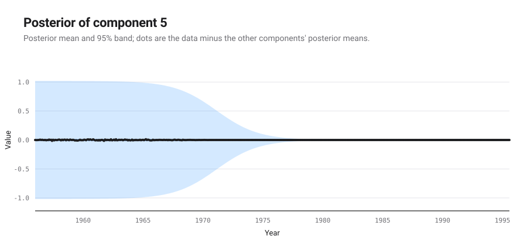
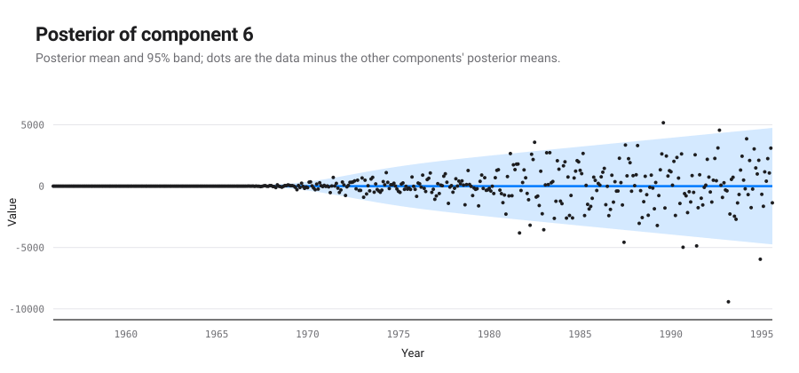
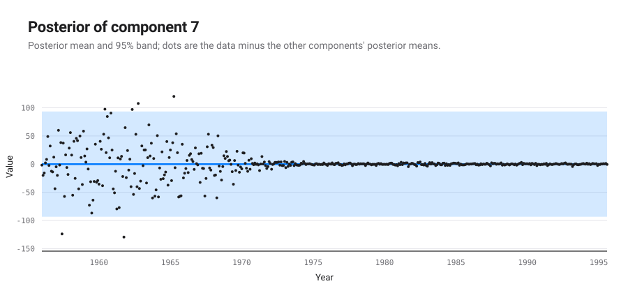

# An automatic report for the dataset: 09-gas-production

*Produced by `autostat` (automatic-statistician-revisited), a Python 3 port of the Automatic Bayesian Covariance Discovery system of Lloyd et al. (AAAI 2014).*

## Executive summary

The structure search selected `CP(SE, SE) + CP(WN, Lin x WN) + WN + Lin x SE + Per x SE` (Bayesian information criterion 7597.1; negative log likelihood 3740.0 on 476 points). It decomposes into 7 additive components, listed by how much each reduces extrapolation error:

1. A very smooth function with linearly decreasing marginal standard deviation.
2. An approximately periodic function with a period of 1.0 years.
3. A smooth function. This function applies until 1967.
4. A smooth function. This function applies from 1967 onwards.
5. Uncorrelated noise. This function applies until 1971.
6. Uncorrelated noise with standard deviation increasing linearly away from 1962. This function applies from 1971 onwards.
7. Uncorrelated noise.

| # | R² cumulative (%) | Residual variance explained (%) | Cross-validated MAE | MAE reduction (%) |
|---|---|---|---|---|
| data | | | 2.14e+04 | |
| 1 | 94.0 | 94.0 | 3.2e+03 | 85.0 |
| 2 | 98.8 | 80.5 | 1.72e+03 | 46.3 |
| 3 | 98.9 | 6.5 | 1.51e+03 | 12.0 |
| 4 | 99.5 | 57.9 | 1.45e+03 | 4.1 |
| 5 | 99.5 | 0.0 | 1.45e+03 | 0.0 |
| 6 | 100.0 | 100.0 | 1.45e+03 | 0.0 |
| 7 | 100.0 | 100.0 | 1.45e+03 | 0.0 |

MAE: mean absolute error over ten contiguous held-out blocks.

## The formula found

The structure search is a symbolic regression: it searches a grammar of expressions over kernels and keeps the one with the lowest Bayesian information criterion. This is the expression it kept, with every fitted parameter in place; $t$ is in years.

$$y(t) = f_{1}(t) + f_{2}(t) + f_{3}(t) + f_{4}(t) + f_{5}(t) + f_{6}(t) + f_{7}(t)$$

Each component is a Gaussian process with its own covariance:

$$f_{1}(t) \sim \mathrm{GP}\!\left(0,\ 1.002 \times 10^{6}\,(t - 2028)(t' - 2028) \cdot \exp\!\left(-\frac{(t - t')^2}{2 \cdot 22.08^2}\right)\right)$$

$$f_{2}(t) \sim \mathrm{GP}\!\left(0,\ 8.877 \times 10^{6}\,\frac{\exp\!\left(0.6776\cos\frac{2\pi (t - t')}{0.9997}\right) - I_0(0.6776)}{e^{0.6776} - I_0(0.6776)} \cdot \exp\!\left(-\frac{(t - t')^2}{2 \cdot 15.36^2}\right)\right)$$

$$f_{3}(t) \sim \mathrm{GP}\!\left(0,\ (1 - w_{1}(t))(1 - w_{1}(t'))\left[1.92 \times 10^{6}\,\exp\!\left(-\frac{(t - t')^2}{2 \cdot 2.281^2}\right)\right]\right)$$

$$f_{4}(t) \sim \mathrm{GP}\!\left(0,\ w_{1}(t)\,w_{1}(t')\left[2.428 \times 10^{6}\,\exp\!\left(-\frac{(t - t')^2}{2 \cdot 0.9494^2}\right)\right]\right)$$

$$f_{5}(t) \sim \mathrm{GP}\!\left(0,\ (1 - w_{2}(t))(1 - w_{2}(t'))\left[0.2706\,\delta_{t t'}\right]\right)$$

$$f_{6}(t) \sim \mathrm{GP}\!\left(0,\ w_{2}(t)\,w_{2}(t')\left[5425\,(t - 1963)(t' - 1963) \cdot \delta_{t t'}\right]\right)$$

$$f_{7}(t) \sim \mathrm{GP}\!\left(0,\ 2274\,\delta_{t t'}\right)$$

The changes of regime weigh the components with:

$$w_{1}(t) = \tfrac{1}{2}\left(1 + \tanh\left(0.9769\,(t - 1967)\right)\right)$$

$$w_{2}(t) = \tfrac{1}{2}\left(1 + \tanh\left(0.2855\,(t - 1971)\right)\right)$$

These components have a closed form, read from their posterior mean:

$$f_{1}(t) \approx 21.46 u^{2} - \frac{612.4 u \cos{\left(0.1047 u \right)}}{\tanh{\left(u \right)}} + 2936.0,\quad u = t - 1956$$

A periodic kernel is exactly a sum of cosines, so a periodic component is a Fourier series in its period; it is written up to the harmonic after which the rest weighs less than 0.1 % of the component, hence the approximate sign.

The other components are smooth, quasi-periodic or noise without a short formula: a draw from such a process has no finite closed form; its covariance above is the formula.

Closed form of each component:

| # | component | closed form |
|---|---|---|
| 1 | A very smooth function with linearly decreasing marginal standard deviation | symbolic regression (PySR) on the posterior mean, largest gap 0.72 % of the component |
| 2 | An approximately periodic function with a period of 1.0 years | none: the covariance is the formula |
| 3 | A smooth function. This function applies until 1967 | none: the covariance is the formula |
| 4 | A smooth function. This function applies from 1967 onwards | none: the covariance is the formula |
| 5 | Uncorrelated noise. This function applies until 1971 | none: the covariance is the formula |
| 6 | Uncorrelated noise with standard deviation increasing linearly away from 1962. This function applies from 1971 onwards | none: the covariance is the formula |
| 7 | Uncorrelated noise | none: the covariance is the formula |

## Search path and stopping criterion

The 2014 configuration searches a fixed number of levels and keeps the lowest BIC; it has no stopping rule. The table follows the winner of each level. A change of structure adds or removes terms; a level that keeps the structure only refits its parameters. BIC differences read on the scale of Kass and Raftery (1995): under 2 barely worth mentioning, 2 to 6 positive, 6 to 10 strong, over 10 very strong.

| level | BIC | change | structure | components | closed | params |
|---|---|---|---|---|---|---|
| 1 | 9416.3 |  | SE + WN | 2 | 0 | 3 |
| 2 | 8692.7 | -723.6 | Per x SE + SE + WN | 3 | 0 | 7 |
| 3 | 8160.7 | -532.0 | CP(WN, WN) + Per x SE + SE | 4 | 0 | 10 |
| 4 | 7942.7 | -218.0 | CP(WN, WN) + Per x SE + SE | 4 | 0 | 10 |
| 5 | 7751.6 | -191.1 | CP(Lin x WN, Lin x WN) + CP(WN, WN) + Lin x SE + Per x SE + SE | 7 | 0 | 19 |
| 6 | 7659.3 | -92.3 | CP(Lin x Lin, Lin x WN) + CP(WN, WN) + Lin x SE + Per x SE + SE | 7 | 1 | 20 |
| 7 | 7631.0 | -28.3 | CP(WN, Lin x WN) + CP(WN, WN) + Lin x SE + Per x SE + SE | 7 | 0 | 18 |
| 8 | 7608.8 | -22.2 | CP(WN, Lin x WN) + Lin x SE + Per x SE + SE + WN | 6 | 0 | 15 |
| 9 | 7601.8 | -7.0 | CP(WN, Lin x WN) + Lin x SE + Per x SE + SE + WN | 6 | 0 | 15 |
| 10 (kept) | 7597.1 | -4.6 | CP(SE, SE) + CP(WN, Lin x WN) + Lin x SE + Per x SE + WN | 7 | 0 | 19 |

Posterior weight of each structure met, exp(-BIC/2) normalised under a flat prior, after the Bayesian machine scientist (Guimerà et al., 2020): where the search keeps one structure, the weights say how much the data prefer it to the others. The 6 structure(s) under 0.001 are left out.

| structure | lowest BIC | weight |
|---|---|---|
| CP(SE, SE) + CP(WN, Lin x WN) + Lin x SE + Per x SE + WN | 7597.1 | 0.910 |
| CP(WN, Lin x WN) + Lin x SE + Per x SE + SE + WN | 7601.8 | 0.090 |

- The search ran 10 levels (the published 2014 search: ten levels, no stopping rule) and keeps the model of level 10, CP(SE, SE) + CP(WN, Lin x WN) + Lin x SE + Per x SE + WN, BIC 7597.1.
- The best different structure, CP(WN, Lin x WN) + Lin x SE + Per x SE + SE + WN (level 9), is 4.6 above it: positive evidence for the kept one on the Kass and Raftery scale.
- Weighed by exp(-BIC/2) under a flat prior, as the Bayesian machine scientist weighs expressions, the structures met give the kept one a posterior weight of 0.910 and the next, CP(WN, Lin x WN) + Lin x SE + Per x SE + SE + WN, 0.090: the data favour the kept one without ruling the next out.
- The last level still changed the structure and lowered BIC by 4.6: more levels might find a better expression.
- A rule stopping after 1 level(s) without a fall above 0.1 would not have stopped within these 10 levels.
- A rule stopping after 2 level(s) without a fall above 0.1 would not have stopped within these 10 levels.
- The kept expression has 19 parameters for 476 points: its BIC is a fit term 2 NLL = 7480.0 plus a complexity term p ln n = 117.1, each extra parameter costing 6.17; it splits into 7 components, 0 of them with a closed form.

## Detailed discussion of the components

### Component 1: A very smooth function with linearly decreasing marginal standard deviation

This component is a very smooth function. The marginal standard deviation of the function decreases linearly.

This component explains 94.0% of the data's variance on its own; with the components above it, 94.0%. Adding it changes the cross-validated MAE by -85.0%.

*Extrapolation.* This component is assumed to continue very smoothly but is also assumed to be stationary so its distribution will eventually return to the prior. The prior distribution places mass on smooth functions with a marginal mean of zero and a typical lengthscale of 22.1 years. The marginal standard deviation of the function is assumed to continue to decrease linearly until 2027 after which the marginal standard deviation of the function is assumed to start increasing linearly.

### Component 2: An approximately periodic function with a period of 1.0 years

This component is approximately periodic with a period of 1.0 years. Across periods the shape of this function varies smoothly with a typical lengthscale of 15.4 years. The shape of this function within each period has a typical lengthscale of 2.3 months.

This component explains 5.1% of the data's variance on its own; with the components above it, 98.8%. Adding it changes the cross-validated MAE by -46.3%.

*Extrapolation.* This component is assumed to continue to be approximately periodic. The shape of the function is assumed to vary smoothly between periods but will return to the prior. The prior is entirely uncertain about the phase of the periodic function. Consequently the pointwise posterior will appear to lose its periodicity, but this merely reflects the uncertainty in the shape and phase of the function.

### Component 3: A smooth function. This function applies until 1967

This component is a smooth function with a typical lengthscale of 2.3 years. This component applies until 1967.

This component explains -2.7% of the data's variance on its own; with the components above it, 98.9%. Adding it changes the cross-validated MAE by -12.0%.

*Extrapolation.* This component is assumed to stop before the end of the data and will therefore be extrapolated as zero.

### Component 4: A smooth function. This function applies from 1967 onwards

This component is a smooth function with a typical lengthscale of 0.9 years. This component applies from 1967 onwards.

This component explains 0.9% of the data's variance on its own; with the components above it, 99.5%. Adding it changes the cross-validated MAE by -4.1%.

*Extrapolation.* This component is assumed to continue smoothly but is also assumed to be stationary so its distribution will return to the prior. The prior distribution places mass on smooth functions with a marginal mean of zero and a typical lengthscale of 0.9 years.

### Component 5: Uncorrelated noise. This function applies until 1971

This component models uncorrelated noise. This component applies until 1971.

This component explains 0.0% of the data's variance on its own; with the components above it, 99.5%. Adding it changes the cross-validated MAE by -0.0%.

*Extrapolation.* This component is assumed to stop before the end of the data and will therefore be extrapolated as zero.

### Component 6: Uncorrelated noise with standard deviation increasing linearly away from 1962. This function applies from 1971 onwards

This component models uncorrelated noise. The standard deviation of the noise increases linearly away from 1962. This component applies from 1971 onwards.

This component explains 0.7% of the data's variance on its own; with the components above it, 100.0%. Adding it changes the cross-validated MAE by -0.0%.

*Extrapolation.* This component assumes the uncorrelated noise will continue indefinitely. The standard deviation of the noise is assumed to continue to increase linearly.

### Component 7: Uncorrelated noise

This component models uncorrelated noise.

This component explains 0.0% of the data's variance on its own; with the components above it, 100.0%. Adding it changes the cross-validated MAE by -0.0%.

*Extrapolation.* This component assumes the uncorrelated noise will continue indefinitely.

## Model checking

Each statistic compares draws of a component's posterior with draws of its prior. A small p-value (bold below 0.05) points at a property of the data that the component's prior does not reproduce.

| # | QQ max | QQ min | ACF min | ACF min lag | Periodogram max | Periodogram peak | MMD |
|---|---|---|---|---|---|---|---|
| 1 | 0.502 | 0.694 | 0.502 | 0.858 | 0.490 | 0.706 | **0.000** |
| 2 | 0.212 | 0.924 | 0.072 | 0.884 | 0.398 | 0.790 | **0.000** |
| 3 | 0.472 | 0.918 | 0.802 | 0.598 | 0.966 | 0.672 | **0.000** |
| 4 | 0.956 | 0.506 | 0.738 | 0.582 | 0.500 | 0.666 | **0.000** |
| 5 | 0.956 | 0.996 | 0.970 | 0.980 | 0.976 | 0.966 | 0.170 |
| 6 | 0.700 | **0.004** | 0.974 | 0.930 | 0.970 | 0.976 | **0.011** |
| 7 | 0.994 | 0.924 | 0.968 | 0.976 | 0.978 | 0.972 | **0.030** |

QQ: quantile-quantile gaps. ACF: autocorrelation function. MMD: maximum mean discrepancy two-sample test.
