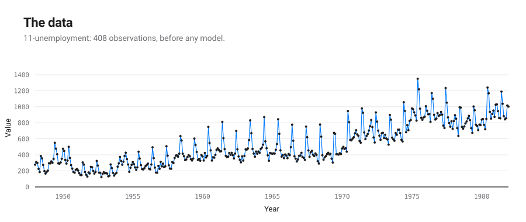
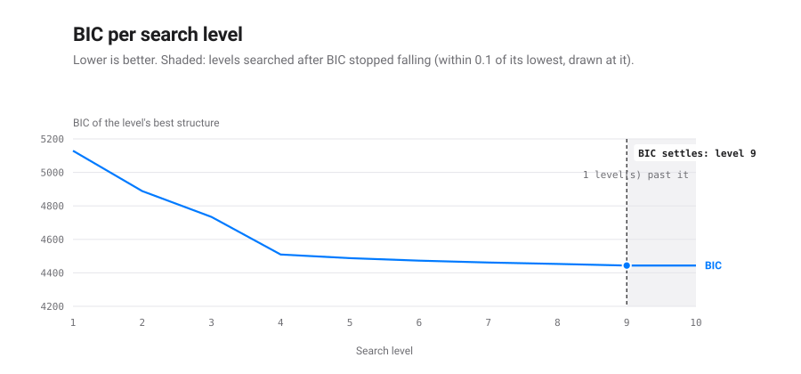
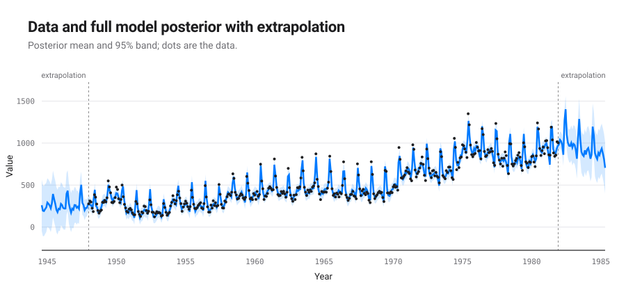
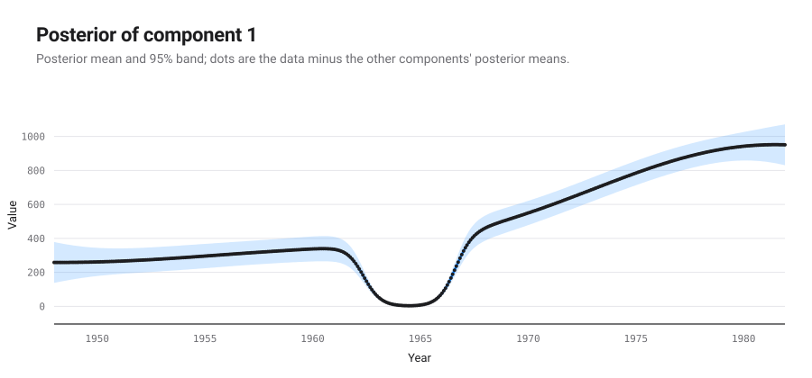
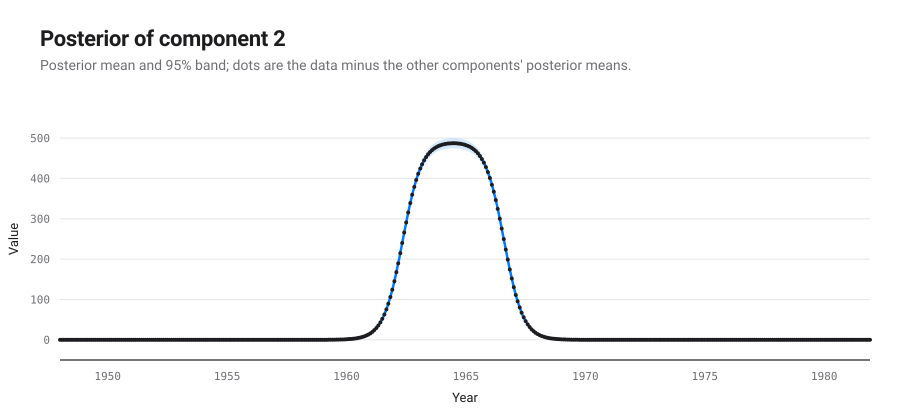
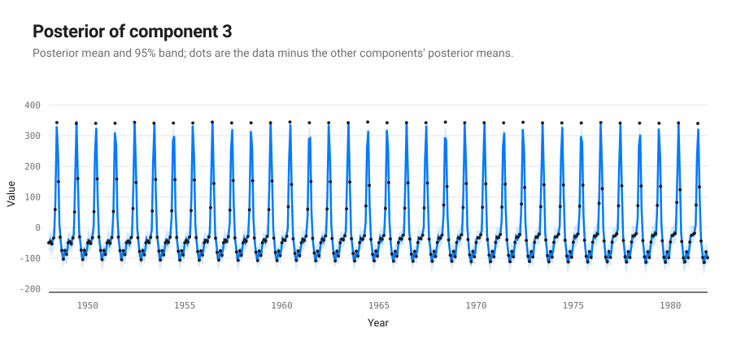
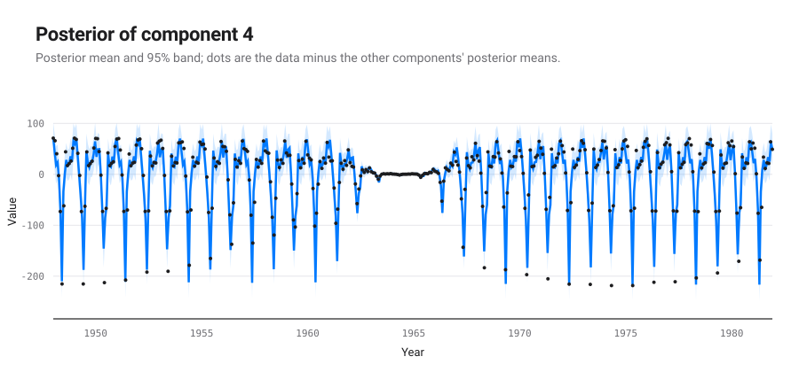
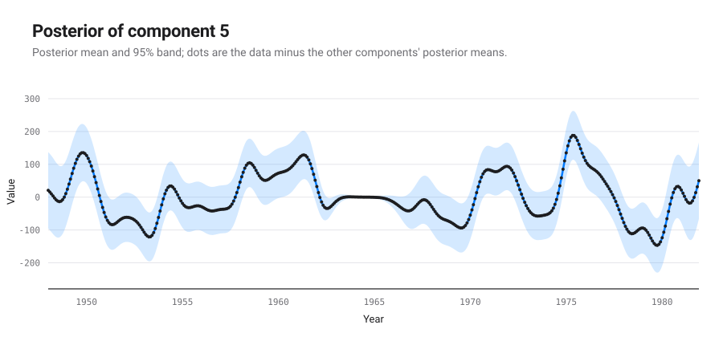
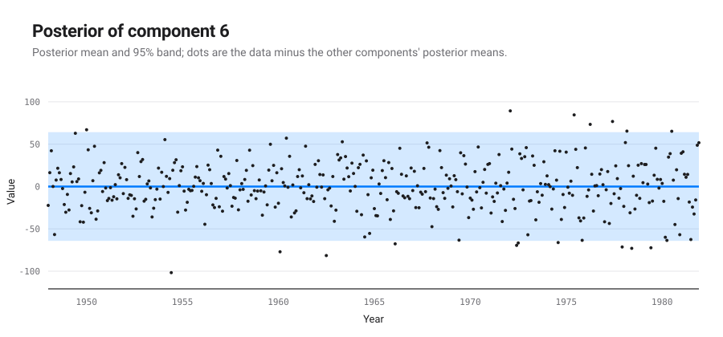

# An automatic report for the dataset: 11-unemployment

*Produced by `autostat` (automatic-statistician-revisited), a Python 3 port of the Automatic Bayesian Covariance Discovery system of Lloyd et al. (AAAI 2014).*

## Executive summary

The structure search selected `CW(Per x SE + SE + SE, C) + WN + Per x SE` (Bayesian information criterion 4443.5; negative log likelihood 2170.6 on 408 points). It decomposes into 6 additive components, listed by how much each reduces extrapolation error:

1. A smooth function. This function applies until 1962 and from 1966 onwards.
2. A constant. This function applies from 1962 until 1966.
3. An approximately periodic function with a period of 1.0 years.
4. An approximately periodic function with a period of 1.0 years. This function applies until 1962 and from 1966 onwards.
5. A smooth function. This function applies until 1962 and from 1966 onwards.
6. Uncorrelated noise.

| # | R² cumulative (%) | Residual variance explained (%) | Cross-validated MAE | MAE reduction (%) |
|---|---|---|---|---|
| data | | | 520 | |
| 1 | 47.1 | 47.1 | 158 | 69.7 |
| 2 | 76.2 | 55.0 | 115 | 26.7 |
| 3 | 84.8 | 36.0 | 97.5 | 15.5 |
| 4 | 91.1 | 41.7 | 87.1 | 10.7 |
| 5 | 98.8 | 86.0 | 73.3 | 15.8 |
| 6 | 100.0 | 100.0 | 73.3 | 0.0 |

MAE: mean absolute error over ten contiguous held-out blocks.

## The formula found

The structure search is a symbolic regression: it searches a grammar of expressions over kernels and keeps the one with the lowest Bayesian information criterion. This is the expression it kept, with every fitted parameter in place; $t$ is in years.

$$y(t) = f_{1}(t) + f_{2}(t) + f_{3}(t) + f_{4}(t) + f_{5}(t) + f_{6}(t)$$

Each component is a Gaussian process with its own covariance:

$$f_{1}(t) \sim \mathrm{GP}\!\left(0,\ (1 - w_{1}(t))(1 - w_{1}(t'))\left[181652\,\exp\!\left(-\frac{(t - t')^2}{2 \cdot 10.21^2}\right)\right]\right)$$

$$f_{2}(t) \sim \mathrm{GP}\!\left(0,\ w_{1}(t)\,w_{1}(t')\left[367177\right]\right)$$

$$f_{3}(t) \sim \mathrm{GP}\!\left(0,\ 11703\,\frac{\exp\!\left(4.131\cos\frac{2\pi (t - t')}{0.9998}\right) - I_0(4.131)}{e^{4.131} - I_0(4.131)} \cdot \exp\!\left(-\frac{(t - t')^2}{2 \cdot 160.2^2}\right)\right)$$

$$f_{4}(t) \sim \mathrm{GP}\!\left(0,\ (1 - w_{1}(t))(1 - w_{1}(t'))\left[3605\,\frac{\exp\!\left(20.62\cos\frac{2\pi (t - t')}{0.9968}\right) - I_0(20.62)}{e^{20.62} - I_0(20.62)} \cdot \exp\!\left(-\frac{(t - t')^2}{2 \cdot 154.3^2}\right)\right]\right)$$

$$f_{5}(t) \sim \mathrm{GP}\!\left(0,\ (1 - w_{1}(t))(1 - w_{1}(t'))\left[6902\,\exp\!\left(-\frac{(t - t')^2}{2 \cdot 0.6259^2}\right)\right]\right)$$

$$f_{6}(t) \sim \mathrm{GP}\!\left(0,\ 1073\,\delta_{t t'}\right)$$

The changes of regime weigh the components with:

$$w_{1}(t) = \tfrac{1}{4}\left(1 + \tanh\left(1.251\,(t - 1962)\right)\right)\left(1 - \tanh\left(1.251\,(t - 1967)\right)\right)$$

These components have a closed form, read from their posterior mean:

$$f_{2}(t) = 492\,w_{1}(t)$$

The other components are smooth, quasi-periodic or noise without a short formula: a draw from such a process has no finite closed form; its covariance above is the formula.

Closed form of each component:

| # | component | closed form |
|---|---|---|
| 1 | A smooth function. This function applies until 1962 and from 1966 onwards | none: the covariance is the formula |
| 2 | A constant. This function applies from 1962 until 1966 | exact polynomial of degree 0 |
| 3 | An approximately periodic function with a period of 1.0 years | none: the covariance is the formula |
| 4 | An approximately periodic function with a period of 1.0 years. This function applies until 1962 and from 1966 onwards | none: the covariance is the formula |
| 5 | A smooth function. This function applies until 1962 and from 1966 onwards | none: the covariance is the formula |
| 6 | Uncorrelated noise | none: the covariance is the formula |

## Search path and stopping criterion

The 2014 configuration searches a fixed number of levels and keeps the lowest BIC; it has no stopping rule. The table follows the winner of each level. A change of structure adds or removes terms; a level that keeps the structure only refits its parameters. BIC differences read on the scale of Kass and Raftery (1995): under 2 barely worth mentioning, 2 to 6 positive, 6 to 10 strong, over 10 very strong.

| level | BIC | change | structure | components | closed | params |
|---|---|---|---|---|---|---|
| 1 | 5129.1 |  | WN + SE | 2 | 0 | 3 |
| 2 | 4888.3 | -240.8 | WN + Per x SE + SE | 3 | 0 | 7 |
| 3 | 4734.0 | -154.3 | WN + Per x SE + SE + SE | 4 | 0 | 9 |
| 4 | 4509.8 | -224.2 | WN + Per x SE + Per x SE + SE + SE | 5 | 0 | 13 |
| 5 | 4487.7 | -22.1 | CW(Per x SE + SE + SE, C) + WN + Per x SE | 6 | 1 | 17 |
| 6 | 4473.1 | -14.6 | CW(Per x SE + SE + SE, C) + WN + Per x SE | 6 | 1 | 17 |
| 7 | 4461.9 | -11.2 | CW(Per x SE + SE + SE, C) + WN + Per x SE | 6 | 1 | 17 |
| 8 | 4453.1 | -8.8 | CW(Per x SE + SE + SE, C) + WN + Per x SE | 6 | 1 | 17 |
| 9 (kept) | 4443.5 | -9.6 | CW(Per x SE + SE + SE, C) + WN + Per x SE | 6 | 1 | 17 |
| 10 | 4443.5 | +0.0 | CW(Per x SE + SE + SE, C) + WN + Per x SE | 6 | 1 | 17 |

Posterior weight of each structure met, exp(-BIC/2) normalised under a flat prior, after the Bayesian machine scientist (Guimerà et al., 2020): where the search keeps one structure, the weights say how much the data prefer it to the others. The 4 structure(s) under 0.001 are left out.

| structure | lowest BIC | weight |
|---|---|---|
| CW(Per x SE + SE + SE, C) + WN + Per x SE | 4443.5 | 1.000 |

- The search ran 10 levels (the published 2014 search: ten levels, no stopping rule) and keeps the model of level 9, CW(Per x SE + SE + SE, C) + WN + Per x SE, BIC 4443.5.
- That structure was first reached at level 5; the levels after it only refitted its parameters, lowering BIC by 44.2 in all.
- The best different structure, WN + Per x SE + Per x SE + SE + SE (level 4), is 66.3 above it: very strong evidence for the kept one on the Kass and Raftery scale.
- Weighed by exp(-BIC/2) under a flat prior, as the Bayesian machine scientist weighs expressions, the structures met give the kept one a posterior weight of 1.000 and the next, WN + Per x SE + Per x SE + SE + SE, 0.000: the kept one takes almost all the weight.
- BIC stopped falling at level 9. The 1 level(s) searched past it kept its structure and lowered BIC by 0.00 in all, less than the tolerance of 0.1: going on buys nothing the data pay for.
- A rule stopping after 1 level(s) without a fall above 0.1 would have ended the search at level 10 and kept the same model.
- A rule stopping after 2 level(s) without a fall above 0.1 would not have stopped within these 10 levels.
- The kept expression has 17 parameters for 408 points: its BIC is a fit term 2 NLL = 4341.3 plus a complexity term p ln n = 102.2, each extra parameter costing 6.01; it splits into 6 components, 1 of them with a closed form.

## Detailed discussion of the components

### Component 1: A smooth function. This function applies until 1962 and from 1966 onwards

This component is a smooth function with a typical lengthscale of 10.2 years. This component applies until 1962 and from 1966 onwards.

This component explains 47.1% of the data's variance on its own; with the components above it, 47.1%. Adding it changes the cross-validated MAE by -69.7%.

*Extrapolation.* This component is assumed to continue smoothly but is also assumed to be stationary so its distribution will return to the prior. The prior distribution places mass on smooth functions with a marginal mean of zero and a typical lengthscale of 10.2 years.

### Component 2: A constant. This function applies from 1962 until 1966

This component is constant. This component applies from 1962 until 1966.

This component explains -39.9% of the data's variance on its own; with the components above it, 76.2%. Adding it changes the cross-validated MAE by -26.7%.

*Extrapolation.* This component is assumed to stop before the end of the data and will therefore be extrapolated as zero.

### Component 3: An approximately periodic function with a period of 1.0 years

This component is approximately periodic with a period of 1.0 years. Across periods the shape of this function varies very smoothly. The shape of this function within each period has a typical lengthscale of 4.1 weeks.

This component explains 8.1% of the data's variance on its own; with the components above it, 84.8%. Adding it changes the cross-validated MAE by -15.5%.

*Extrapolation.* This component is assumed to continue to be approximately periodic. The shape of the function is assumed to vary very smoothly between periods but will eventually return to the prior. The prior is entirely uncertain about the phase of the periodic function. Consequently the pointwise posterior will appear to lose its periodicity, but this merely reflects the uncertainty in the shape and phase of the function.

### Component 4: An approximately periodic function with a period of 1.0 years. This function applies until 1962 and from 1966 onwards

This component is approximately periodic with a period of 1.0 years. Across periods the shape of this function varies very smoothly. The shape of this function within each period has a typical lengthscale of 12.8 days. This component applies until 1962 and from 1966 onwards.

This component explains -7.5% of the data's variance on its own; with the components above it, 91.1%. Adding it changes the cross-validated MAE by -10.7%.

*Extrapolation.* This component is assumed to continue to be approximately periodic. The shape of the function is assumed to vary very smoothly between periods but will eventually return to the prior. The prior is entirely uncertain about the phase of the periodic function. Consequently the pointwise posterior will appear to lose its periodicity, but this merely reflects the uncertainty in the shape and phase of the function.

### Component 5: A smooth function. This function applies until 1962 and from 1966 onwards

This component is a smooth function with a typical lengthscale of 7.5 months. This component applies until 1962 and from 1966 onwards.

This component explains 4.2% of the data's variance on its own; with the components above it, 98.8%. Adding it changes the cross-validated MAE by -15.8%.

*Extrapolation.* This component is assumed to continue smoothly but is also assumed to be stationary so its distribution will return to the prior. The prior distribution places mass on smooth functions with a marginal mean of zero and a typical lengthscale of 7.5 months.

### Component 6: Uncorrelated noise

This component models uncorrelated noise.

This component explains 1.9% of the data's variance on its own; with the components above it, 100.0%. Adding it changes the cross-validated MAE by -0.0%.

*Extrapolation.* This component assumes the uncorrelated noise will continue indefinitely.

## Model checking

Each statistic compares draws of a component's posterior with draws of its prior. A small p-value (bold below 0.05) points at a property of the data that the component's prior does not reproduce.

| # | QQ max | QQ min | ACF min | ACF min lag | Periodogram max | Periodogram peak | MMD |
|---|---|---|---|---|---|---|---|
| 1 | 0.138 | 0.110 | 0.290 | 0.586 | 0.350 | 0.418 | **0.000** |
| 2 | 0.520 | 0.414 | 0.962 | 0.978 | 0.834 | 0.968 | **0.000** |
| 3 | 0.244 | 0.382 | 0.416 | 0.734 | 0.534 | 0.498 | **0.000** |
| 4 | 0.446 | **0.034** | 0.888 | 0.910 | 0.102 | 0.286 | **0.000** |
| 5 | 0.786 | 0.646 | 0.338 | 0.818 | 0.332 | 0.992 | **0.000** |
| 6 | 0.926 | 0.626 | 1.000 | 0.998 | 1.000 | 0.972 | **0.000** |

QQ: quantile-quantile gaps. ACF: autocorrelation function. MMD: maximum mean discrepancy two-sample test.
